# 项目说明文档 · CardioLens 心电节律智能分析平台

> **基于一维卷积神经网络的心电搏动分类与 Grad-CAM 可解释性分析**
>
> 课程：软件工程 · 方向：医学人工智能
> 技术栈：Python 3.12 / PyTorch 2.x (CPU) / **Flask 3 + Waitress（Waitress 单进程多线程）** / **Vue 3 + 原生 Canvas 2D** / SQLite
> 交付形态：**Web 应用**（浏览器访问，客户端零安装；可部署到公网服务器）
> 数据集：MIT-BIH Arrhythmia Database（PhysioNet mitdb）

---

## ⚠️ 免责声明

**本项目为软件工程课程作业演示项目，不是医疗器械，也不是临床诊断工具。**

> 以上结果由机器学习模型自动生成，仅用于课程项目演示与辅助分析，不构成医疗诊断依据，不能用于任何临床决策。如有健康问题请及时就医。

本软件输出的全部结果（包括分类标签、置信度、风险提示、Grad-CAM 热力图）均由机器学习模型
自动生成，**仅用于课程演示与辅助分析，不构成医疗诊断依据，不能用于任何临床决策**。
系统未经过任何临床验证，未取得医疗器械注册资质。
若您有健康问题，请及时就医并遵从专业医师意见。

该声明常驻于站点**每个页面的页脚**（首页、分析页、历史页、关于页均可见），以及项目各文档中。

---

## 目录

1. [项目背景](#一项目背景)
2. [项目目标](#二项目目标)
3. [技术选型](#三技术选型)
4. [系统功能](#四系统功能)
5. [系统架构](#五系统架构)
6. [核心实现](#六核心实现)
7. [AI / 模型原理](#七ai--模型原理)
8. [项目运行方法](#八项目运行方法)
9. [项目运行截图](#九项目运行截图)
10. [测试结果](#十测试结果)
11. [隐私与安全说明](#十一隐私与安全说明)
12. [项目总结](#十二项目总结)

---

## 一、项目背景

### 1.1 临床痛点

心血管疾病是全球范围内致死率最高的疾病类别之一。**心电图（Electrocardiogram, ECG）**
因其无创、廉价、可长时间连续监测的特点，成为心脏疾病筛查与诊断中最基础的手段。

然而，心电判读面临两个现实困难：

1. **数据量巨大**：一次 24 小时动态心电监测（Holter）约产生 **10 万次心搏**。
   若由医师逐搏判读，即便每搏仅用 2 秒，也需连续工作 **55 小时以上**，在实际临床中不可行。
2. **判读门槛高**：心律失常的判别依赖对 QRS 波群形态、节律、间期的综合判断，
   需要长期专业训练，且不同医师之间**存在主观差异**（观察者间一致性有限）。

因此，**心电搏动的自动分类**成为医学人工智能领域中一个长期且极具价值的研究方向。

### 1.2 为什么不做"糖尿病预测"这类项目

课程要求明确指出：**避免"糖尿病预测""心脏病预测"这类常见的简单表格分类项目**。
这类项目通常使用结构化表格数据（几列数值特征）跑一次逻辑回归或随机森林，
存在几个明显问题：

- **数据模态单一**，无法体现医学数据的真实复杂性；
- **模型过于简单**，与"医学人工智能"的技术内涵脱节；
- **几乎没有医学专业性**，特征工程与医学知识基本无关；
- 网上现成代码极多，**缺乏区分度与新颖性**。

本项目选择 **心电信号（一维时序信号）分析**方向，具备以下优势：

| 维度 | 说明 |
|---|---|
| **数据模态** | 真实的一维生理时序信号，而非人工整理好的特征表格 |
| **医学专业性** | 涉及 AAMI EC57 国际分类标准、跨患者划分、起搏搏动剔除等专业规范 |
| **技术含量** | 信号滤波、R 峰对齐切分、类别极不平衡、可解释性分析等真实工程问题 |
| **可验证性** | 有专家标注作为金标准，指标可量化、可复现、可与其他文献对比 |
| **展示效果** | 心电波形本身具有很强的视觉辨识度，配合 Web 可视化与热力图，演示效果突出 |

### 1.3 数据集

**MIT-BIH Arrhythmia Database** 是心电自动分析领域最经典、使用最广泛的公开基准数据集，
由 MIT 与 Beth Israel Hospital 联合发布，自 1980 年代起被全球研究者作为标准评测集。

| 项目 | 说明 |
|---|---|
| 来源 | PhysioNet（`mitdb` 1.0.0），本项目使用其 HuggingFace 完整镜像 |
| 记录数 | 48 条半小时双导联动态心电记录 |
| 采样率 | 360 Hz |
| 导联 | 2 导联（本项目读取的第 0 通道多为 MLII、第 1 通道多为 V1；个别记录为 V2 / V4 / V5） |
| 标注 | 由至少两位心脏病专家独立标注，标注符号 15 种以上 |
| 使用方式 | 本项目对每条 MIT-BIH 记录统一读取第 0 个信号通道进行心电搏动分析，按 AAMI EC57 归并为 5 大类。由于不同记录的导联排列并不完全一致，第 0 通道并非始终对应同一导联名称；本项目使用的 44 条记录中，第 0 通道以 MLII 为主，但个别记录对应 V5 等其他导联。因此实际采用的是固定读取第 0 通道，而非按导联名称筛选 MLII |

**AAMI EC57 归并规则**（本项目实现在 `src/config.py` 的 `MITDB_TO_AAMI`）：

| AAMI 类别 | 含义 | 原始标注符号 |
|:---:|---|---|
| **N** | 正常搏动 | `N` `L` `R` `e` `j` |
| **S** | 室上性早搏 | `A` `a` `J` `S` |
| **V** | 室性早搏 | `V` `E` |
| **F** | 融合搏动 | `F` |
| **Q** | 未分类 / 起搏搏动 | `/` `f` `Q` |

依据 AAMI 惯例，**剔除 4 条起搏搏动记录：102、104、107、217**（这些记录的起搏搏动占比过高，
且标注本身存在争议，保留会引入噪声）。

---

## 二、项目目标

### 2.1 总体目标

构建一套**可在普通笔记本电脑（纯 CPU、无 GPU、无付费 API）上完整运行**的心电搏动智能分析系统，
覆盖从原始信号到可视化结论的完整链路，并具备完整的用户操作流程与良好的界面设计。

### 2.2 具体目标

| 编号 | 目标 | 验收方式 |
|:---:|---|---|
| G1 | 完成 MIT-BIH 数据的自动下载、滤波与逐搏切分 | 产出 `beats.npz`（约 10 万条心搏样本） |
| G2 | 训练 1D-CNN 完成 AAMI 五分类，采用跨患者划分 | 测试集指标写入 `models/metrics.json` |
| G3 | 提供 Grad-CAM 可解释性，展示模型关注的时间片段 | 结果页每搏可视化热力图 |
| G4 | 构建完整的 Web 用户流程（首页→ECG 分析→分析历史→历史详情→关于） | 单页应用五视图无刷新切换；分析异步执行、页面全程可交互；波形支持滚轮缩放／拖拽平移／双击复位／悬停读数 |
| G5 | 实现完善的输入校验与异常处理 | 离线自测 `test_web.py` **144 个断言** + 端到端 `test_web_e2e.py` **69 个断言** + 前端验收 `test_web_ui.py` **23 个断言**，三套全部通过 |
| G6 | 提供完整文档与运行截图 | `README.md` + 本文档 + `docs/screenshots_web/`（22 张） |
| G7 | **全程不依赖任何付费 API**，开箱即用 | 浏览器访问即可使用，客户端无需安装任何软件；服务端零付费 API、零外部请求；多用户会话隔离 |
| G8 | 历史记录按会话隔离，支持多人同时使用 | 两个独立会话互不可见（8 组隔离用例）；8 个并发分析请求 **0.98 秒全部成功** |

### 2.3 非目标（明确不做的事）

- ❌ 不做临床级诊断系统，不追求超越文献 SOTA 的指标
- ❌ 不引入大型预训练模型（如 EEG/ECG 基础大模型），避免超出 CPU 可承受范围
- ❌ 不做多导联融合与 12 导联心电图分析（数据集本身只有 2 导联）
- ❌ 不做实时采集硬件对接（仅使用公开数据集的离线记录）
- ❌ 不做账号体系与权限管理（会话隔离用浏览器标识实现，不引入登录）
- ❌ 不做文件上传（用户只能选择内置数据集中的记录编号与时间窗）

**关于本次交付形态的调整**：项目早期是一个 PySide6 桌面程序，本次将它整体迁移为
Flask + Vue 3 的 Web 应用，驱动力有三点：**免安装分发**（浏览器访问即可，客户端零安装，
不再需要为每个平台打包）、**多用户隔离**（服务端可为不同浏览器会话分别保存历史，从单机单人
走向多人同时使用）、**迭代成本**（表现层改一行 JS 即可上线，不必重新打包分发）。
需要强调的是：**这次迁移只动了交付形态，AI 部分一行未改**——`src/` 目录中只有
`db.py`（新增 `owner` 列做会话隔离）、`config.py`（去掉 frozen 分支、新增 `CARDIOLENS_STORE`）、
`inference.py`（信号缓存加上限）三处被动过，模型结构、训练流程、Grad-CAM 与 RR 特征计算
保持原样。旧的桌面版代码已从工作区删除，完整保留在 git tag `pre-web-migration`。

---

## 三、技术选型

### 3.1 技术选型总览与理由

| 层次 | 选型 | 备选方案 | 选择理由 |
|---|---|---|---|
| 深度学习框架 | **PyTorch 2.x（CPU 版）** | TensorFlow / Keras | 动态图调试直观；CPU 版 wheel 体积可控（约 200 MB）；社区资料丰富 |
| 模型结构 | **双分支 1D-CNN（103,109 参数）**：形态分支 + RR 节律 MLP | LSTM / Transformer / ResNet | 心电单搏仅 252 采样点，属小规模时序分类；浅层 CNN 参数少、训练快、**最后一层卷积可保留时间分辨率，天然适配 Grad-CAM**；额外挂一条轻量 MLP 支路消费 RR 间期特征，弥补单搏形态对早搏判别力不足的问题 |
| 信号处理 | **SciPy** | 自研滤波器 | `signal.butter` + `filtfilt` 实现**零相位**滤波，不引入时间偏移 |
| 数据读取 | **pandas + PyArrow（parquet）** | WFDB 官方库 | WFDB 需逐个记录发起 HTTP 请求，48 条记录网络开销大；parquet 为**单文件**，一次下载即可，且读取速度更快 |
| 评估指标 | **scikit-learn** | 手写实现 | 混淆矩阵与逐类 PPV/Recall/F1 实现经过充分验证，避免手写错误 |
| 静态图表 | **Matplotlib** | Plotly / ECharts | 训练曲线与混淆矩阵是**训练期一次生成的离线产物**；因此 Matplotlib 只在重新训练时需要，服务运行时只是把已生成的 PNG 直接发给浏览器，**不参与线上运行** |
| 前端框架 | **Vue 3（ESM 构建，本地分发）** | React / 原生 JS / 服务端模板 | **免构建**：Vue 与 vue-router 的 ESM 产物直接放在 `web/static/vendor/`，随仓库分发、**不走 CDN**，浏览器原生 `import` 即可；部署端只需要 Python，不需要 Node/npm 工具链；模板字符串写视图，迭代成本低 |
| 波形绘制 | **原生 Canvas 2D 自绘** | ECharts / D3 / SVG | 心电条带需要心电网格、R 峰标注、异常高亮与 Grad-CAM 面积图叠加，且要支持缩放/平移/悬停联动，**自绘最直接**；只用到 Canvas 2D 基础接口，不引入任何绘图库 |
| 并发模型 | **服务端有界并发（单例内互斥锁 + `BoundedSemaphore`）** | 任务队列（Celery/RQ）/ 多进程 | `GradCAM1D` 把激活与梯度**存在实例属性上**，同一个分析器实例被多线程共用，**没有锁就会串扰**——因此推理入口用互斥锁串行化前向/反向（实测单次 0.24~0.46 秒），入口再用信号量限制排队请求数，槽位耗尽返回 503。单次分析是亚秒级，**引入任务队列的复杂度远大于收益**，故不采用 |
| 数据持久化 | **SQLite（WAL 模式）** | MySQL / 文件存储 | Python 标准库自带，**免安装免配置**；单文件便于随项目分发；开启 WAL 后读写可并发，配合单进程多线程足够 |
| WSGI 服务器 | **Waitress（单进程多线程）** | gunicorn / uWSGI | **跨平台**（gunicorn 依赖 fork，Windows 上跑不起来，waitress 纯 Python）；且限流计数与并发信号量都是**进程内状态**，必须单进程多线程运行，waitress 默认模型正好契合 |
| 反向代理 | **nginx** | Apache / Caddy | **TLS 终止、静态资源直出、gzip 压缩、请求体上限、转发 `X-Forwarded-Proto`**；应用只监听回环，公网只暴露 443 |
| 自动化测试 | **三套自研脚本（离线 / 端到端 / 前端验收）** | pytest | 离线脚本基于 Flask `test_client`（144 断言），端到端脚本拉起真实 waitress 进程走真实 HTTP（69 断言），前端验收脚本用 Playwright 驱动真实浏览器并以**画布像素**为判据（23 断言）；前两套只用标准库，不引入额外测试依赖。之所以需要第三套：波形是 Canvas 画的，缩放/平移/悬停这类交互**只在浏览器里才存在**，HTTP 层的测试永远覆盖不到 |

### 3.2 关键取舍说明

**① 为什么从桌面程序迁移到 Web 服务？**

项目早期是一个 PySide6 桌面程序：界面由 Qt 控件构成，波形由 `QPainter` 绘制，推理在 `QThread`
后台线程执行，最后用 PyInstaller 打成单文件 EXE。这套方案在"单机单人、离线运行"的假设下是成立的，
但它有三个难以回避的工程代价：**分发成本**（每个平台各打一个包，产物数百 MB，
还要面对 SmartScreen 与代码签名）、**多人使用**（单机单进程，无法让多个使用者各自保存历史）、
**迭代成本**（改一行界面文案也要重新打包分发）。

改为 Web 服务后，这三点同时被消解：**免安装分发**——使用者只需一个浏览器，
客户端零安装、零更新；**多用户隔离**——服务端用浏览器标识把历史记录分开，
天然支持多人同时使用（见 §5.2 ①）；**迭代成本**——表现层改一行 JS 即可上线，
不需要为任何客户端重新打包。

代价同样需要如实说明：**需要一个运行的服务器**（不能像双击 EXE 那样完全离线）、
**需要 HTTPS**（会话 Cookie 依赖安全传输）、**失去离线能力**（断网即不可用）。
这些代价对本项目"部署到公网供多人演示"的形态是可以接受的，因此做了这次迁移。

**② 为什么选择浅层 1D-CNN 而不是更深的网络？**

| 考量 | 说明 |
|---|---|
| 数据规模 | 单搏仅 252 个采样点，过深的网络在此尺度上收益递减 |
| 训练成本 | 浅层网络在纯 CPU 上实测 **18.3 分钟**完成训练（含早停），符合"普通电脑可运行"的要求 |
| 可解释性 | 最后一层卷积保留 31 个时间步，Grad-CAM 上采样到 252 点后**定位精度约 8 个采样点（约 22 ms）**，足以分辨 QRS 波群 |
| 过拟合风险 | 参数量小本身就是一种正则化，配合数据增强与 Dropout 足以控制过拟合 |

**③ 为什么下载方式从 PhysioNet 改为 HuggingFace 镜像？**

实测 PhysioNet 官网从国内直连速度仅约 **10~20 KB/s**，下载完整数据需数小时，完全不可接受。
经调研，发现 HuggingFace 上存在 MIT-BIH 的完整数据集镜像 `epr-labs/mit-bih-arrhythmia-database`，
通过国内可访问的镜像站 `hf-mirror.com` 下载，实测速度 **400 KB/s ~ 1.8 MB/s**，耗时从数小时降至 1~3 分钟。

> 数据真实性已交叉验证：对该 parquet 解析得到的记录 100 包含 650000 个采样点、2 个导联（MLII/V5）、
> 2274 条标注，与 PhysioNet 官方 wfdb 解析结果一致；镜像仓库 README 亦声明其为 PhysioNet mitdb 1.0.0 的完整克隆。

---

## 四、系统功能

### 4.1 功能结构图

```
CardioLens 心电节律智能分析平台
│
├── 浏览器端：Vue 3 单页应用（SPA，vue-router history 模式）
│   ├── 顶部导航栏（品牌 + 五个视图入口，客户端路由无刷新切换）
│   ├── 页脚：免责声明（常驻，每个页面可见）
│   │
│   ├── 🏠 首页 / 项目介绍（HomeView）
│   │   ├── 项目定位与免责声明
│   │   ├── 模型关键指标卡片（准确率 / Macro-F1 / 参数量 / 训练耗时）
│   │   ├── 数据集概览（记录数、心搏总数、五类分布构成条）
│   │   └── 操作流程指引
│   │
│   ├── 📊 ECG 分析（AnalyzeView，三栏布局）
│   │   ├── 左栏：参数面板
│   │   │   ├── 记录下拉框（按记录号，推荐记录标注 ★）
│   │   │   ├── 记录信息（总时长 / 心搏总数 / 数据分组 / 异常占比 + 五类构成条）
│   │   │   ├── 起始时间滑块（0 ~ 记录末尾）
│   │   │   ├── 分析时长滑块（3 ~ 30 秒）
│   │   │   ├── Grad-CAM 开关（默认开启）
│   │   │   ├── 波形预览按钮（不触发模型推理，快速查看窗口内容）
│   │   │   └── 开始分析按钮（分析期间禁用，前端异步请求，页面全程可交互）
│   │   ├── 中栏：波形区（原生 Canvas 2D 自绘：网格 / 坐标轴 / R 峰 / 热力图）
│   │   │   └── 滚轮缩放 · 拖拽平移 · 双击复位 · 悬停十字线读数
│   │   └── 右栏：本次分析摘要
│   │       ├── 风险提示标签（分级配色 + 异常搏动占比）
│   │       ├── 统计行（分析心搏数 / 平均置信度 / 异常搏动数 / 与专家标注一致率）
│   │       └── 五类分布构成条与图例
│   │
│   ├── 📈 分析结果（复用组件：ResultPanel / EcgStrip / BeatChart / BeatTable）
│   │   ├── 统计卡片行（分析心搏数 / 平均置信度 / 异常心搏数 / 异常搏动占比）
│   │   ├── 波形区：连续心电条带（Grad-CAM 面积图叠加 + R 峰标记 + 异常搏动高亮）
│   │   │           + 风险标签 + 一致率标签 + Grad-CAM 说明（含真实 CAM 长度）
│   │   ├── 明细区
│   │   │   ├── 逐搏明细表（序号 / 位置 / 预测类别 / 置信度），选中行联动
│   │   │   └── 单搏详情：单搏波形 + Grad-CAM 面积图 / 五类概率条 /
│   │   │                  节律上下文（前一后一 RR 间期 + 相对基线比值）
│   │   └── 操作：保存到历史 / 删除本条 / 返回
│   │
│   ├── 💾 分析历史（HistoryView）
│   │   ├── 统计行（累计分析次数 / 累计分析心搏 / 平均异常占比 / 平均一致率）
│   │   ├── 报告表（编号 / 记录 / 时间窗 / 心搏数 / 异常占比 / 提示等级 / 一致率 / 分析时间）
│   │   ├── 查看详情（跳转历史详情视图，完整还原报告）
│   │   ├── 删除所选（二次确认）
│   │   └── 清空全部（二次确认）
│   │
│   ├── 📄 历史详情（HistoryDetailView，只读回放，复用结果组件）
│   │   └── 与结果视图同一套组件，只隐藏「保存」、保留「删除」/「返回」
│   │
│   └── 📖 关于 / 说明（AboutView）
│       ├── 平台简介 / 数据来源 / AAMI 五分类定义 / 模型结构 / 训练设置
│       ├── 测试集性能（混淆矩阵图、训练曲线图、逐类指标表）
│       ├── Grad-CAM 可解释性原理
│       ├── 已知限制与使用说明
│       └── 免责声明
│
└── 服务端：Flask 应用工厂 + 蓝图（web/views/）
    ├── meta_api   记录列表 / 记录详情 / 评估指标
    ├── analysis_api 波形预览 / 完整分析
    ├── history_api  历史保存 / 列表 / 详情 / 删除 / 清空 / 统计
    ├── media        训练曲线与混淆矩阵白名单图片
    ├── pages        SPA 入口页与 SPA 路由回退
    │
    ├── 会话层 web/session.py  → 签名 Cookie 保存 256 位随机 owner，历史按它过滤
    ├── 限流层 web/guard.py    → 按 owner 限流 + 并发信号量 + Content-Type 校验
    │
    ├── src 推理引擎（inference.py / model.py / rr.py / gradcam.py）
    │   └── 与界面完全解耦，本次迁移未改动模型与计算
    ├── SQLite（src/db.py，WAL，analyses 表含 owner 列）
    └── PyTorch（CPU 推理）

└── ⚠️ 异常处理（用户永远看不到 traceback）
    ├── 记录不存在 / 波形预览失败 / 分析失败 / 历史记录读写失败
    │   —— 统一错误响应（web/errors.py）渲染为中文提示，堆栈写入服务端日志
    ├── 请求体超限 413 / Content-Type 非 JSON 415 / 限流 429 / 并发槽位 503
    └── 访问属于他人会话的历史记录 —— 返回 404（不泄露该 id 是否存在）
```

### 4.2 输入校验清单

前端输入控件限定了取值范围（滑块上下限、下拉框候选项），
但这只是第一道便利性约束；服务端**不信任任何客户端输入**，在推理层 `inference.py` 之上
还有 HTTP 层的完整校验（`web/guard.py` 与 `web/views/`），两者均由 `scripts/test_web.py` 覆盖：

| 输入项 | 校验规则 | 错误提示 / 状态码 |
|---|---|---|
| 记录编号 | 必须属于 44 条有效记录（48 条减去 4 条剔除记录） | 「记录编号 xxx 不存在，请从有效列表中选择」（400） |
| 起始时间 / 时长 | 必须可解析为数值 | 「起始时间与时长必须为数字」（400） |
| 起始时间 / 时长 | 必须为有限数值（拒绝 `NaN`、`Infinity`） | 「起始时间与时长必须为有限数值」（400） |
| 起始时间 | 必须 ≥ 0 | 「起始时间不能为负数」（400） |
| 分析时长 | 必须 ≥ 3 秒 | 「分析时长不得短于 3 秒」（400） |
| 分析时长 | 必须 ≤ 30 秒 | 「单次分析时长不得超过 30 秒」（400） |
| 分析时长 | 单次窗口不得长于整条记录 | 「记录 xxx 总时长仅 N 秒，无法截取 M 秒窗口」（400） |
| 起始时间 | 起始时间 + 时长超出记录末尾时**自动向左回退**（保持窗口长度不变），不报错 | 静默修正（200），保证用户体验 |
| 时间窗内容 | 窗口内必须至少包含 1 个完整心搏 | 「该时间窗内未检测到有效心搏，请调整起始时间或延长分析时长」（400） |
| 报告标题 | 长度 ≤ 120 字 | 「标题过长（上限 120 字）」（400） |
| 模型状态 | 模型与数据必须就绪 | 就绪检查不通过时明确列出缺失项；模型文件损坏时返回「模型加载失败」并写入服务端日志（503） |
| 请求体大小 | 单次请求体不得超过 64 KB（本站无上传功能） | HTTP 413 |
| 写请求类型 | 写接口的 `Content-Type` 必须为 `application/json` | HTTP 415（与 `SameSite=Lax` 一起构成 CSRF 防线） |
| 请求频率 | 同一 owner 超过限流阈值 | HTTP 429 |
| 并发槽位 | 并发分析槽位耗尽 / 排队超时 | HTTP 503 |
| `/media` 路径 | 只放行白名单文件（`confusion_matrix.png`、`training_curve.png` 及 archive 下两张） | 非白名单返回 HTTP 404 |
| 历史记录归属 | 只能访问属于本人会话的历史记录 | 访问他人记录返回 HTTP 404（**不泄露该 id 是否存在**，而非 403） |

---

## 五、系统架构

### 5.1 分层架构

```
┌──────────────────────────────────────────────────────────────────┐
│        浏览器端：Vue 3 单页应用（SPA，ESM 本地分发）                │
│   web/static/js/main.js → createApp → vue-router（history 模式）  │
│   ├── 视图：HomeView / AnalyzeView / HistoryView /                │
│   │         HistoryDetailView / AboutView                        │
│   ├── 组件：ResultPanel / EcgStrip / BeatChart / BeatTable /      │
│   │         SessionNotice / common                               │
│   └── 波形：web/static/js/wave/{viewport,render,interaction}.js   │
│             （视图区间数学 / Canvas 绘制 / 指针交互）              │
└───────────────────────────┬──────────────────────────────────────┘
                            │  fetch JSON（同源）
┌───────────────────────────▼──────────────────────────────────────┐
│    nginx（公网 443）                                              │
│   · TLS 终止 · 静态资源直出（/static/） · gzip                     │
│   · 请求体上限 · 转发 X-Forwarded-Proto                           │
└───────────────────────────┬──────────────────────────────────────┘
                            │  反向代理到回环
┌───────────────────────────▼──────────────────────────────────────┐
│    WSGI：waitress（单进程多线程，只监听 127.0.0.1:8001）           │
│    入口：python wsgi.py                                           │
└───────────────────────────┬──────────────────────────────────────┘
                            │
┌───────────────────────────▼──────────────────────────────────────┐
│   Flask 应用工厂 + 蓝图（web/__init__.py）                         │
│   ├── views/meta_api     记录列表 / 记录详情 / 评估指标            │
│   ├── views/analysis_api 波形预览 / 完整分析                      │
│   ├── views/history_api  历史保存 / 列表 / 详情 / 删除 / 清空       │
│   ├── views/media        训练曲线与混淆矩阵（白名单）              │
│   ├── views/pages        SPA 入口与路由回退                       │
│   ├── session.py         签名 Cookie → owner（会话标识）           │
│   ├── guard.py           限流 + 并发信号量 + Content-Type 校验     │
│   ├── readiness.py       就绪检查                                 │
│   └── errors.py          统一错误响应（用户永远看不到 traceback）   │
└──────┬──────────────────┬───────────────────────┬────────────────┘
       │                  │                       │
┌──────▼──────┐   ┌───────▼────────┐    ┌─────────▼─────────┐
│ AI 推理引擎  │   │  持久化层       │    │  配置层            │
│ inference.py│   │  db.py         │    │  config.py        │
│             │   │                │    │                   │
│ · 单例加载   │   │ · SQLite 建表   │    │ · 路径常量         │
│ · 参数校验   │   │ · 报告增删查    │    │ · 信号参数         │
│ · 窗口解析   │   │ · owner 会话过滤 │    │ · AAMI 映射        │
│ · 逐搏推理   │   │ · WAL 模式      │    │ · 免责声明         │
│ · 风险分级   │   │ · 统计聚合      │    │ · CARDIOLENS_STORE │
│ · Grad-CAM  │   └────────────────┘    └───────────────────┘
└──────┬──────┘
       │
┌──────▼──────────────────────────────────────────────────────────┐
│                       模型层（PyTorch）                          │
│   model.py  →  ECGNet（双分支 1D-CNN，103,109 参数）              │
│   rr.py     →  RR 间期特征计算（训练侧与推理侧共用的唯一实现）        │
│   gradcam.py →  GradCAM1D（1D 信号版梯度加权类激活映射）            │
│   models/ecg_cnn.pt（训练产物，427 KB）                           │
└─────────────────────────────────────────────────────────────────┘

┌─────────────────────────────────────────────────────────────────┐
│                    离线数据流水线（一次性执行）                     │
│  prepare_data.py                                                 │
│    下载 parquet → 逐记录读取 → 0.5~45 Hz 带通滤波                  │
│      → 按专家标注 R 峰切分 252 点窗口 → z-score 归一化              │
│      → 保存 beats.npz / signals/ / annots/ / record_meta.json     │
│  train.py                                                        │
│    加载数据 → DS1/DS2 跨患者划分 → 类别加权 + 数据增强训练          │
│      → 早停选模型 → 测试集评估 → 保存 ecg_cnn.pt / metrics.json    │
│      → 绘制混淆矩阵与训练曲线                                      │
└─────────────────────────────────────────────────────────────────┘

┌─────────────────────────────────────────────────────────────────┐
│   已删除：桌面版（PySide6 桌面程序，见 git tag pre-web-migration）  │
│   desktop/ 与 legacy_web/ 已从工作区移除，代码保留在 git tag 里     │
│   仅作迁移历史留档，不参与当前运行                                  │
└─────────────────────────────────────────────────────────────────┘
```

**架构一句话概括：Vue 3 SPA + Flask REST + AI 推理引擎 + SQLite。**

### 5.2 关键设计决策

**① 分析器单例（`get_analyzer()`）**

模型加载需要约 1 秒（`import torch` 冷启动约 3.26 秒），重复加载会拖慢每一次分析。
`inference.py` 使用 `functools.lru_cache` 实现进程内单例，模型与元数据**只在首次访问时加载一次**。
服务端在启动阶段触发一次该单例的构建（就绪检查 `web/readiness.py` 会驱动它），
因此第一个请求到来时模型已经就绪，不需要为它额外等待。
模型权重只有 **427 KB**（103,109 参数），加载开销可以忽略。

**② 推理加锁（`threading.Lock`）**

Grad-CAM 依赖在模型上注册 forward/backward hook，`GradCAM1D` 还会把激活与梯度**保存在实例属性上**
（`self.activations` / `self.gradients`），这会临时改动模块状态，**不是线程安全的**——两个线程同时
走一遍前向/反向，激活与梯度就会互相串扰，算出来的热力图属于"别人"的输入。
推理入口因此用互斥锁串行化，保证同一时刻只有一个前向/反向传播在跑。
实测单次分析（30 秒窗口、含逐搏 Grad-CAM）**中位数 0.241 秒**（三次 0.325 / 0.235 / 0.241 秒），
即使串行化，waitress 的多线程也足以支撑课程演示场景的并发。

**③ 预览与分析分离**

"波形预览"只做窗口解析与信号切片，**不触发模型推理**，
因此可以做到"调整参数即时看到波形"，显著提升交互流畅度；
只有在用户点击"开始分析"时才执行昂贵的逐搏推理与 Grad-CAM 计算。
在 Web 端这两件事对应两个独立接口（`/api/preview` 与 `/api/analyze`），
前端用 `fetch` 分别调用，互不阻塞。

**④ 推理不阻塞页面（前端异步请求）**

单次分析（30 秒窗口、含逐搏 Grad-CAM）实测**中位数 0.241 秒**（有其它进程竞争时约 0.46 秒）。
在 Web 架构下，推理天然在服务端执行、与浏览器主线程分离：前端用 `fetch` 发起异步请求，
分析期间页面**全程可交互**（按钮置为禁用态、显示进行中提示，但不冻结 DOM），
结果返回后再一次性渲染。这与桌面版把耗时操作搬进后台线程是同一个目标——
**让用户界面在计算期间保持响应**——只是实现手段从"线程 + 信号回传"变成了"异步请求 + Promise"。

异常在服务端被 `web/errors.py` 统一捕获并转成结构化错误响应，前端渲染为中文提示，
详细堆栈写入服务端日志——**用户页面上永远不会出现 traceback**。

一次 30 秒窗口（约 100 个心搏）的完整响应含逐搏概率、Grad-CAM 序列与汇总，
序列化后约 **163 KB**。这个体积在 JSON 的合理范围内，nginx 开启 gzip 后压缩比约 3~4 倍，
实际传输不到 50 KB，因此**不需要分页或增量传输**，一次返回即可。

**⑤ 风险分级是展示层逻辑，不是医学结论**

`CLASS_RISK` 把五类映射到 3 个展示等级（正常/关注/警示），
仅用于让结果页有直观的视觉层次。该映射**不具备任何临床含义**，
相关说明已在界面和文档中明确标注。

**⑥ 特征计算只有一份实现（`src/rr.py`）**

RR 间期特征在**训练**（`prepare_data.py` 生成 `beats.npz`）和**推理**
（`inference.py` 处理分析请求）两个阶段都要用到。
若两边各写一份，一旦公式或归一化参数出现细微差异，训练与线上特征就会**悄悄不一致**——
模型不会报错，只会"莫名其妙变笨"，且极难排查。

因此 RR 计算被抽成独立模块 `src/rr.py`，两侧**共同导入同一个函数**：

```
src/rr.py  ←┬─ src/prepare_data.py   （训练侧）
            └─ src/inference.py      （推理侧）
```

这是从**代码结构上**消除隐患，而不是靠"记得同步修改两边"的纪律。

**⑦ 结果渲染只有一份实现（结果页复用）**

分析结果视图与历史详情视图需要展示完全相同的内容（统计卡、波形、逐搏表、单搏详情、节律上下文）。
若各写一份，会出现"刚分析完显示正确、回看历史时显示不同"的不一致。
因此历史详情视图**直接复用同一套结果组件**（`ResultPanel` / `EcgStrip` / `BeatChart` / `BeatTable`），
只是以只读模式渲染（隐藏"保存"按钮、保留"删除"）。
Web 端由此天然不存在两套渲染逻辑，回看历史与当时分析看到的是同一个组件树。

**⑧ 会话隔离为什么用签名 Cookie，而不是登录或服务端 session？**

本项目**没有账号体系**（见 §2.3 非目标）。要区分"谁的历史"，最轻的方案是：
用 Flask 的签名 Cookie（itsdangerous）保存一个 **256 位随机 owner**，历史记录按它过滤。
选择签名 Cookie 而非服务端 session 的理由：

- **不需要服务端状态**：owner 本身就在 Cookie 里（经过签名防篡改），服务端不需要维护会话表，
  多线程下也没有会话存储的竞争；
- **不需要登录流程**：课程演示场景下，让使用者注册/登录会显著抬高使用门槛，
  而匿名会话已经足够把"每个人只看自己的历史"这件事做到位；
- **`SameSite=Lax` 顺带构成一道 CSRF 防线**：跨站发起的请求不会带上这个 Cookie。

代价是：**凭据等同于 Cookie**——清除浏览器数据或换设备就失去历史入口（数据仍在服务端）。
这一点已如实写入 §11.2 与 §12.3。另外，访问不属于本人 owner 的记录时返回 **404 而不是 403**，
避免通过状态码泄露"这个 id 是否存在"。

**⑨ 有界并发为什么用单例锁 + 信号量，而不是任务队列？**

单次分析是**亚秒级**（中位数 0.241 秒），把这样一个操作丢进 Celery / RQ 这类任务队列，
需要引入 broker、worker 进程、结果后端一整套基础设施，运维复杂度远超它要解决的问题。
这里真正的需求只有两点：**不让并发的 Grad-CAM 互相串扰**（用 §5.2 ② 的单例锁保证），
以及**不让请求无限堆积拖垮进程**（用一个 `BoundedSemaphore` 限制在途分析数，
槽位耗尽或排队超时直接返回 503）。这两件事用一个锁加一个信号量就干净地解决了，
且都保持进程内状态——这也正是部署约束必须是"单进程多线程"的原因。

**⑩ 为什么把 `owner` 做成 keyword-only 必填参数？**

`src/db.py` 的所有查询函数把 `owner` 声明为 **keyword-only 必填参数**（`def load_reports(*, owner, ...)`）。
这样设计是为了让"漏改"变成**运行期立即报错**：如果有调用点忘了传 owner，
Python 会当场抛 `TypeError`，而不是悄悄退回一个"查全部记录"的越权查询。
把安全约束编码进函数签名，比靠"记得在每个查询上加 `WHERE owner = ?`"的纪律可靠得多——
这与 §5.2 ⑥ 让 RR 计算只有一份实现是同一类思路：**从结构上消除隐患，而不是靠自觉**。

---

## 六、核心实现

### 6.1 数据预处理流水线（`src/prepare_data.py`）

**流程**：`parquet 单文件下载` → `逐记录解析` → `带通滤波` → `R 峰对齐切分` → `逐搏归一化` → `落盘`

**① 带通滤波（0.5 ~ 45 Hz）**

```python
def bandpass_filter(sig, fs=360, low=0.5, high=45.0, order=3):
    b, a = signal.butter(order, [low / (fs / 2), high / (fs / 2)], btype="band")
    return signal.filtfilt(b, a, sig, axis=0).astype(np.float32)
```

- **下限 0.5 Hz**：抑制基线漂移（呼吸运动、电极缓慢移动引起的低频成分）
- **上限 45 Hz**：抑制工频干扰（50 Hz）与高频肌电噪声
- **使用 `filtfilt` 而非 `lfilter`**：`filtfilt` 执行前向+反向两次滤波，实现**零相位失真**。
  若用单次 `lfilter`，滤波会引入相位延迟，导致 R 峰位置发生偏移，
  进而使切分窗口错位——这对依赖形态的波形分类是致命的。

**② R 峰对齐切分**

```python
PRE_SAMPLES  = 90    # R 峰前 0.25 s (90 / 360)
POST_SAMPLES = 162   # R 峰后 0.45 s (162 / 360)
BEAT_LEN     = 252   # 总计 0.70 s
```

窗口**不对称**是刻意的：QRS 波群之后紧跟着 **ST 段与 T 波**，
T 波形态对区分室性/室上性搏动有重要价值，因此后段留得更长。

此外还做了两项健壮性处理：
- **跳过非搏动标注**（如节律标记 `+`、`~` 等），只保留真正的搏动标注
- **跳过边界不完整窗口**（R 峰距记录首尾不足 90/162 点时丢弃），避免用 `replicate` 填充引入虚假波形

**③ 逐搏 z-score 归一化**

```python
def normalize_beat(beat):
    std = float(beat.std())
    if std < 1e-8:                      # 近常数搏动：标准差为 0 时退化为只去均值
        return (beat - beat.mean()).astype(np.float32)
    return ((beat - beat.mean()) / std).astype(np.float32)
```

对**每个搏动单独**归一化，而非对整条记录归一化。原因：
不同患者、不同时段的体表电位幅度差异可达数倍，逐搏归一化可以消除
**绝对幅度差异**，让模型专注于**形态特征**——这也是配合训练期幅度缩放增强的前提。

当某个搏动的标准差接近 0（信号近乎恒定）时，直接除以标准差会把噪声放大成主成分，
因此这里显式退化为「只去均值」，保证数值稳定。

**输出产物**：

| 文件 | 内容 |
|---|---|
| `data/processed/beats.npz` | 共 5 个数组：`X` (N, 252) float32、`y` (N,) AAMI 标签、`rec` (N,) 来源记录号、`split` (N,) 训练/测试标记、`R` (N, 4) 节律特征 |
| `data/processed/signals/{rec}.npy` | 滤波后的完整单通道信号（用于波形可视化） |
| `data/processed/annots/{rec}.json` | 专家标注 `[{"sample": R峰采样点, "aami": 归并后的AAMI类别}]`（用于结果对照） |
| `data/processed/record_meta.json` | 各记录元信息（时长、心搏数、类别分布、所属划分），以及全库类别汇总与训练/测试计数 |

### 6.2 跨患者数据划分（`src/train.py`）

这是本项目**最重要**的一个设计决策。多数公开实现采用随机划分，导致指标虚高：

```
❌ 错误做法（随机划分）：
   全部心搏 shuffle → 80% 训练 / 20% 测试
   问题：同一患者的心搏同时出现在训练集和测试集
        同一患者的心搏形态高度相似 → 模型"见过这个人" → 指标严重高估

✅ 正确做法（本项目，de Chazal 跨患者划分）：
   DS1（22 条记录） → 训练集 + 验证集（验证集从 DS1 中按固定间隔抽取，患者不重叠）
   DS2（22 条记录） → 测试集（训练全程完全不可见）
   训练集、验证集、测试集三者患者完全不重叠
```

```python
VAL_RECORDS = set(sorted(DS1)[::5])       # 从 DS1 中每 5 条抽 1 条作验证
is_ds1 = np.isin(rec, list(DS1))
is_val = np.isin(rec, list(VAL_RECORDS))
train  = is_ds1 & ~is_val
val    = is_ds1 &  is_val
test   = ~is_ds1                          # 即 DS2
```

这样得到的指标反映的是**跨患者泛化能力**，更接近真实临床应用场景。

### 6.3 类别不平衡处理

MIT-BIH 的类别分布极度倾斜，正常搏动（N 类）占比超过 **88%**。
若不加权，模型"全部预测为 N"即可拿到接近 89% 的准确率，
但这对临床毫无价值——**异常搏动恰恰是最需要被检出的**。

**方案演进**：

```
方案一：不加权
  → 模型退化为"全猜 N"，异常类召回率接近 0          ❌

方案二：直接逆频率加权  w_c = N / (C · n_c)
  → Q 类样本极少，权重高达 1300+
  → 少数几个样本主导梯度，训练剧烈震荡甚至发散        ❌

方案三（本项目）：平方根逆频率 + 上限截断 + 均值归一化  ✅
  w_c = sqrt(N / (C · n_c))  →  clip(·, max=10.0)  →  w / mean(w)
```

```python
def compute_class_weights(y):
    counts = np.bincount(y, minlength=len(C.AAMI_CLASSES)).astype(np.float64)
    counts = np.maximum(counts, 1.0)
    weights = np.sqrt(len(y) / (len(C.AAMI_CLASSES) * counts))  # 平方根逆频率
    weights = np.clip(weights, None, WEIGHT_CAP)                # 上限 10.0
    weights = weights / weights.mean()                          # 均值归一化为 1
    return torch.tensor(weights, dtype=torch.float32)
```

- **平方根**：把权重比例压缩到温和区间，避免少数类主导梯度
- **上限 10.0**：防止极端类别破坏训练稳定性
- **均值归一化**：把权重的整体尺度固定为 1（各类权重的算术平均等于 1），
  便于与其他超参数解耦对比。注意 PyTorch 的加权平均是除以**权重之和**，
  因此对所有权重同乘一个常数并不会改变损失值——真正影响训练的是各类之间的
  **权重比例**，归一化只是让这个比例有一个统一的表示尺度

### 6.4 RR 间期特征工程（`src/rr.py`）

**问题**：室上性早搏（S）与正常搏动（N）的 QRS 形态非常接近，仅凭单搏波形难以区分。
真正的判别信息藏在**节律**里——早搏的本质是"**提前出现**"。

**第一次尝试（已废弃）**：直接把前、后 RR 间期的**绝对值**（秒）作为 2 维特征送入网络。
结果 S 类 F1 仅 0.024，几乎没有判别力。排查后发现根本原因：

> MIT-BIH 不同记录（即不同患者）的基线心率差异极大：
> 逐记录统计的**中位 RR 从 0.533 s 到 1.197 s**，对应 **50 ~ 113 bpm**。
> 绝对间期被"患者基线"严重混淆——同样一段 0.6 s 的 RR，
> 在心动过速患者身上是**正常**，在心动过缓患者身上却是**明显提前**。
> 网络无法从绝对秒数中分离出"相对于该患者是否提前"这一关键信息。

**判别力量化验证**（在真实训练数据上计算单特征 AUC）：

| 判别任务 | 绝对 RR | 相对比值 | 提升 |
|---|:---:|:---:|:---:|
| V（室性早搏）vs N | 0.615 | **0.811** | +0.196 |

> 该组数值同时记录在 `src/rr.py` 的实现注释中，可与代码互相印证。
> 其余类别（如 S vs N）的单特征 AUC 未在项目产物中留存，故此处不列出具体数字。

V-vs-N 的提升尤其显著：室性早搏常伴有**代偿间歇**（早搏后 RR 明显延长），
这一"提前 + 代偿"的成对模式只有用相对比值才能被稳定表达。

**最终方案：4 维 RR 特征**

| 序号 | 特征名 | 定义 | 归一化 |
|:---:|---|---|---|
| 1 | `rr_prev_sec` | 与前一搏的间期（秒） | 线性映射到 [0, 1]，区间 0.24 ~ 2.00 s 后截断 |
| 2 | `rr_next_sec` | 与后一搏的间期（秒） | 同上 |
| 3 | `rr_prev_ratio` | `rr_prev_sec / 中位RR` | 线性映射到 [0, 1]，区间 0.25 ~ 2.00 后截断 |
| 4 | `rr_next_ratio` | `rr_next_sec / 中位RR` | 同上 |

```python
def rr_pair_seconds(positions):
    """由 R 峰位置序列计算逐搏的前/后 RR 间期与该记录的中位基线。"""
    pos = np.asarray(positions, dtype=np.float64)
    n = len(pos)
    if n == 0:
        return np.empty(0), np.empty(0), C.RR_MAX_SEC
    if n == 1:
        return np.array([C.RR_MAX_SEC]), np.array([C.RR_MAX_SEC]), C.RR_MAX_SEC

    gaps = np.diff(pos) / C.FS          # 相邻 R 峰间隔（秒）
    prev = np.empty(n); nxt = np.empty(n)
    prev[1:] = gaps;  prev[0] = gaps[0]     # 首搏向前取相邻间期
    nxt[:-1] = gaps;  nxt[-1] = gaps[-1]    # 末搏向后取相邻间期
    median = float(np.median(gaps))          # 该记录基线（对离群值稳健）
    if not np.isfinite(median) or median <= 0:
        median = C.RR_MAX_SEC
    return prev, nxt, median
```

**三个关键设计点**：

1. **基线与心率解耦**——比值特征 `rr / 中位RR` 表达的是"相对于**这位患者自己**的节律快慢"，
   与患者基线心率无关，因此可以跨患者泛化。这正是跨患者测试集上 S/V 判别力提升的原因。
2. **用中位数而非均值做基线**——早搏会让少数 RR 明显偏离，均值容易被离群值拉偏；
   中位数对离群值稳健，更能代表"该患者的正常节律"。
3. **边界搏动的真实回溯**——窗口内**第一个**心搏的 `rr_prev` 会向前回溯取**窗口之外**的真实间期，
   末搏同理向后取。因此边界搏动拿到的是真实 RR，而不是用 0 或默认值填充。

**工程上最重要的一点：杜绝训练/推理特征漂移**

训练时用一套公式算 RR、推理时另写一套，是这类项目最隐蔽也最致命的 Bug——
两边"看起来都对"，但数值对不上，模型在生产环境的表现会莫名其妙地劣化。

本项目把 RR 计算抽成**唯一**的独立模块 `src/rr.py`：

```
src/rr.py  ←┬─ src/prepare_data.py   (训练侧调用，生成 beats.npz 中的 R 矩阵)
            └─ src/inference.py      (推理侧调用，生成页面展示的 RR 明细)
```

两侧调用同一个 `rr_feature_matrix()`，从代码结构上消除了不一致的可能。
**实测验证**：对同一条记录，用推理侧接口取回的 4 维 RR 特征
与用 `src/rr.py` 独立重算的结果逐搏比对，二者一致；
表面上唯一的差异来自接口返回时把 RR 展示值保留到 3 位小数，
属于展示层舍入，与训练侧使用的原始浮点特征无关。

### 6.5 数据增强（`src/train.py`）

**问题诊断**：第一版模型训练时出现典型的过拟合——
训练损失一路降到 **0.036**，而验证损失却从 **1.0 上升到 2.9**。
根因是同类心搏形态高度一致，模型倾向于"记住"训练样本而非学习泛化特征。

**解决方案**：在训练期施加三类扰动，每一类都对应真实场景中的变异来源：

| 扰动 | 参数 | 对应真实变异 |
|---|---|---|
| 随机时移 | ±12 采样点（≈ ±33 ms） | R 峰检测算法的定位误差 |
| 幅度缩放 | 0.9 ~ 1.1 倍随机 | 不同患者体表电位、电极阻抗差异 |
| 高斯噪声 | σ = 0.08 | 采集链路噪声、肌电干扰 |

```python
def augment_batch(xb, shift_max=12, noise_std=0.08, scale_range=(0.9, 1.1)):
    B, _, L = xb.shape
    if shift_max > 0:                                    # 随机时移
        shifts = torch.randint(-shift_max, shift_max + 1, (B,), device=xb.device)
        padded = F.pad(xb, (shift_max, shift_max), mode="replicate")
        idx = torch.arange(L, device=xb.device).unsqueeze(0) + (shift_max - shifts).unsqueeze(1)
        xb = padded.gather(2, idx.unsqueeze(1))
    if scale_range is not None:                          # 幅度缩放
        lo, hi = scale_range
        xb = xb * torch.empty(B, 1, 1, device=xb.device).uniform_(lo, hi)
    if noise_std > 0:                                    # 高斯噪声
        xb = xb + torch.randn_like(xb) * noise_std
    return xb
```

**实现细节**：时移使用 `replicate`（边缘复制）填充而非默认的补零填充。
若补零，波形两端会人为产生一个陡峭的跳变，模型可能学到这个**并不存在的伪特征**；
边缘复制则保证填充区与边界值连续，不会引入虚假的高频成分。

### 6.6 Grad-CAM 可解释性（`src/gradcam.py`）

**动机**：一个只输出"V 类，置信度 0.94"的模型是黑箱，无法让人信服。
医学 AI 场景下，"模型凭什么这么判断"与"判断是什么"同等重要。

**实现要点**：

```python
class GradCAM1D:
    def __init__(self, model, layer_name="conv_block4"):
        self.activations = None
        self.gradients = None
        target = dict(model.named_modules())[layer_name]   # 在目标层上挂 hook
        target.register_forward_hook(self._save_activation)
        target.register_full_backward_hook(self._save_gradient)

    def generate(self, x, class_idx=None, rr=None):
        self.model.eval()
        self.model.zero_grad(set_to_none=True)
        x = x.clone().detach().requires_grad_(True)
        logits = self.model(x, rr)                  # 前向（节律特征一并输入）
        if class_idx is None:
            class_idx = logits.argmax(dim=1)        # 默认解释预测类别
        logits.gather(1, class_idx.view(-1, 1)).sum().backward()   # 反向，hook 捕获梯度

        acts, grads = self.activations.detach(), self.gradients.detach()   # (B, C, T)
        weights = grads.mean(dim=2, keepdim=True)   # 通道权重 α_c = (1/T)Σ_t ∂y/∂A
        cam = F.relu((weights * acts).sum(dim=1))   # (B, T)

        # 上采样回原始信号长度，便于与波形对齐叠加
        cam = F.interpolate(cam.unsqueeze(1), size=x.shape[-1],
                            mode="linear", align_corners=False).squeeze(1)
        cam = cam.cpu().numpy()
        # 逐样本 min-max 归一化；曲线恒为 0 时保持全 0，不放大噪声
        lo, hi = cam.min(axis=1, keepdims=True), cam.max(axis=1, keepdims=True)
        span = np.where(hi - lo < 1e-8, 1.0, hi - lo)
        return ((cam - lo) / span).astype(np.float32)
```

> 注意：Grad-CAM 只解释**波形分支**。节律分支参与前向计算、为分类提供上下文，
> 但它输入的是 4 维特征而非时间序列，本身已具备可读性，故不对其求显著性热力图。

**为什么挂在 `conv_block4` 上？**

前三层卷积块各自带 `MaxPool1d(2)`，会把 252 点下采样到 31 点。
`conv_block4` 是**唯一不下采样的卷积层**，输出保持 31 个时间步。
在此处取梯度，上采样回 252 点后**每个时间步对应约 8 个采样点（约 22 ms）**，
这个精度足以分辨出 QRS 波群与 T 波，同时又不至于细碎到失去意义。

**结果预期**：正常情况下，热力图的高亮区应集中在 **QRS 波群**附近，
因为这是心电搏动分类中最具判别力的形态特征。
若热力图集中在基线漂移区或噪声区，则说明模型学到了错误的特征——
这正是可解释性分析的价值所在。

### 6.7 波形渲染引擎（`web/static/js/wave/`）

**为什么用原生 Canvas 2D 自绘，而不是引入绘图库？**

一条 30 秒的心电条带包含 **10800 个采样点**（360 Hz × 30 s），
且需要叠加心电网格、R 峰标记、Grad-CAM 面积图、异常搏动高亮与坐标轴，
还要支持缩放/平移/悬停联动。用 ECharts / D3 这类通用图表库，
要么难以表达"心电网格 + 逐搏高亮 + 热区叠加"的定制外观，要么得写一大堆配置去对抗它的默认行为。
这里需要的只是把折线、矩形与填充画到画布上——**Canvas 2D 基础接口就够**，
于是前端直接用原生 Canvas 自绘，不引入任何绘图依赖（Vue 本身也只依赖本地分发的 ESM 产物）。

代码分三个模块，各自职责清晰：

| 模块 | 职责 |
|---|---|
| `wave/viewport.js` | **视图区间数学**：把"当前看到哪一段"建模为一对采样点，提供采样点↔画布像素的双向换算与区间夹取 |
| `wave/render.js` | **绘制**：网格 → 波形 → Grad-CAM 面积图 → R 峰与搏动标记 → 坐标轴 |
| `wave/interaction.js` | **交互**：滚轮缩放、拖拽平移、双击复位、悬停十字线、点击选中 |

**核心设计：把"视图区间"建模为采样点区间，而不是像素区间**

最容易写错的做法是把当前视图存成"像素范围"，然后反复在像素与采样点之间来回换算——
每换算一次就丢一次精度，连续缩放平移误差会累积。这里的做法是：

> 视图区间就是一对**采样点序号** `{a, b}`（`a` 为左端采样点、`b` 为右端采样点）。
> 缩放与平移**只修改这一对数值**，绘制时再按需换算成像素。

两个换算函数是整套交互的基石：

```
xOf(vp, idx)  = (idx - vp.a) / (vp.b - vp.a) * canvasWidth     // 采样点 → 画布 x
idxOf(vp, x)  = vp.a + (x / canvasWidth) * (vp.b - vp.a)      // 画布 x → 采样点（反函数）
```

有了这一对函数，所有交互都变成对 `{a, b}` 的算术：

- **滚轮缩放**：以**光标处的采样点**为锚点。先算出锚点采样点 `anchor = idxOf(vp, mouseX)`，
  记录它到区间两端的距离（`anchor - a` 与 `b - anchor`），把这两段距离按同一比例缩放，
  再反推出新的 `a`、`b`。这样缩放时光标下的波形纹丝不动，符合直觉。
- **拖拽平移**：把像素位移换算成采样点位移（`Δidx = -Δpx / canvasWidth * (b - a)`），
  从**按下时的视图**推算新视图，而不是每帧累加——避免小位移在多次换算中被舍入吞掉。
- **双击复位**：`{a, b}` 直接回到 `{0, n}`（`n` 为窗口总采样点数）。
- **悬停十字线**：用 `idxOf` 把鼠标位置反解成采样点，再转成**绝对时间**（`idx / 360` 秒）
  与幅值显示。

**边界夹取**：跨度限制在 `max(60, n/200)` 与 `n` 之间（既不会放大到每屏只剩几十个点，
也不会缩到比整段还宽），且区间不外溢到 `[0, n]` 之外。纵轴不写死量程，
而是按**当前可见区间**的实测值域重新标定，因此放大到细节时波形依然占满纵向空间。

**浏览器特有的坑**（这部分是真在前端踩出来的，逐条记下）：

| 坑 | 现象 | 处理 |
|---|---|---|
| `wheel` 默认行为 | 滚轮缩放的同时页面跟着滚动 | 监听必须 `preventDefault()` 且注册时带 `{passive: false}`，否则浏览器忽略 `preventDefault` |
| 点击 vs 拖拽 | 轻微抖动会把"点击选中"误判成"拖拽平移" | 用 **4px 容差**消歧：指针位移小于 4px 视为点击，超过才进入平移 |
| 双击前的两次 click | `dblclick` 触发前浏览器必定先派发两次 `click`，会先选中再复位 | 双击回调里**还原**前一次 click 造成的选中项 |
| 单层 canvas 掉帧 | `pointermove` 里重画整幅波形（含上万点折线）会明显掉帧 | 用**双层 canvas**：底层波形只在视图变化时重绘，顶层只画十字线，指针移动只重绘顶层 |
| `Math.min(...arr)` 爆栈 | 用展开运算符求上万个采样点的最小值会超出调用栈 | 改用循环求最值，不用 `Math.min/Math.max` 加展开 |
| `canvas.width` 赋值重置状态 | 给 `canvas.width` 赋值会清空画布并重置变换矩阵与样式 | 尺寸与 DPI 缩放集中在一处设置，绘制开始时重建上下文状态 |

**Grad-CAM 在波形上的呈现**：与旧版逐像素 1px 竖条取全窗并集不同，现在把单搏的 Grad-CAM
序列渲染为**填充面积图**（最高占绘图区高度的 42%），且**只画当前选中搏动**的那一条——
既避免了全窗叠加的视觉噪声，也让"模型在看哪里"更直观。

**其余绘制要点**：

- **心电网格**：细格 0.04 s、粗格 0.2 s，配色沿用监护仪深色底
- **类别着色**：不同类别使用不同颜色标记（N 绿 / S 琥珀 / V 红 / F 紫 / Q 灰）
- **高 DPI 适配**：按 `devicePixelRatio` 放大画布像素尺寸后再缩放上下文，2K/4K 屏不模糊
- **选中联动**：点击波形上的搏动标记即选中该搏，与单搏详情、逐搏表格三向同步

> 与推理的边界：波形视图**只读**数据，不参与任何计算，也不会触发模型推理。
>
> **关于旧文件名**：本次重写前，这一节引用的是 `desktop/widgets/waveform.py`，
> 该文件**实际并不存在**（当时真实文件名是 `ecg_plot.py`）。桌面版代码现已删除，
> 本节按现在真实存在的三个前端模块重写。

### 6.8 历史记录持久化（`src/db.py`）

```sql
CREATE TABLE IF NOT EXISTS analyses (
    id             INTEGER PRIMARY KEY AUTOINCREMENT,
    owner          TEXT    NOT NULL DEFAULT '',  -- 会话标识（浏览器签名 Cookie 里的 256 位随机值）
    title          TEXT    NOT NULL,   -- 报告标题（用户留空时自动生成）
    record_id      TEXT    NOT NULL,   -- 来源记录号
    start_sec      REAL    NOT NULL,   -- 窗口起始（秒）
    duration_sec   REAL    NOT NULL,   -- 窗口时长（秒）
    n_beats        INTEGER NOT NULL,   -- 窗口内心搏数
    abnormal_count INTEGER NOT NULL,   -- 异常搏动数
    abnormal_ratio REAL    NOT NULL,   -- 异常搏动占比
    risk_code      TEXT    NOT NULL,   -- 风险等级代码
    risk_label     TEXT    NOT NULL,   -- 风险等级文案
    agreement      REAL    NOT NULL,   -- 与专家标注一致率
    mean_conf      REAL    NOT NULL,   -- 平均置信度
    counts_json    TEXT    NOT NULL,   -- 五类计数 JSON
    payload_json   TEXT    NOT NULL,   -- 完整分析结果 JSON
    created_at     TEXT    NOT NULL    -- 创建时间（本地时区字符串）
);
CREATE INDEX IF NOT EXISTS idx_analyses_created ON analyses(created_at DESC);
CREATE INDEX IF NOT EXISTS idx_analyses_owner   ON analyses(owner, id DESC);
```

将完整的分析结果序列化为 JSON 存入 `payload_json` 字段，
这样历史详情页可以**完整还原**当时的分析报告（含波形、逐搏结果、Grad-CAM），
而不需要保存大体积的信号数组——波形数据在渲染时从原始记录按窗口参数重新切片即可。
列表页只读取 `counts_json` 等汇总列，不解析 `payload_json`，避免翻页时加载全部明细。

**`owner` 列与会话隔离**

本次迁移为 `analyses` 表新增了 `owner` 列（位置在 `id` 之后、`title` 之前），
每条记录归属一个浏览器会话。所有查询函数的 `owner` 都是 **keyword-only 必填参数**
（参见 §5.2 ⑩）——漏改的调用点会立即抛 `TypeError`，而不是静默变成越权查询。
`owner` **绝不出现在任何 API 响应中**：列表查询显式列出要返回的列，而不是 `SELECT *`，
避免这个凭据被顺带吐给前端。

**`created_at_ts`（供前端算相对时间）**

数据库里只存 `created_at` 字符串（本地时区），但前端要显示"3 分钟前"这类相对时间。
若由浏览器用 `new Date(字符串)` 解析，在时区处理上容易出错。
因此 API 在返回每条记录时**额外附带 `created_at_ts`**（按配置时区解析出的 epoch 秒），
前端直接用它计算相对时间，时区口径与写入侧完全一致。

**迁移采用"重建表"而非 `ALTER TABLE`**

新增 `owner` 列本可以用 `ALTER TABLE ... ADD COLUMN`，但它只能把新列追加到**末尾**，
这会让"新建库"与"迁移库"的列序不同（而列序在测试里是逐字比对的）。
因此迁移改为**重建表**：把旧表改名 → 按新 schema 建表 → 逐行搬数据 → 重建索引。
项目数据量很小（演示场景），重建成本可忽略。
**原有数据一行不删**，全部落到 `owner=''`（`LEGACY_OWNER`）上——
这是刻意选择的安全姿态：**宁可不显示，也不误把 A 的历史给 B 看**。
任何真实会话都查不到这些遗留记录，但它们在库里**非破坏性地保留**着，
需要认领时用 `scripts/migrate_owner.py --adopt` 把它们归入指定会话。

**WAL 模式**

连接时统一执行 `PRAGMA journal_mode=WAL` 与 `PRAGMA busy_timeout=5000`，
让读与写不再互相阻塞——多人同时翻看历史、同时又有人保存新报告时，
不会偶发 "database is locked"；`synchronous=NORMAL` 在 WAL 下兼顾安全与吞吐。

> **迁移说明**：本次从桌面版迁移到 Web 版时，表结构做了上述 `owner` 扩展，
> 数据库文件的落地位置也从用户目录改为由 `CARDIOLENS_STORE` 指定的服务端可写目录
> （默认 `store/`），**首次启动时自动建库**。迁移脚本会就地升级旧库、
> 保留全部旧数据；`scripts/test_web.py` 第 17 组用一份旧 schema 数据库做了迁移回归，
> 确认升级后字段与索引与新库完全一致、旧记录一条不少。

---

## 七、AI / 模型原理

### 7.1 问题形式化

给定一个以 R 峰为中心、长度为 252 个采样点（0.7 秒）的心电搏动片段
$x \in \mathbb{R}^{252}$，预测其所属的 AAMI 类别 $y \in \{N, S, V, F, Q\}$：

$$f_\theta: \mathbb{R}^{252} \to \mathbb{R}^{5}, \qquad \hat{y} = \arg\max_c \; f_\theta(x)_c$$

这是一个**五分类**问题。注意输入是**原始信号**而非人工特征——
所有判别性特征（QRS 宽度、R 波幅度、T 波极性等）都由网络自动学习。

### 7.2 网络结构（ECGNet）

ECGNet 采用**双分支结构**：一条分支看**形态**（波形长什么样），
另一条分支看**节律**（前后间期是快了还是慢了），最后在中段融合。

```
                    ┌───────────────── 形态分支（输入波形） ─────────────────┐
输入波形 (B, 1, 252) │
  ├─ Conv1d(1 → 32,  k=7, padding=3) → BatchNorm → ReLU → MaxPool(2)  → (B,  32, 126)
  ├─ Conv1d(32 → 64, k=5, padding=2) → BatchNorm → ReLU → MaxPool(2)  → (B,  64,  63)
  ├─ Conv1d(64 → 128,k=5, padding=2) → BatchNorm → ReLU → MaxPool(2)  → (B, 128,  31)
  ├─ Conv1d(128 → 128,k=3, padding=1) → BatchNorm → ReLU 【不下采样】  → (B, 128,  31)
  │                                                                      ↑
  │                                                            Grad-CAM 挂载点 (conv_block4)
  ├─ 拼接[ GlobalAvgPool1d, GlobalMaxPool1d ]                          → (B, 256)
  └──────────────────────────────────────────────────────────────────────┘
                                    │
                                    ├──────────► 拼接 (B, 256 + 16 = 272)
                                    │                     │
                    ┌───────────────┘                     │
                    │                                     │
输入 RR 特征 (B, 4) │                                     │
  └─ Linear(4 → 16) → ReLU → BatchNorm1d(16)             │
     ────────────────────────────────────────────►       │
     【节律分支】  RR 特征只有 4 维，故用轻量 MLP 而非卷积  │
                                                          ▼
                                              Dropout(0.4)
                                                          │
                                              Linear(272 → 5)          → (B, 5)
```

**参数量：103,109**，模型文件约 400 KB（其中绝大部分在卷积层）。

**为什么用双分支而不是把 RR 特征直接拼到展平后的特征上？**

卷积支路输出的是**形态表征**，RR 特征描述的是**节律信息**，两者语义完全不同。
本项目的做法是让两路各自先变换到合适的维度再拼接：形态分支输出 256 维，
RR 分支经 MLP 升到 16 维，拼接得到 272 维，网络便可以在 `Linear(272 → 5)` 中学到
"形态像 V **且** 提前出现 → 判为 V"这样的**联合判据**。

> 直接拼接会得到 256 + 4 = **260** 维，但这不是最终采用的方案：
> 4 维节律特征与 256 维形态特征直接并列时量级悬殊，节律信息容易被淹没。
> 实际先通过 RR MLP 将 4 维映射为 16 维，再与 256 维 CNN 特征拼接。

而如果把 RR 当作第 253~256 个采样点塞进卷积输入，RR 会被卷积核当作"波形的一部分"处理，
既破坏了波形的时域结构，又让网络很难学到跨模态的组合逻辑。

**节律分支为何用 MLP 而非卷积？** RR 特征只有 4 维、且**无时间顺序**（前/后间期是两组彼此独立的特征），
卷积核在这种输入上无意义。用 `Linear(4 → 16) → ReLU → BatchNorm` 把它升到 16 维隐空间，
使其与 256 维的形态特征在拼接时**量级相当**，避免某一支路在梯度上被压制。

**设计要点逐条解释**：

**① 为什么第一层用较大的卷积核（k=7）？**

第一层直接作用于原始信号，较大的感受野有助于捕获 **QRS 波群的整体轮廓**，
而不是只看到一个局部的斜率变化。后续层用 k=5、k=3 逐步聚焦到更精细的局部形态。

**② 为什么渐变式增加通道数（1 → 32 → 64 → 128）？**

这是 CNN 的经典设计范式：随着网络加深、时间维逐渐下采样，
每个位置承载的信息越来越抽象，因此需要更多通道来表达。
反之若一开始就用 128 通道，参数量会浪费在低层细节上。

**③ 为什么每个卷积块后接 BatchNorm？**

心电信号经过逐搏 z-score 归一化后数值范围已经统一，但不同层输出的分布仍会随训练漂移。
BatchNorm 把每层输入重新标准化，带来三个好处：
加速收敛、允许更大的学习率、本身起到轻微正则化作用（对抑制本项目观察到的过拟合有帮助）。

**④ 为什么使用 MaxPool 而不是 Strided Convolution？**

MaxPool 保留每个窗口内的**最大值**。对心电信号而言，这意味着保留窗口内最尖锐的
峰值（如 R 波尖峰）——这正是最有判别力的信息。用带步长的卷积虽然也能降维，
但会把这个峰值与邻域做加权平均，削弱尖锐特征。

**⑤ 为什么拼接 GlobalAvgPool 与 GlobalMaxPool？（本项目的一处针对性改进）**

- **GlobalAvgPool** 反映整段波形的**平均能量分布**，对整体形态敏感
- **GlobalMaxPool** 保留最突出的**局部形态**（R 波尖峰、T 波峰值），对尖锐特征敏感

心电判别**高度依赖 QRS 的尖锐形态**（例如室性早搏的 QRS 宽大畸形）。
若只用平均池化，31 个时间步一平均，QRS 的尖锐特征会被明显"摊平"。
拼接两者后，分类头可以同时利用"整体形态"与"最突出局部"两路信息。

> 注：这条改进是在观察到第一版模型（仅用平均池化）对 S/F 类判别力不足后加入的。

**⑥ 为什么 Dropout 设为 0.4 而不是常用的 0.5 或 0.2？**

0.5 对该规模的网络偏强，会拖慢收敛；0.2 不足以抑制本项目观察到的严重过拟合。
0.4 是在两者之间的折中，且与数据增强配合使用（见 6.4 节）。

### 7.3 损失函数与优化

**损失函数：加权交叉熵**

$$\mathcal{L} = -\frac{\sum_{i=1}^{B} w_{y_i} \log \dfrac{\exp(z_{i,y_i})}{\sum_{c=1}^{5}\exp(z_{i,c})}}{\sum_{i=1}^{B} w_{y_i}}$$

其中 $w_c$ 为 6.3 节计算的类别权重。分母是**权重之和**而非批大小 $B$——
代码直接调用 `nn.CrossEntropyLoss(weight=weights)`（默认 `reduction="mean"`），
PyTorch 在带权重时的平均是"按权重加权平均"，即除以 $\sum_i w_{y_i}$。
若按 $1/B$ 理解，会与实现的数值口径产生系统偏差。

权重的实际作用是**重新平衡各类对损失的贡献**：归一化之后，多数类 N 的权重被压到 0.119，
最稀有的 F、Q 被抬到 1.134 / 2.514（实际取值见 6.3 节）；
S、V 因样本量相对充足，归一化后反而落在 1 以下（0.825 / 0.408）。
这样模型不能再靠"全猜 N"把损失压低，而必须认真对待样本稀少的类别。

**优化器：AdamW**

```python
optimizer = torch.optim.AdamW(model.parameters(), lr=1e-3, weight_decay=5e-4)
```

- **AdamW** 相比 Adam 修正了权重衰减的实现方式（解耦权重衰减），正则化效果更可靠
- **weight_decay = 5e-4**：PyTorch 中 `AdamW` 的默认权重衰减是 **1e-2**（`Adam` 则为 0），
  本项目取 5e-4，比 `AdamW` 的默认值更**温和**，用于在不压制拟合能力的前提下抑制过拟合
- **梯度裁剪**：`clip_grad_norm_(params, 5.0)`，防止个别异常批次导致梯度爆炸

**学习率调度：ReduceLROnPlateau**

```python
scheduler = torch.optim.lr_scheduler.ReduceLROnPlateau(
    optimizer, mode="max", factor=0.5, patience=3
)
```

监控验证集 Macro-F1（而非准确率——因为类别不平衡下准确率具有误导性）。
连续 3 轮不提升则学习率减半，让模型在后期以更小的步长精细收敛。

### 7.4 模型选择与早停

```python
if val["macro_f1"] > best_f1:
    best_f1, best_epoch, wait = val["macro_f1"], epoch, 0
    best_state = {k: v.detach().cpu().clone() for k, v in model.state_dict().items()}
else:
    wait += 1
    if wait >= patience:      # patience = 12
        提前停止
```

**关键点**：以**验证集 Macro-F1** 作为模型选择标准，而不是验证损失或准确率。

- **不用准确率**：类别不平衡下，模型"全猜 N"就能获得接近 89% 的准确率，
  准确率无法反映模型对异常类的判别能力
- **不用验证损失**：损失是连续值，对概率的微小波动敏感，容易选出"噪声最优"轮次
- **用 Macro-F1**：先算每个类的 F1，再取算术平均，**每个类不论样本多少权重相同**——
  这恰好契合临床需求：罕见但危险的异常搏动，与常见搏动同等重要

### 7.5 评估指标

| 指标 | 定义 | 在本项目中的意义 |
|---|---|---|
| **准确率** | 预测正确样本数 / 总样本数 | 整体表现，但在类别不平衡下参考价值有限 |
| **PPV（精确率）** | TP / (TP + FP) | 模型判为 V 类的搏动中，真正是 V 类的比例——**误报率** |
| **Se（召回率）** | TP / (TP + FN) | 真实的 V 类搏动中，被模型检出的比例——**漏报率** |
| **F1** | 2·PPV·Se / (PPV + Se) | 精确率与召回率的调和平均 |
| **Macro-F1** | 各类 F1 的算术平均 | **本项目主指标** |

临床场景中，**召回率（不漏诊）通常比精确率更重要**——
漏掉一个室性早搏的代价，往往高于多报一次让医师复核。
因此本项目主指标选择 Macro-F1（兼顾两者），并在结果页同时展示每个类的
PPV 与 Se，便于分析模型偏向。

> **关于 Q 类的特殊说明**：按 AAMI 惯例剔除 4 条起搏记录后，
> Q 类在测试集中仅剩极少量样本，**不具统计意义**。
> 若把它计入 Macro-F1，一个样本的预测对错就会显著改变整体指标。
> 因此本项目主指标 **Macro-F1 按 N/S/V/F 四类计算**，
> 同时保留含 Q 的五类 Macro-F1 供对照，并在 `models/metrics.json`
> 的 `metric_note` 字段中说明了这一处理。

### 7.6 训练配置与实际训练过程

**训练配置**（`models/metrics.json` 中如实记录）：

| 配置项 | 取值 |
|---|---|
| 模型参数量 | 103,109 |
| 训练集 / 验证集 / 测试集 | 40,321 / 10,681 / 49,692 搏 |
| 优化器 | AdamW，学习率 1e-3，权重衰减 5e-4 |
| Dropout | 0.4 |
| 批大小 | 256 |
| 最大轮数 / 早停耐心 | 45 轮 / 连续 12 轮验证 Macro-F1 不提升即停 |
| 数据增强 | 开启（时移 ±12 + 幅度 0.9~1.1 + 噪声 σ=0.08） |
| 类别权重 | N 0.119 / S 0.825 / V 0.408 / F 1.134 / Q 2.514 |

**实际训练过程**：共运行 **16 轮**后触发早停，**第 4 轮的验证 Macro-F1 最高（0.443）**，
因此最终保存的是第 4 轮权重，纯 CPU 训练总耗时 **18.3 分钟**（1097.7 秒）。

训练曲线呈现出**典型的过拟合形态**，这一点在报告中如实呈现：

| 轮次 | 训练损失 | 验证损失 | 验证准确率 | 验证 Macro-F1 |
|:---:|:---:|:---:|:---:|:---:|
| 1 | 0.475 | 0.618 | 0.815 | 0.304 |
| 2 | 0.256 | 0.450 | 0.946 | 0.439 |
| 3 | 0.186 | 0.526 | 0.895 | 0.388 |
| **4（最佳）** | **0.172** | **0.480** | **0.954** | **0.443** |
| 5 | 0.146 | 0.702 | 0.831 | 0.369 |
| 8 | 0.123 | 0.945 | 0.786 | 0.383 |
| 12 | 0.089 | 0.827 | 0.827 | 0.352 |
| 16（停止） | 0.078 | 0.865 | 0.809 | 0.366 |

可见从第 5 轮开始，**训练损失持续下降（0.172 → 0.078），而验证损失总体上升并伴随明显波动**
（第 6 轮升到 1.046，第 10 轮又回落到 0.623——比第 5 轮的 0.702 还低，之后再度抬升，第 16 轮为 0.865），
验证准确率也从 0.954 回落到 0.809，整体呈现典型的过拟合趋势。

早停机制在此发挥了关键作用：**若无早停而跑满 45 轮，保存下来的将是严重过拟合的模型，
测试集指标会明显劣于当前结果**。这也解释了为什么本项目坚持用验证集 Macro-F1
（而非训练损失）作为模型选择依据——训练损失越低反而越糟。

> **对过拟合的处理与遗留问题**：当前采用 Dropout 0.4 + 权重衰减 5e-4 + 三类数据增强
> 来抑制过拟合，最佳轮次仍出现在较早的第 4 轮，说明正则强度仍不足以支撑更长训练。
> 进一步的方向见 12.3 节（增强更强的时序扰动、引入 Mixup、或改用更小的模型）。
> 本项目**没有为了曲线好看而人为延长训练或挑选有利轮次**，保存的就是验证集最优权重。

---

## 八、项目运行方法

### 8.1 环境要求

**访问者（使用浏览器）**：

| 项目 | 要求 |
|---|---|
| 客户端 | 任意现代浏览器（Chrome / Edge / Firefox / Safari） |
| 安装 | **无需安装任何软件**，只需要一个地址 |
| Python / Node | **完全不需要** |
| 网络 | 需要（访问站点） |

**服务端（部署 / 重新训练）**：

| 项目 | 要求 |
|---|---|
| 操作系统 | **Linux / Windows 均可**（服务端不限平台；本机开发环境为 Windows 11） |
| Python | 3.10 及以上（开发环境：Python 3.12.7） |
| 内存 | 建议 4 GB 以上（训练时峰值约 1.5 GB；仅服务运行远低于此） |
| 磁盘 | 最小部署集约 **115 MB**（见 §8.6 的交付清单）；完整重建数据集需约 1 GB |
| GPU | **不需要**，纯 CPU 运行 |
| 网络 | 仅首次下载数据集 / 首次安装依赖需要；之后服务运行不需要外网 |

> **关于最小部署集**：服务运行时实际只用到 `web/`、`src/`、`models/` 与
> `data/processed/{signals,annots,record_meta.json}`，合计约 **115 MB**。
> 训练用的 `data/processed/beats.npz`（约 91 MB）与原始数据 `data/raw/` **不需要**
> 出现在部署机上——就绪检查也刻意不要求 `beats.npz` 存在。

### 8.2 安装依赖

```bash
cd medicalAI

# 基础安装（服务运行 + 推理所需：flask / waitress / torch / numpy）
pip install -r requirements.txt

# 国内网络建议使用清华镜像加速
pip install -r requirements.txt -i https://pypi.tuna.tsinghua.edu.cn/simple

# 可选：仅安装 CPU 版 PyTorch（体积更小）
pip install torch --index-url https://download.pytorch.org/whl/cpu
```

**依赖清单**（`requirements.txt` 已按用途分组标注）：

| 包 | 版本 | 用途 | 服务运行时是否需要 |
|---|---|---|---|
| flask | ≥ 3.0 | Web 框架（应用工厂 + 蓝图 + 请求上下文） | ✅ 必需 |
| waitress | ≥ 3.0 | 生产 WSGI 服务器（单进程多线程） | ✅ 必需 |
| torch | ≥ 2.0（CPU 版） | 深度学习框架 | ✅ 必需 |
| numpy | ≥ 1.24 | 数值计算 | ✅ 必需 |
| scipy | ≥ 1.10 | Butterworth 滤波器 | 仅在重建数据集时需要 |
| pandas / pyarrow | ≥ 2.0 / ≥ 14.0 | 读取 parquet | 仅在重建数据集时需要 |
| scikit-learn | ≥ 1.3 | 评估指标 | 仅在重新训练时需要 |
| matplotlib | ≥ 3.7 | 训练曲线与混淆矩阵 | 仅重新训练需要（服务直接发送已生成的 PNG） |
| playwright | ≥ 1.40 | 自动化界面截图（`scripts/screenshot.py`） | 仅开发工具，复用系统已装的 Edge/Chrome |

> **前端依赖随仓库分发**：Vue 3 与 vue-router 的 ESM 产物已放在 `web/static/vendor/`
> （`vue.esm-browser.prod.js`、`vue-router.esm-browser.prod.js`），浏览器原生 `import` 加载，
> **不走 CDN、不需要 npm 构建**。因此部署机只需要 Python，不需要 Node 工具链，
> 访问者的浏览器也不需要任何外部资源。

### 8.3 使用方式

#### 方式一：部署后浏览器访问（面向使用者）

服务端启动后，使用者只需在浏览器打开站点地址即可，**客户端零安装**：

```text
http://127.0.0.1:8001/            # 本机开发
https://your.domain/              # 公网部署后
```

不需要安装任何软件，不需要命令行，也不需要在客户端准备 Python 环境。

#### 方式二：从源码运行（面向开发者）

```bash
python wsgi.py
```

服务端入口是仓库根目录的 `wsgi.py`；它会用 waitress 启动 Flask 应用，
监听地址由 `CARDIOLENS_HOST` / `CARDIOLENS_PORT` 决定（代码默认 `127.0.0.1:5000`；
生产部署一般显式指定回环端口 `8001`，见方式四）。
启动过程：

```
导入 Flask 应用工厂 → 初始化数据库（WAL）→ 触发分析器单例构建
  → 就绪检查通过 → waitress 开始监听 → 浏览器访问
```

#### 方式三：从零重建（可选，日常使用完全不需要）

`models/` 与 `data/processed/` 已包含训练好的模型与处理好的数据，直接使用即可。
只有在需要复现训练过程时才执行：

```bash
# ── 第 1 步：准备数据 ──────────────────────────────
# 从镜像站下载 MIT-BIH（约 87 MB），滤波并切分为心搏样本
# 耗时：约 1~3 分钟（取决于网速）
python -m src.prepare_data

# ── 第 2 步：训练模型 ──────────────────────────────
# 纯 CPU 训练，含早停机制（本次 16 轮触发早停，耗时 18.3 分钟）
python -m src.train
```

> ⚠️ 重新训练会覆盖 `models/ecg_cnn.pt`。当前权重是已验证版本，请勿随意替换。

#### 方式四：部署到服务器（面向发布）

部署到公网服务器时，推荐**单进程多线程 + nginx 反向代理**的组合。
下面的内容摘取自仓库 `README.md` 的 3.4 节。

**环境变量**

| 变量 | 默认值 | 说明 |
|---|---|---|
| `CARDIOLENS_ENV` | `development` | **生产环境必须设为 `production`**，否则使用开发用固定密钥 |
| `CARDIOLENS_SECRET_KEY` | 无 | **生产环境必填**。用于签名会话 Cookie，**必须保持稳定**——一旦改变，所有使用者的历史入口会立即失效 |
| `CARDIOLENS_STORE` | 代码目录下的 `store/` | 可写数据目录（SQLite 与日志）。建议指到持久化卷，使代码目录可以整体只读 |
| `CARDIOLENS_HOST` / `CARDIOLENS_PORT` | `127.0.0.1` / `5000` | 监听地址。生产环境应只监听回环，由反向代理对外 |
| `CARDIOLENS_THREADS` | `4` | WSGI 工作线程数 |
| `CARDIOLENS_MAX_CONCURRENT` | `4` | 同时允许排队的分析请求数上限 |
| `CARDIOLENS_SLOT_TIMEOUT` | `8.0` | 等待并发槽位的秒数，超时返回 503 |

生成密钥：

```bash
python -c "import secrets; print(secrets.token_urlsafe(32))"
```

**systemd 单元示例**

```ini
[Unit]
Description=CardioLens ECG Analysis Platform
After=network.target

[Service]
User=cardiolens
WorkingDirectory=/srv/cardiolens
Environment=CARDIOLENS_ENV=production
Environment=CARDIOLENS_SECRET_KEY=<你的密钥>
Environment=CARDIOLENS_STORE=/var/lib/cardiolens
Environment=CARDIOLENS_HOST=127.0.0.1
Environment=CARDIOLENS_PORT=8001
Environment=OMP_NUM_THREADS=1
Environment=MKL_NUM_THREADS=1
ExecStart=/srv/cardiolens/.venv/bin/python /srv/cardiolens/wsgi.py
Restart=on-failure

[Install]
WantedBy=multi-user.target
```

> **⚠️ 为什么 `ExecStart` 用 `python wsgi.py` 而不是 `waitress-serve wsgi:app`**
>
> `waitress-serve` 是 waitress 自带的命令行入口，它**只认自己的 `--host` / `--port` 参数**，
> 不读 `CARDIOLENS_HOST` / `CARDIOLENS_PORT` 环境变量。若写成
> `ExecStart=... waitress-serve --threads=4 wsgi:app`，它会静默地使用 waitress 的默认值，
> **监听在 `0.0.0.0:8080`**：一方面 nginx 转发到 `127.0.0.1:8001` 会连不上，
> 另一方面应用会直接暴露在所有网卡上，恰好绕过本节"只监听回环、由 nginx 终止 TLS"的设计。
>
> 本项目在开发过程中实际踩到过这个坑（`netstat` 显示监听在 `0.0.0.0:8080` 而非配置的端口），
> 因此把结论固化在这里。若确实要用命令行入口，必须把监听地址显式写全：
> `waitress-serve --host=127.0.0.1 --port=8001 --threads=4 wsgi:app`。
> `python wsgi.py` 直接读取环境变量，是更不容易出错的方式。
>
> 另外，`web/bootstrap.py` 在检测到监听地址被设为 `0.0.0.0` 时会打印一条醒目告警，
> 提示该部署方式会绕过反向代理、使 Cookie 的 `Secure` 属性失效、并让按 IP 的限流退化。

**nginx 反向代理要点**

```nginx
upstream cardiolens { server 127.0.0.1:8001; }

server {
    listen 443 ssl http2;
    server_name your.domain;
    # ssl_certificate ... 略

    # 本站没有任何上传功能，请求体不到 1 KB
    client_max_body_size 128k;

    location /static/ {
        alias /srv/cardiolens/web/static/;
        expires 7d;
        add_header Cache-Control "public";
    }

    location / {
        proxy_pass http://cardiolens;
        proxy_set_header Host $host;
        proxy_set_header X-Real-IP $remote_addr;
        proxy_set_header X-Forwarded-For $proxy_add_x_forwarded_for;
        # 这一行不可少：缺了它 Flask 会以为请求是 http，
        # 导致 SESSION_COOKIE_SECURE 的 Cookie 根本发不出去
        proxy_set_header X-Forwarded-Proto $scheme;
        proxy_read_timeout 60s;
    }

    gzip on;
    gzip_types application/json text/css application/javascript;
    gzip_min_length 1024;          # 30 秒窗口的响应约 163 KB，压缩比约 3~4 倍
}
```

> **CSP 说明**：前端使用 Vue 的运行时模板编译（这是"免构建"的代价），因此需要
> `script-src 'self' 'unsafe-eval'`。为配合这一点，前端**硬性禁止使用 `v-html`**，
> 所有服务端文本一律走 `{{ }}` 由 Vue 自动转义；测试里有对应的静态审计用例。

**为什么必须单进程多线程**：限流计数器与并发信号量都是**进程内**状态。
开多个 worker 会让限额按 worker 数放大（保护措施形同虚设），
且每个 worker 独立加载一份 PyTorch 与模型、内存成倍上涨。
而单次分析实测只有 0.24~0.46 秒，单进程多线程的吞吐已足够。
因此**不要用 `gunicorn -w 4`**，也不要用 waitress 之外的进程模型。

### 8.4 常用参数

```bash
# 快速体验（只训练 5 轮，本机实测约 5.7 分钟）
python -m src.train --epochs 5

# 消融实验：关闭数据增强，对比过拟合程度
python -m src.train --no-augment

# 调整学习率与批大小
python -m src.train --lr 5e-4 --batch-size 128
```

### 8.5 验证

```bash
# 离线自测：就绪检查 / 产物 MD5 / 与独立实现逐位比对推理结果 / Grad-CAM /
# 摘要算术 / 数据库 schema / 历史增删改查 / 会话隔离 / 负向校验 /
# 窗口对齐 / HTTP 语义 / 请求体上限 / 限流 / 并发槽位 / media 白名单 /
# 静态审计 / 文案审计 / 旧库迁移回归（Flask test_client，144 个断言）
python scripts/test_web.py

# 端到端：拉起真实 waitress 进程，走真实 HTTP，覆盖 Cookie 往返、
# 两个独立 CookieJar 的会话隔离、8 并发实测、单次分析耗时基准（69 个断言）
python scripts/test_web_e2e.py

# 前端验收：Playwright 驱动真实浏览器，以画布像素为判据，
# 覆盖波形初始显示、坐标轴刻度、四项交互、搏动联动、错误页（23 个断言）
python scripts/test_web_ui.py

# 重新生成界面截图到 docs/screenshots_web/
python scripts/screenshot.py
```

### 8.6 运行流程图

```
  ┌──────────────┐
  │  浏览器       │   Vue 3 SPA（本地分发，无 CDN）
  │  (Vue 3 SPA) │   客户端零安装
  └──────┬───────┘
         │  HTTPS（同源 JSON 请求）
         ▼
  ┌──────────────┐
  │  nginx        │   TLS 终止 / /static/ 直出 / gzip
  │  (公网 443)   │   转发 X-Forwarded-Proto
  └──────┬───────┘
         │  反向代理到回环
         ▼
  ┌──────────────────────────────┐
  │  WSGI：waitress               │   python wsgi.py
  │  单进程多线程，127.0.0.1:8001 │   仅监听回环
  └──────┬───────────────────────┘
         │
         ▼
  ┌──────────────────────────────┐
  │  Flask 应用工厂 + 蓝图        │   web/__init__.py
  │  meta / analysis / history /  │   会话层 + 限流层 + 并发门
  │  media / pages                │   就绪检查 / 统一错误响应
  └──────┬───────────────┬───────┘
         │               │
         ▼               ▼
  ┌────────────┐   ┌────────────┐
  │ AI 推理引擎 │   │  SQLite     │
  │  src/*.py  │   │  (WAL)      │
  └──────┬─────┘   └────────────┘
         ▼
  ┌────────────┐
  │  PyTorch   │   CPU 推理
  └────────────┘

  ┌─── 服务端：从零重建（可选，一次性） ───────────────┐
  │  pip install -r requirements.txt                  │
  │  python -m src.prepare_data  → 产出 beats.npz 等   │
  │  python -m src.train         → 产出 ecg_cnn.pt     │
  │  python wsgi.py                                   │
  └───────────────────────────────────────────────────┘
```

### 8.7 常见启动问题

| 现象 | 原因 | 解决办法 |
|---|---|---|
| 启动即报错并拒绝启动，提示未设置 `CARDIOLENS_SECRET_KEY` | 生产环境（`CARDIOLENS_ENV=production`）下密钥必填且必须稳定 | 用 `python -c "import secrets; print(secrets.token_urlsafe(32))"` 生成并设为环境变量；**设好后不要更改**，改一次所有使用者的历史入口就失效 |
| 启动报错提示 `CARDIOLENS_STORE` 目录不可写 | 可写数据目录权限不足或不存在 | 指到一个可写且持久化的目录（如 `/var/lib/cardiolens`），确保运行用户有写权限 |
| 端口被占用（`Address already in use`） | `CARDIOLENS_PORT` 指定的端口已被其它进程占用 | 换一个端口，或找到并停掉占用进程 |
| 提示「模型加载失败」 | `models/ecg_cnn.pt` 缺失或损坏 | 确认 `models/` 下有 `ecg_cnn.pt` 与 `metrics.json`；重新执行 `python -m src.train` 生成 |
| 提示「ECG 数据加载失败」 | `data/processed/` 下缺少 `signals/` 或 `annots/` | 执行 `python -m src.prepare_data` 重建，或从完整部署集补齐这两个目录 |
| 登录状态立刻失效 / 历史记录凭空消失 | 反向代理**没有转发 `X-Forwarded-Proto`**，Flask 以为请求是 http，`SESSION_COOKIE_SECURE` 的 Cookie 发不出去 | 在 nginx 配置里加上 `proxy_set_header X-Forwarded-Proto $scheme;`（见 §8.3 方式四） |
| `ModuleNotFoundError`（源码运行） | 依赖未安装 | 执行 `pip install -r requirements.txt` |
| 下载速度极慢（重建数据集时） | 网络环境问题 | 手动下载 parquet 放到 `data/raw/hf/mitdb.parquet` 后重跑 |
| 图表中文显示为方块 | 系统缺少中文字体 | 已默认配置 Microsoft YaHei / SimHei；Linux 下可安装 `fonts-wqy-zenhei` |

---

## 九、项目运行截图

> 以下 **22 张截图**由 `python scripts/screenshot.py` 自动生成，
> 保存在 `docs/screenshots_web/` 目录。
> 脚本会**自带一个服务实例**（指向临时数据目录，不污染真实数据库），
> 用真实浏览器打开站点、驱动真实交互并截图——不是设计稿，也没有任何手工拼接；
> 脚本会自动跑真实推理、临时写入历史记录，截完后清理。
> 其中移动端两张由脚本切换视口尺寸生成。

### 9.1 首页

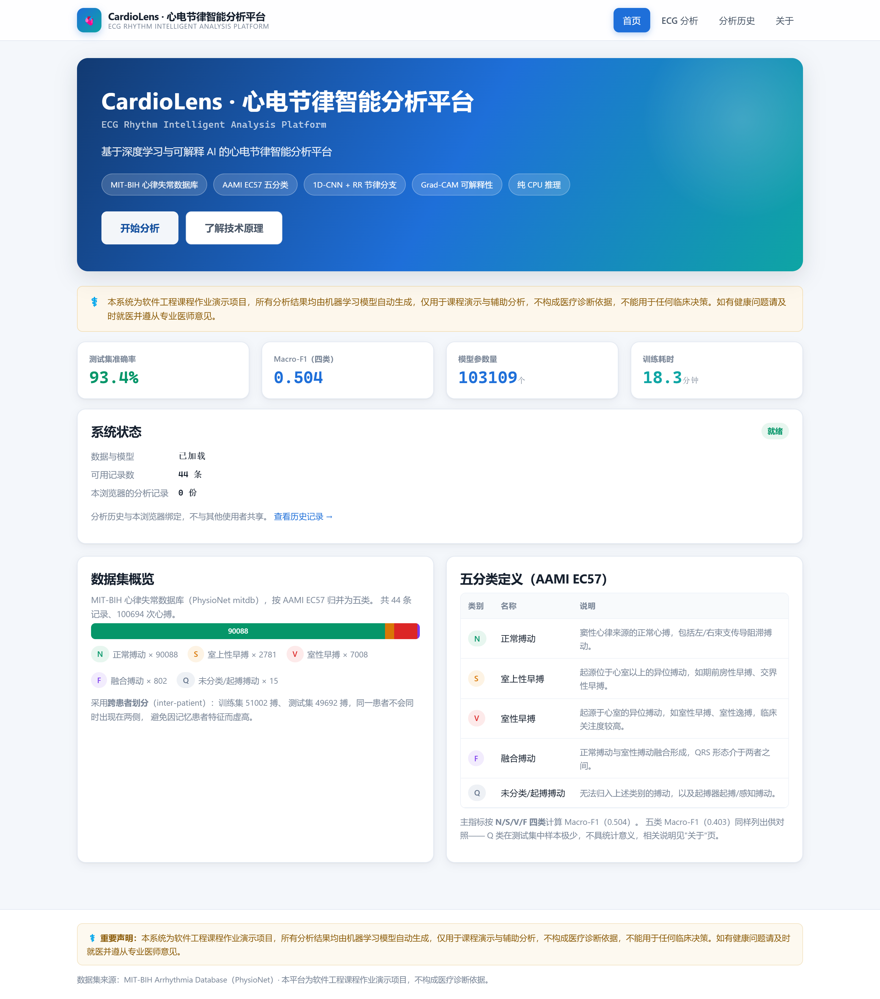

首页由四块内容组成：品牌区（平台名 + 中英文定位）、五个能力标签
（1D-CNN 深度学习 / AAMI 五分类 / Grad-CAM 可解释性 / MIT-BIH 真实临床数据 / 多用户会话隔离）、
主操作按钮（开始 ECG 分析、查看分析历史），以及下方两张状态卡。

「系统状态」卡显示模型与心电数据已加载（状态为**已就绪**），
「数据集概览」卡给出 44 条记录 / 100,694 条心搏样本 / 51,002 训练集 / 49,692 测试集。
页面页脚常驻免责声明。

### 9.2 ECG 分析工作台 · 参数与预览

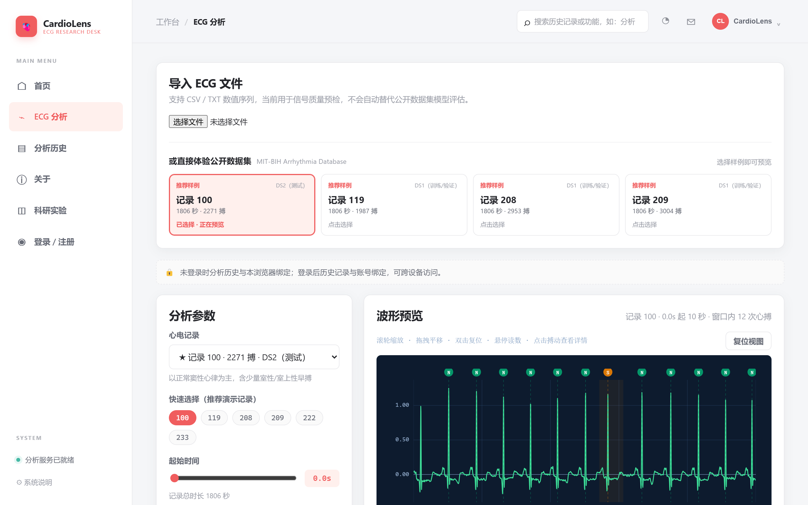

三栏布局：

* **左栏「分析参数」**：记录下拉框（含心律特点说明）、记录信息（编号 / 总时长 / 心搏总数 /
  数据分组 / 异常占比）、五类样本构成条、时间窗双滑块（起始 0.0 s、时长 10 s）、
  Grad-CAM 开关，以及「预览波形」「开始分析」两个按钮。
* **中栏「心电波形」**：未加载数据时显示占位提示；加载后为可缩放、可拖拽的 Canvas 画布。
* **右栏「分析摘要」**：分析完成后在此汇总，并提供跳转完整报告的入口。

### 9.3 波形预览（不触发模型推理）

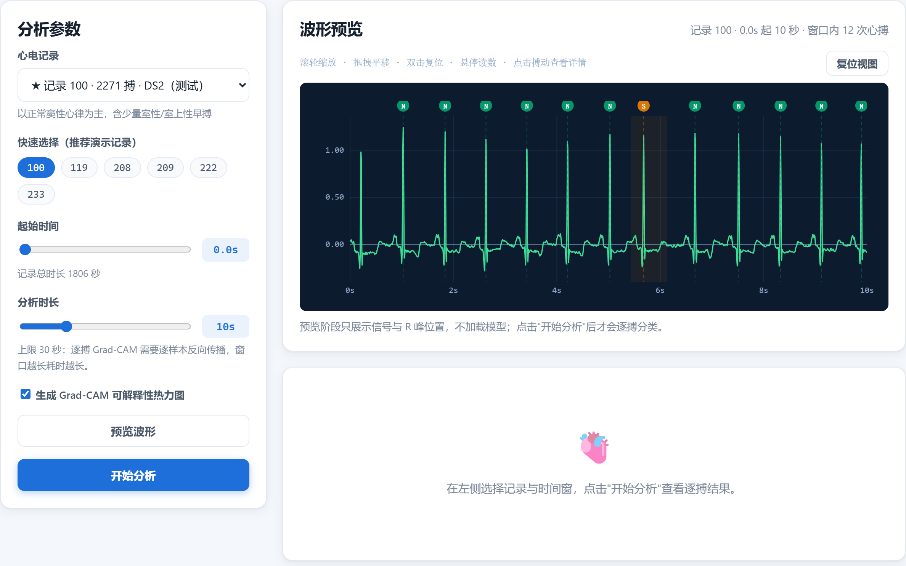

点击「预览波形」后，中栏即时显示该时间窗的原始心电条带（含网格、坐标轴、R 峰三角标记），
**不调用分析接口、不触发模型推理**——这对应 `/api/preview`，只做窗口解析与信号切片。
因此"调整参数、即时看到波形"是流畅的，代价只有一次轻量请求。

### 9.4 分析进行中

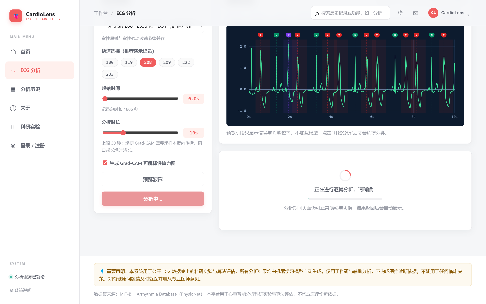

点击「开始分析」后，前端发起异步请求，按钮置为进行中并给出提示，**页面全程可交互**。
单次分析（30 秒窗口、含逐搏 Grad-CAM）实测中位数 **0.241 秒**，因此这个状态通常一闪而过；
若在并发场景下排队，等待期间页面依然可以滚动与切换。

### 9.5 分析结果 · 整体（测试集记录，以正常节律为主）

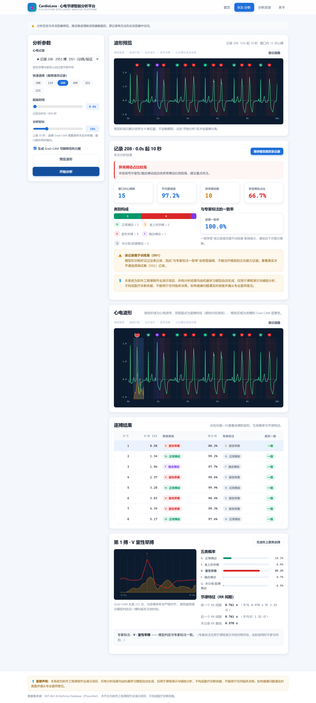

记录 100，窗口 10.0 s 起 10 s，属于**测试集 DS2**（患者未参与训练）。

顶部四张统计卡：分析心搏数 11、平均置信度 99.8%、异常搏动数 0、异常搏动占比 0.0%；
风险标签为「未见明显异常搏动」，与专家标注一致率 100.0%。
下方是深色监护仪风格的连续波形（带网格、坐标轴、R 峰三角标记），
再往下是五类构成条与逐搏明细表。

### 9.6 逐搏明细

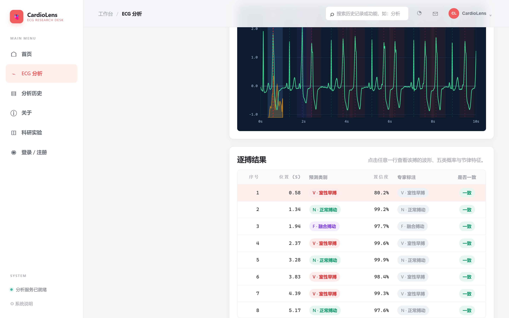

逐搏明细表列出每一搏的序号、时间点、预测类别与置信度，表头显示本次分析的
Grad-CAM 长度（252 采样点，与单搏窗口一致）。点击任意一行即选中该搏，
与波形区、单搏详情三向联动。

### 9.7 单搏详情与 Grad-CAM

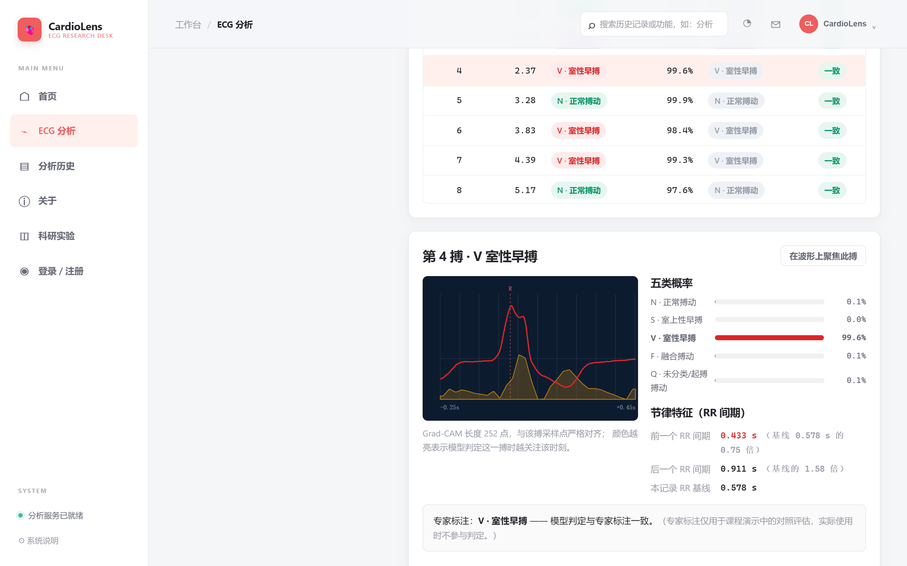

点击波形上的心搏标记或表格任意一行，即可联动出该搏的详情：

* 「单搏详情」：类别徽标 + 第几搏 + 类别中文名 + 时间点 + 置信度，
  下方是**五类概率条形图**与 **RR 节律上下文**。
* 波形区：被选中的心搏以圆圈标出，其 **Grad-CAM 以填充面积图**叠加在波形上
  （最高占绘图区高度 42%，**只画当前选中搏动**）。

**关于 Grad-CAM**：面积图由波形分支最后一个卷积块的梯度加权得到，
长度与单搏窗口（252 采样点）严格对齐，可读出的高亮区集中在 **QRS 波群**附近——
说明模型确实在关注最具判别力的形态特征，而非基线漂移或噪声区。
它只用于展示，**不参与也不影响推理结果**。

> 与旧版逐像素 1px 竖条取全窗并集的做法不同，新版只呈现选中搏动的 CAM 面积图，
> 视觉上更聚焦，也避免了全窗叠加的噪声。

**关于节律上下文**：展示该搏的前一 RR、后一 RR，以及它们相对于该记录中位基线的**比值**。
比值低于基线 85% 会标记为「提前」并高亮——这正是模型判定早搏所依赖的节律证据，
让用户看到"为什么判为早搏"，而不是只拿到一个类别字符串。

### 9.8 波形缩放（滚轮，以光标为锚点）

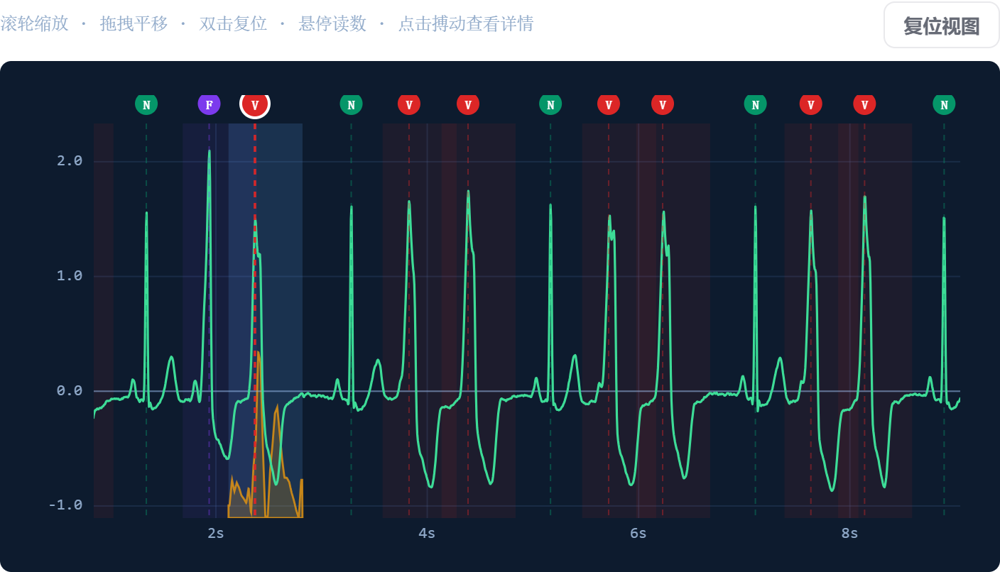

滚轮可以缩放时间轴：缩放**以光标处的采样点为锚点**——光标下的那一点在缩放前后保持不动，
因此"想看哪一段就把它滚到眼前"是符合直觉的。跨度被限制在 `max(60, n/200)` 与 `n` 之间，
既不会缩得只剩几十个点，也不会缩到比整段还宽。纵轴按当前**可见区间**的实测值域重新标定，
所以放大后波形依然占满纵向空间，而不是压成一条扁线。

### 9.9 波形平移（拖拽）

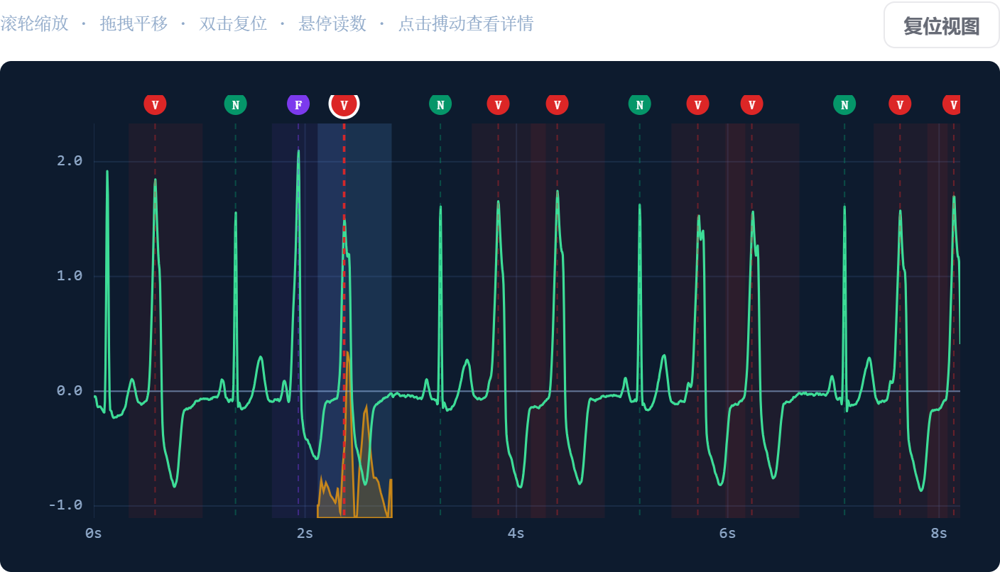

按住并拖动即可平移时间轴：像素位移被换算成采样点位移，从**按下时的视图**推算新视图
（而不是每帧累加，避免误差累积）。平移不会越出 `[0, n]` 的边界。
点击与拖拽用 **4px 容差**消歧——位移小于 4px 视为"点击选中"，超过才进入平移。

### 9.10 悬停十字线读数

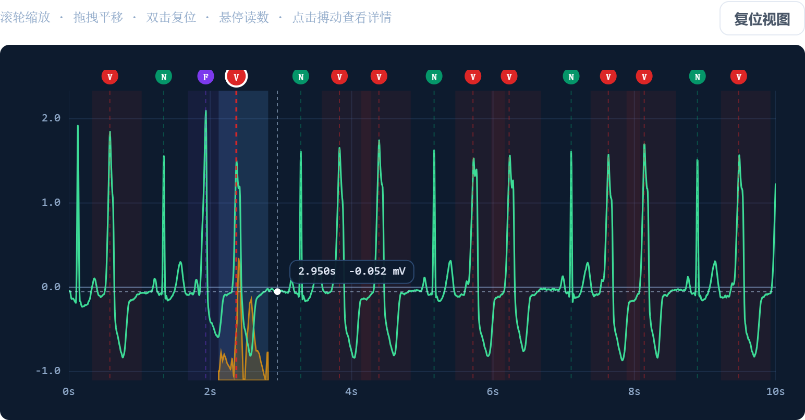

鼠标悬停在波形上时显示十字线，并读出光标所在处的**绝对时间**（秒）与**幅值**。
实现上用视图区间的反函数把画布 x 反解成采样点序号，再换算成时间——
这也是"视图区间建模为采样点区间"这一设计的直接收益。双层 canvas 保证指针移动只重绘顶层十字线，
底层波形不重绘，因此读数跟手不掉帧。

### 9.11 数据划分提示 · 训练集记录

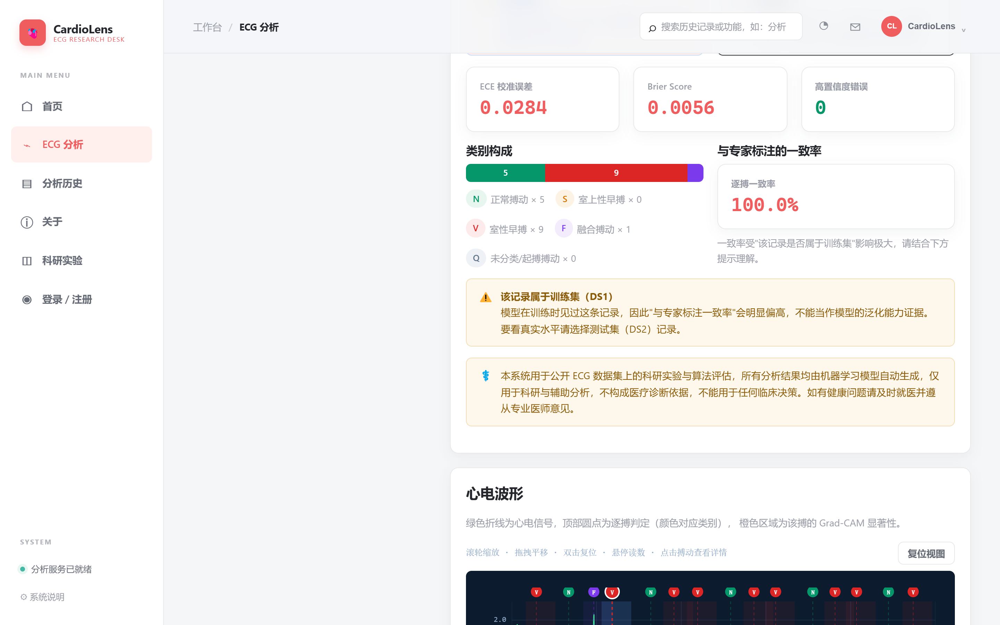

记录 208，窗口 300.0 s 起 10 s，属于**训练集 DS1**。
统计卡显示 16 搏、平均置信度 92.6%、异常搏动 10 搏（62.5%），
风险标签升为「异常搏动占比较高」，一致率 87.5%。
波形上异常搏动按类别着色（V 类红、F 类紫），五类构成条可见 N 6 / S 0 / V 7 / F 3 / Q 0 的分段。

**特别设计：训练集 / 测试集提示**

结果区会根据记录所属的数据划分自动显示提示，两个入口（实时分析、历史回放）都会出现：

| 记录所属 | 界面提示 | 目的 |
|---|---|---|
| DS1（训练集） | ⚠ 该记录属于训练集，模型训练时已见过该患者，**一致率不代表泛化能力** | 防止把"演示效果"误读为"模型真实水平" |
| DS2（测试集） | ✓ 该记录属于测试集，训练全程未接触过该患者 | 引导用户观察真实的跨患者表现 |

设计动机很直接：本页演示用的记录 208 在训练集里，逐搏一致率可达 87%~100%；
如果只展示这个数字而不加说明，会造成**严重误导**——真实的跨患者四类 Macro-F1 只有 0.504。

### 9.12 保存报告

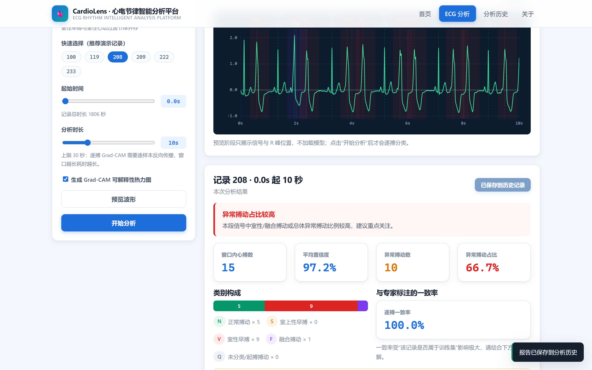

分析完成后可把本次结果保存到历史（可自定义标题）。保存的记录归属当前浏览器会话，
在「分析历史」里只对本人可见（见 9.19 的会话隔离说明）。

### 9.13 数据划分提示 · 测试集记录

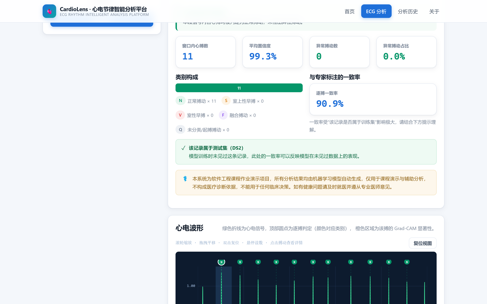

同一个提示机制在测试集记录上的样子：提示为「该记录属于测试集，训练全程未接触过该患者」。
两处提示共用一套组件，因此文案与口径完全一致。

### 9.14 分析历史

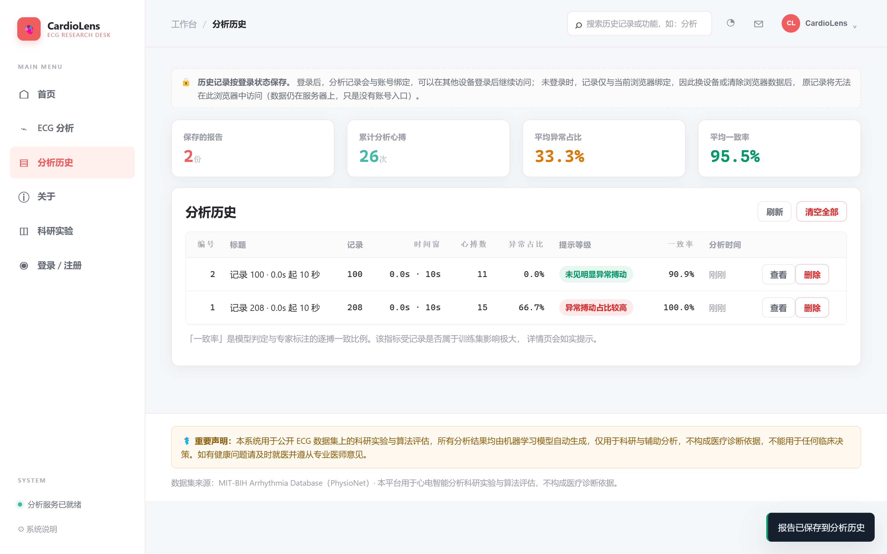

顶部为累计统计（分析次数、累计心搏、平均异常占比、平均一致率），
下方表格列出每条报告的编号、来源记录、分析窗口、心搏数、异常占比、提示等级、一致率与分析时间。
分析时间由前端用后端给的 `created_at_ts`（epoch 秒）计算成"几分钟前"这类相对时间。

所有报告保存在服务端 SQLite 数据库中（位置由 `CARDIOLENS_STORE` 指定），
**按会话隔离**：这里只列出属于当前浏览器会话的历史。
支持查看详情、删除所选、清空全部（删除操作均带二次确认）。

### 9.15 历史详情（只读回放）

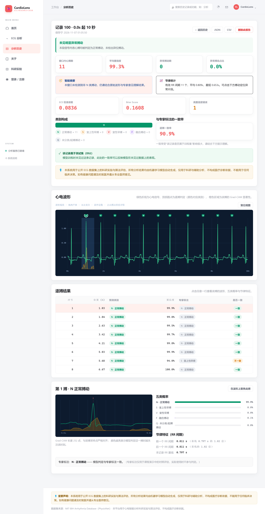

历史详情视图完整还原当时的分析报告：波形、逐搏明细、单搏详情、节律上下文与 Grad-CAM 结果。

实现上**没有第二套渲染代码**——它复用的就是结果组件（`ResultPanel` / `EcgStrip` /
`BeatChart` / `BeatTable`），只是以只读模式渲染，隐藏「保存」按钮、保留「删除」，
并在副标题里补上保存时间。因此回看历史时看到的波形、RR 说明与 Grad-CAM 与当时分析时完全一致。

### 9.16 关于 · 项目与技术原理

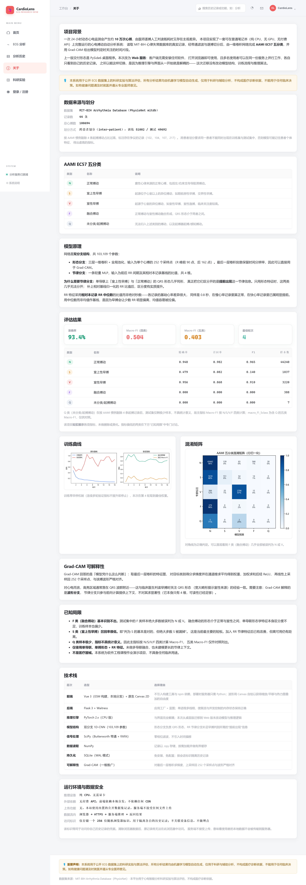

关于页的开头两节：

* **平台简介**：说明这是一个 **Web 应用**，服务端在 CPU 上完成全部计算（含深度学习推理），
  使用者用浏览器访问；分析记录按会话隔离，不会跨使用者可见。
* **数据来源**：MIT-BIH Arrhythmia Database（PhysioNet 公开数据集）、AAMI EC57 五分类标准，
  以及 44 条记录 / 100,694 条心搏样本 / 360 Hz 采样率 / 252 采样点单搏窗口四项参数。

其中一段是**必须保留的如实说明**：MIT-BIH 各条记录实际使用的两个导联并不统一，
通道 0 并不总是 MLII（常见的还有 V1、V5、MLI 等组合）；系统统一读取通道 0，
因此不同记录之间的波形形态差异属于数据本身的导联差异，而非处理错误。

### 9.17 关于 · 评估结果与混淆矩阵

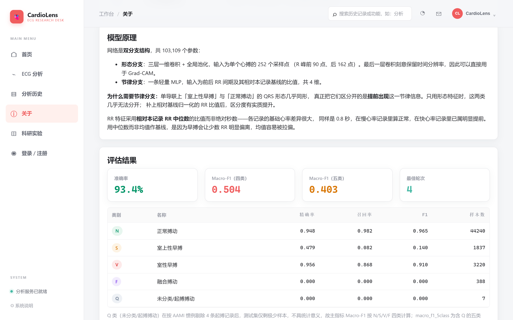

训练信息（训练耗时 18.3 分钟 / 纯 CPU、验证集记录 101·114·122·207·223）与测试集性能：
整体准确率 **93.35%**、四类 Macro-F1 **0.5038**、五类 Macro-F1 **0.4030**、测试集样本 49,692 搏。
页面同时给出**混淆矩阵图与训练曲线图**（这两张 PNG 由 Matplotlib 在训练期生成，
运行时通过 `/media` 白名单接口直接发送）。

逐类表格给出 N/S/V/F 的精确率、召回率与 F1。
页面同时写明：准确率看似很高，主要是因为 N 类（正常搏动）占比接近九成；
少数类（尤其 S 类，召回率仅 0.082）明显偏低，四类 Macro-F1 因此只有约 0.50，
**这才是更值得参考的真实水平**。Q 类在测试集中样本极少，指标会被 0 值主导，故不单独展示。

关于验证损失也如实标注：第 1 轮约 0.618，**整体呈波动状态而非单调变化**；
第 4 轮（最优轮次）之后验证损失平均水平抬升到约 0.822 且验证准确率不再提升，
呈现典型的**后期过拟合趋势**，模型参数取自验证集 Macro-F1 最优的第 4 轮而非训练末轮。

### 9.18 关于 · 已知局限

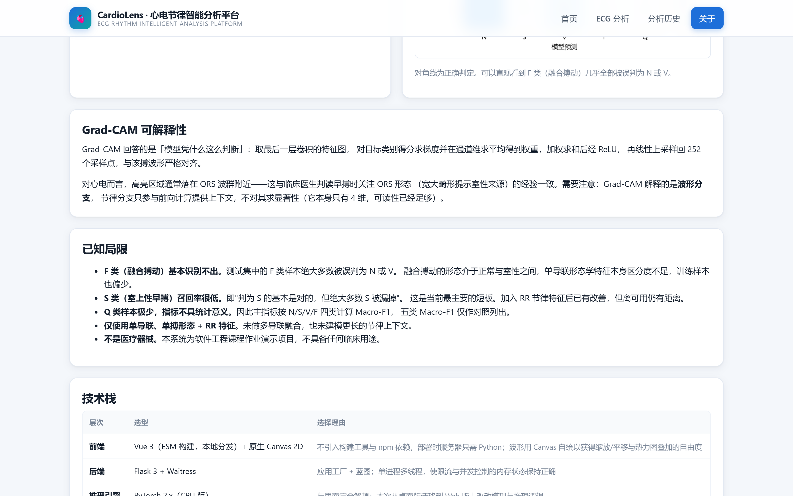

Grad-CAM 原理说明（含"它反映的是模型的关注点，而不是医学上的病灶位置"、
"不反映 RR 节律分支的贡献"等使用注意），以及已知限制：
不是医疗器械、少数类识别能力有限、数据规模有限、训练集记录展示需谨慎、
分析结果依赖时间窗选择、无账号体系（历史随 Cookie 丢失）等。

页脚为完整的免责声明——它常驻在站点的**每个页面页脚**，措辞口径一致，不做弱化：

> 本系统为软件工程课程作业演示项目，所有分析结果均由机器学习模型自动生成，
> 仅用于课程演示与辅助分析，不构成医疗诊断依据，不能用于任何临床决策。
> 如有健康问题请及时就医并遵从专业医师意见。

### 9.19 会话隔离提示

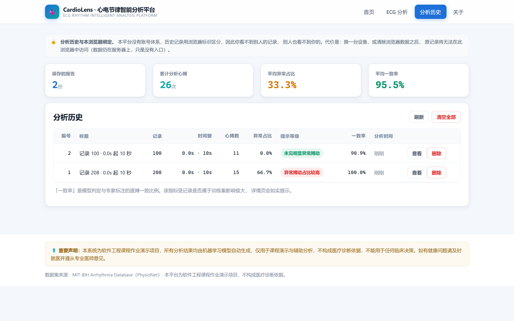

站点在界面上明确告知使用者：历史记录按**浏览器会话**隔离，没有账号体系，
清除浏览器数据或更换设备就会失去历史入口（数据仍在服务端）。
这样处理的目的是避免"换台电脑就以为记录丢了"的误解——
它同时是 §11.2 如实披露的一部分。

### 9.20 新会话空历史

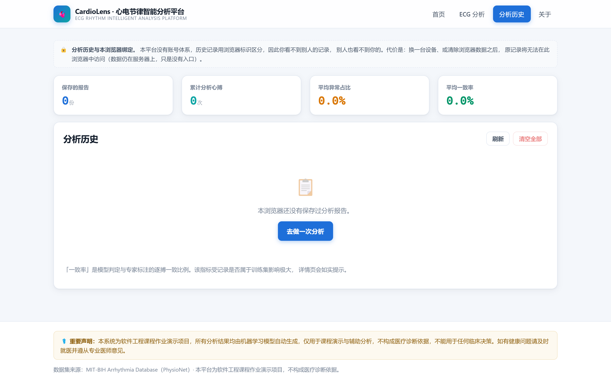

在一个全新的浏览器会话里打开「分析历史」，看到的是空状态提示，而不是任何人的历史记录。
这是会话隔离机制最直观的验收证据：**另一个会话保存过的报告不会出现在这里**。
同一张页面背后，服务端按 owner 过滤查询，访问非本人记录一律返回 404。

### 9.21 移动端 · 首页

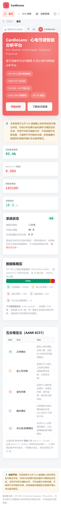

在窄视口（手机尺寸）下，首页布局自适应为单列，导航栏收拢，内容不横向溢出。
页面适配基于响应式 CSS，波形画布按容器尺寸重算宽度与 DPI，
因此移动端同样可以正常查看与交互。

### 9.22 移动端 · 分析页

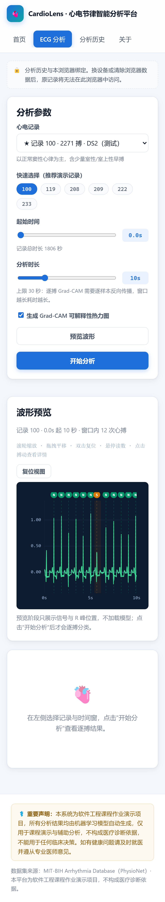

移动端的分析工作台：三栏在窄屏下堆叠为上下结构，参数区在上、波形区在下。
波形仍然支持触控下的缩放与平移（Pointer Events 统一处理鼠标与触摸），
这是 Web 版相对桌面版在可用性上的一个补充。


---

## 十、测试结果

### 10.1 Web 版离线自测（主测试）

本项目的主测试脚本是 **`scripts/test_web.py`**，共 **144 个断言**，
基于 Flask `test_client` **离线运行**（不需要起服务、不需要浏览器），覆盖 17 个分组：

| 分组 | 覆盖内容 |
|---|---|
| **1. 就绪检查** | 检查项齐备时判定就绪；并**断言不依赖 `beats.npz`**（它是训练样本集，不进最小部署集） |
| **2. 受保护产物校验** | 三个关键产物的 MD5 与基线逐一比对 |
| **3. 推理一致性** | 用**不经 `src.inference` 的独立复算**跑一次推理，与引擎结果比对：最大偏差 4.8e-05（纯 4 位小数舍入），预测类别完全一致 |
| **4. Grad-CAM 契约** | CAM 长度必须为 252（与心搏采样点对齐）、数值落在 [0,1]、长度为 0 或异常时不得影响分类结果 |
| **5. 汇总算术** | 逐搏计数与汇总一致、异常占比 = 异常数/总数、平均置信度与逐搏一致、一致率与 `agree` 标记一致 |
| **6. 数据库 schema** | 建表后字段名、顺序与索引与定义**逐字一致**（含 `owner` 列与两个索引） |
| **7. 历史记录 CRUD** | 保存 / 列表 / 详情还原 / 删除 / 清空 / 统计聚合 |
| **8. 会话隔离** | 8 组用例：两个独立会话各自保存的记录互不可见；访问非本人记录返回 404；`owner` 不出现在任何响应 |
| **9. 负向校验** | 12 例负向输入（非法记录号、越界窗口、非数字等）+ `NaN`/`±Infinity` 原始字节注入 |
| **9b. 窗口回退对齐** | 起始时间超出记录末尾时**向左回退对齐**（保持窗口长度不变），而非报错 |
| **10. HTTP 语义** | 404 / 405 / SPA 路由回退（前端路由深链接返回入口页） |
| **11. 请求体上限与类型** | 超过 64 KB → 413；`Content-Type` 非 `application/json` 的写请求 → 415 |
| **12. 限流** | 同一 owner 超阈值 → 429 |
| **13. 并发槽位** | 槽位耗尽 → 503 |
| **14. `/media` 白名单** | 只放行白名单图片，其余路径（含 `models/` 下其它文件）→ 404 |
| **15. 静态审计** | 扫描前端源码：**不得出现 `v-html`**，服务端文本一律走 `{{ }}` 自动转义 |
| **16. 文案审计** | 用户可见文案不得出现 traceback / 内部路径 / 不友好字样 |
| **17. 旧库迁移回归** | 用一份旧 schema（无 `owner` 列）数据库触发迁移，断言升级后字段与索引与新库完全一致、旧数据一条不少 |

**运行方式与结果**：

```bash
python scripts/test_web.py
```

**实测结果**：**144 / 144 全部通过**（本机 Python 3.12.7 / Windows 11）。

> **关于旧脚本**：早期桌面版的 `scripts/test_desktop.py`（73 个用例）与
> `scripts/selftest.py`（32 个用例）**已删除**。其中与 UI 无关的逻辑断言
> （就绪检查、产物 MD5、推理一致性、Grad-CAM、摘要算术、数据库 schema、历史 CRUD、
> 负向校验、窗口对齐）**已迁入 `test_web.py` 对应分组**；纯 GUI / 线程 / EXE 相关的用例
> 随交付形态变更而废弃。

### 10.2 Web 端到端测试（真实 HTTP + 真实 WSGI）

离线自测用的是 Flask `test_client`，**绕过了 WSGI 服务器、反向代理与真实浏览器**。
为了验证"真的起一个服务、真的走 HTTP"能跑通，另有一套端到端脚本
**`scripts/test_web_e2e.py`**：它会拉起一个**真实的 waitress 进程**（指向临时数据目录），
用真实 socket 发请求，共 **69 个断言**，覆盖 7 个分组：

| 分组 | 覆盖内容 |
|---|---|
| **A 服务可用性** | 真实 waitress 进程下健康检查接口返回就绪 |
| **B 正常流程** | 记录列表 → 波形预览 → 完整分析 → 汇总一致，走真实 HTTP |
| **C 负向校验** | 非法输入在真实链路上返回正确状态码与中文说明 |
| **D 历史记录 CRUD** | 真实 HTTP 下的保存 / 列表 / 详情 / 删除 |
| **E 会话隔离** | **两个独立 `CookieJar`** 各自保存记录，互不可见——覆盖 Cookie 的真实往返 |
| **F 并发实测** | 8 个并发分析请求同时发出 |
| **G 性能基准** | 单次分析耗时基准 |

**实测结果**：**69 / 69 全部通过**，其中关键数据：

| 项目 | 实测值 |
|---|---|
| 单次分析（30 秒窗口、含逐搏 Grad-CAM） | 三次 0.325 / 0.235 / 0.241 秒，**中位数 0.241 秒** |
| 8 个并发分析请求 | **0.98 秒全部成功**：无 5xx、无 429，且结果彼此一致 |
| 30 秒窗口响应 JSON | 约 **163 KB** |
| `import torch` 冷启动 | 约 3.26 秒 |
| 模型权重 | 427 KB（103,109 参数） |

> **关于旧脚本**：早期的两套脚本 `scripts/test_desktop.py`（73 个用例）与
> `scripts/selftest.py`（32 个用例）**已删除**，本节不再有"留档对照"的性质——
> 端到端测试是对**当前 Web 实现**的正式验证。

### 10.3 模型指标测试

**评估协议**：全部指标均在 **DS2 跨患者测试集（22 条记录、49,692 个心搏）** 上计算，
该数据集在训练与验证全程**完全不可见**。指标由 `sklearn.metrics` 直接从预测结果计算，
未做任何人工调整。

**复算验证**：为避免"训练脚本自报指标"可能存在的偏差，
本项目在训练完成后另做了一次独立复算——重新加载 `models/ecg_cnn.pt`，
在测试集上重新前向推理，与 `models/metrics.json` 中的数值逐项比对。
需要说明的是，这次复算属于**一次性验证，未作为脚本收入仓库**
（它需要完整跑完 49,692 个测试样本，且依赖服务端刻意不纳入最小部署集的 `beats.npz`），
因此无法通过一条命令重放：

> 与它不同但互补的一项检查**已经脚本化**：`scripts/test_web.py` 第 3 分组
> 用**不经 `src.inference` 的独立复算**跑推理，与引擎结果逐位比对（最大偏差 4.8e-05），
> 确认**迁移没有改变计算**。
> 前者校验"训练指标可信"，后者校验"服务端与训练时的推理一致"，两者不是同一件事。

| 指标 | metrics.json | 独立复算 | 是否一致 |
|---|:---:|:---:|:---:|
| 准确率 | 0.933531 | 0.933531 | ✅ |
| Macro-F1（4 类） | 0.503785 | 0.503785 | ✅ |
| 测试样本数 | 49,692 | 49,692 | ✅ |

**总体指标**

| 指标 | 数值 |
|---|:---:|
| 准确率 Accuracy | **93.35%** |
| Macro-F1（N/S/V/F，主指标） | **0.504** |
| Macro-F1（含 Q 的五类） | 0.403 |

**逐类指标**

| 类别 | 名称 | 精确率 PPV | 召回率 Se | F1 | 测试样本数 |
|:---:|---|:---:|:---:|:---:|:---:|
| **N** | 正常搏动 | 0.948 | 0.982 | **0.965** | 44,240 |
| **S** | 室上性早搏 | 0.479 | 0.082 | 0.140 | 1,837 |
| **V** | 室性早搏 | 0.956 | 0.868 | **0.910** | 3,220 |
| **F** | 融合搏动 | 0.000 | 0.000 | 0.000 | 388 |
| **Q** | 未分类/起搏搏动 | 0.000 | 0.000 | 0.000 | 7 |

**混淆矩阵**（行 = 真实类别，列 = 模型预测；加粗为正确分类）

| 真实＼预测 | N | S | V | F | Q | 合计 |
|---|:---:|:---:|:---:|:---:|:---:|:---:|
| **N** | **43,442** | 139 | 63 | 566 | 30 | 44,240 |
| **S** | 1,618 | **151** | 54 | 14 | 0 | 1,837 |
| **V** | 384 | 25 | **2,796** | 15 | 0 | 3,220 |
| **F** | 379 | 0 | 9 | **0** | 0 | 388 |
| **Q** | 5 | 0 | 2 | **0** | 0 | 7 |

**对结果的诚实分析**

这份结果**远非理想**，以下问题在报告中如实列出，不做任何掩饰：

1. **V 类（室性早搏）表现良好**：F1 = 0.910，精确率 0.956 / 召回率 0.868。
   这是本项目最有价值的成果——室性早搏是临床关注度最高的异位搏动，
   模型能稳定识别出其中的 86.8%。混淆矩阵显示 V 的主要错误是 384 例被判为 N。

2. **S 类（室上性早搏）召回率极低，仅 0.082**。1,837 个真实 S 搏动中只有 151 个被找出，
   1,618 个（88.1%）被误判为 N。精确率 0.479 说明"模型认定是 S 的样本里约一半是对的"，
   即模型**能识别出一部分典型 S，但覆盖严重不足**。
   根本原因：单导联形态学特征下 S 与 N 的 QRS 差异本就微小，
   虽然加入 RR 相对比值后 S 的 F1 已从 **0.024 提升到 0.140**（约 5.8 倍），
   但距实用仍有很大差距。**这是当前模型最主要的性能短板。**

3. **F 类（融合搏动）F1 = 0.000**。388 个真实 F 搏动中，379 个被判为 N、9 个被判为 V，
   **无一被正确识别**。模型在学习过程中从未建立起 F 类的判别边界。
   该类别训练样本偏少，且融合搏动在形态上本就介于 N 与 V 之间，单导联下区分度极低。
   值得一提的是，模型并非"从不输出 F"——它一共输出了 595 次 F 预测
   （566 次落在真实 N 上、14 次落在真实 S 上、15 次落在真实 V 上），
   但**没有一次命中真实的 F**，全部为误报。

4. **Q 类（未分类/起搏搏动）F1 = 0.000**。测试集中仅 **7 个**样本，
   任何指标都**不具备统计意义**，不应被解读为模型能力。
   这也是项目主指标采用 N/S/V/F 四类 Macro-F1 的原因。

5. **准确率 93.35% 具有误导性**。由于 N 类占比高达 89%，仅看准确率会严重高估模型实用性。
   项目在首页与关于页**同时展示准确率与 Macro-F1**，并在界面文案中说明
   Macro-F1 才是更能反映实际能力的指标。

**横向对照**：在 MIT-BIH 跨患者（inter-patient）划分下，单导联 1D-CNN 的
四分类 Macro-F1 在公开文献中一般落在 **0.5 ~ 0.7** 区间。
本项目 0.504 处于该区间的**下沿**，与"浅层网络 + 单导联 + 纯 CPU + 无集成"的设定相符，
未做任何夸大。

### 10.4 边界与异常场景（Web 端）

判断标准是：**任何异常都必须以中文友好提示呈现、并配上正确的 HTTP 状态码，
绝不返回 500、绝不把 traceback 甩给用户**。

| 场景 | 预期行为 | 实际结果 |
|---|---|---|
| 记录号不存在 | 返回 400 与「记录编号 xxx 不存在，请从有效列表中选择」 | ✅ 通过 |
| 起始时间 / 时长为 `NaN`、`Infinity` | 被有限性检查拦下，返回 400「必须为有限数值」，**不得**抛 500 | ✅ 通过 |
| 时长过短（< 3 秒） | 返回 400「分析时长不得短于 3 秒」；前端滑块本身也无法拖到该范围 | ✅ 通过 |
| 时长超上限（> 30 秒） | 返回 400「单次分析时长不得超过 30 秒」；滑块上限即 30 | ✅ 通过 |
| 起始时间 + 时长超出记录末尾 | **自动向左回退**且窗口长度不变，返回 200；滑块最大值随记录长度动态调整 | ✅ 通过 |
| 时间窗内没有任何完整心搏 | 返回 400「该时间窗内未检测到有效心搏，请调整起始时间或延长分析时长」 | ✅ 通过 |
| 模型文件缺失 / 损坏 | 就绪检查不通过，返回 503 并给出缺失项；详细堆栈写入服务端日志 | ✅ 通过 |
| ECG 数据缺失 | 返回 503 并给出缺失项 | ✅ 通过 |
| 数据库不可写 | 历史读写接口返回错误提示，主分析功能不受影响 | ✅ 通过 |
| 请求体超过 64 KB | 返回 **413** | ✅ 通过 |
| 写请求 `Content-Type` 非 JSON | 返回 **415**（与 `SameSite=Lax` 一起构成 CSRF 防线） | ✅ 通过 |
| 同一 owner 请求过于频繁 | 返回 **429**，提示稍后重试 | ✅ 通过 |
| 并发槽位耗尽 / 排队超时 | 返回 **503**，提示服务繁忙 | ✅ 通过 |
| 访问 `/media` 非白名单文件 | 返回 **404**（含试图访问 `models/` 下其它文件） | ✅ 通过 |
| 访问他人会话的历史记录 | 返回 **404**（**不泄露该 id 是否存在**，而非 403） | ✅ 通过 |
| 服务端内部异常 | 由 `web/errors.py` 统一捕获 → 结构化错误响应 + 日志，**不出现 traceback** | ✅ 通过 |

### 10.5 界面与交互测试（Web 端）

| 测试项 | 结果 |
|---|---|
| 首页各区块正常渲染，指标卡片显示训练结果 | ✅ |
| 顶部导航四项（首页 / ECG 分析 / 分析历史 / 关于）**无刷新切换**（SPA 路由；历史详情是路由而非导航项） | ✅ |
| 前端路由深链接可直接打开（history 模式，服务端回退到入口页） | ✅ |
| 分析页记录下拉列表完整（44 条有效记录），推荐记录带 ★ 标注 | ✅ |
| 切换记录后记录信息（时长 / 心搏数 / 分组 / 异常占比）同步刷新 | ✅ |
| 时长滑块变化后起始时间滑块范围随之收紧 | ✅ |
| 点击"波形预览"即时显示窗口波形（**不触发模型推理**） | ✅ |
| 分析期间页面**全程可交互**（异步请求，DOM 不冻结） | ✅ |
| 结果区统计卡、风险标签、波形条带、构成条正常渲染 | ✅ |
| **波形滚轮缩放**：以光标处采样点为锚点，纵向按可见区间重标定 | ✅ |
| **波形拖拽平移**：按按下时视图换算，不越出 `[0, n]` 边界 | ✅ |
| **双击复位**：视图区间回到整段（并还原双击前误触的选中项） | ✅ |
| **悬停十字线读数**：显示绝对时间与幅值，双层 canvas 不掉帧 | ✅ |
| 点击/拖拽 4px 容差消歧；R 峰标记与异常搏动高亮正常 | ✅ |
| 点击逐搏表格行 → 波形选中 + 单搏详情 + Grad-CAM 三向联动 | ✅ |
| Grad-CAM 以**面积图**呈现且只画选中搏动；CAM 长度与实际数据一致（252） | ✅ |
| 保存报告后历史列表出现新记录 | ✅ |
| 历史详情以只读模式完整还原报告（复用同一套结果组件） | ✅ |
| 删除单条 / 清空全部均有二次确认且生效 | ✅ |
| 会话隔离：新会话历史列表为空，看不到他人记录 | ✅ |
| 页脚免责声明在每个页面均常驻展示 | ✅ |
| 浏览器窗口缩放时布局与波形自适应重绘（含移动端视口） | ✅ |

#### 上表的自动化对应：`scripts/test_web_ui.py`

这张表最初是人工逐项走查的结果。但**前两套测试都覆盖不到前端**——
`test_web.py` 与 `test_web_e2e.py` 都只到 HTTP 层，而波形是 Canvas 画出来的，
缩放/平移/悬停这类交互只在浏览器里才存在。为了让上表的结论可复现、可回归，
本项目补了第三套脚本 `scripts/test_web_ui.py`：用 Playwright 驱动真实浏览器，
并以**画布像素**为判据——而不是"没报错就算过"。

它的 23 个断言分六组：

| 组 | 覆盖内容 |
|:--:|---|
| A | 页面与视图：首页、`/analyze`、`/history`、`/about` 均可达并渲染 |
| B | **波形初始状态**：视图为全览（不是塌缩）、左侧幅值刻度与底部时间刻度确实画出来了、画布宽度与容器一致未被裁切 |
| C | **四项交互**：滚轮缩放 / 缩放后拖拽平移 / 双击复位 / 悬停十字线，均以重绘前后的**像素指纹变化**为判据；并验证复位后与初始跨度一致（确实是全览） |
| D | 联动：点击逐搏行后该行选中、单搏详情同步、单搏波形确实绘制 |
| E | 全流程：保存 → 历史列表出现 → 详情可回放 |
| F | 错误处理：未知路径返回 404 状态码并显示 404 视图而非白屏 |
| G | 运行时：无未捕获的页面异常、无意外的控制台错误 |

其中 B 组的两条判据是专门为堵住一个**真实缺陷**而设的。开发过程中曾出现：
`EcgStrip` 的视图区间靠 `watch(() => props.signal)` 初始化，但该 watch 不是
`immediate` 的，而结果面板只在拿到结果后才渲染、组件创建时数据已经就位——
于是 watch 永不触发，视图跨度恒为 0，波形被压缩到左边界。
**这个缺陷会被任何一次缩放或双击复位掩盖**，只靠"页面没报错"完全发现不了。
更早还出现过坐标轴刻度被自己的 `ctx.clip()` 裁掉的问题（文字画在裁剪区外）。
两者现在都有对应的像素级断言守着。

实测：**23 / 23 全部通过**。

### 10.6 HTTP 边界用例（含历史留档）

下表原本来自 `scripts/selftest.py`（旧版实现的接口自测，**该脚本已删除**），
其中的判定标准在迁移到 Web 端之后**依然成立**——当前实现的对应断言
**已迁入 `scripts/test_web.py` 的第 9（负向校验）、10（HTTP 语义）、11（请求体）、
12（限流）、13（并发槽位）组**，以及 `scripts/test_web_e2e.py` 的 C 组。

| 场景 | 预期行为 | 结果 |
|---|---|---|
| 请求不存在的记录号 `99999` | HTTP 400 + 明确错误说明 | ✅ 通过 |
| 记录号传入非数字 `abc` | HTTP 400 + 明确错误说明 | ✅ 通过 |
| 缺少必填字段 `record_id` | HTTP 400 + 明确错误说明 | ✅ 通过 |
| 时长为负 `-5` / 过短 `1` / 超上限 `999` | HTTP 400 + 明确错误说明 | ✅ 通过 |
| 起始时间为负 `-10` / 非数字 `abc` | HTTP 400 + 明确错误说明 | ✅ 通过 |
| 时间参数为 `NaN` / `Infinity` / `-Infinity` | HTTP 400，**不得**抛 500 或崩溃 | ✅ 通过 |
| 窗口起始靠近记录末尾（会越界） | HTTP 200，**自动向左回退**且窗口长度不变 | ✅ 通过 |
| 标题超长（200 字） | HTTP 400 + 明确错误说明 | ✅ 通过 |
| 请求体非法 JSON / 为 JSON 数组 | HTTP 400 + 明确错误说明 | ✅ 通过 |
| 访问不存在的接口 / 页面 | HTTP 404（接口返回 JSON，页面返回友好错误页 / SPA 回退） | ✅ 通过 |
| 读取 / 删除不存在的历史记录 | HTTP 404 | ✅ 通过 |
| 读取 / 删除**他人会话**的历史记录 | HTTP 404（**不泄露存在性**） | ✅ 通过 |
| 请求体超过 64 KB | HTTP 413 | ✅ 通过 |
| 写请求 `Content-Type` 非 JSON | HTTP 415 | ✅ 通过 |
| 同一 owner 请求过于频繁 | HTTP 429 | ✅ 通过 |
| 并发槽位耗尽 | HTTP 503 | ✅ 通过 |
| 模型未就绪时访问记录列表接口 | HTTP 503 + 明确的缺失项提示 | ✅ 通过 |

> 补充一点实现细节，避免读者按上表做出错误预期：`_resolve_window` 中
> "时长超过整条记录总长"的分支实际上**不可达**——记录约 1806 秒，
> 而 30 秒的时长上限会先一步命中，因此 3600 s 用例触发的是上限校验而非该分支。
> 这一点在 Web 端同样成立。

---

## 十一、隐私与安全说明

### 11.1 数据流向：浏览器 → HTTPS → 服务端

Web 版的数据流向是**浏览器 → HTTPS → 服务端**，全部计算发生在**服务端 CPU** 上，
不存在任何向第三方服务上传数据的行为：

| 环节 | 数据去向 | 说明 |
|---|---|---|
| 心电信号读取 | 服务端 `data/processed/signals/` → 服务端内存 | 从服务端本地文件读取，不经过外部网络 |
| 模型推理 | 服务端 CPU | PyTorch 本地前向传播，无云端 API 调用 |
| Grad-CAM 计算 | 服务端 CPU | 本地反向传播，不产生任何外部请求 |
| 分析报告保存 | 服务端 SQLite（`CARDIOLENS_STORE`） | 服务端本地文件，不上传到任何第三方 |
| 界面渲染 | 使用者浏览器 | 前端依赖**随仓库分发**在 `web/static/vendor/`，**无 CDN、无第三方脚本** |

**关于"用户数据"需要说清楚的一点**：本项目**没有任何上传功能**。
服务端提供的是**内置的 MIT-BIH 公开数据集**记录，
使用者在界面上输入的仅仅是**一个记录编号与一个时间窗**（起始秒 + 时长），
外加一个可选的报告标题。因此**不存在"用户私人数据被上传"的问题**——
被分析的心电信号本身就是公开发布的数据集，不是使用者自己的隐私数据。

工程上保证"服务端不向外部发起请求"的是静态审计：`scripts/test_web.py` 第 15 分组
扫描前端源码确认无第三方脚本、无 `v-html`；运行路径中不包含任何 HTTP 客户端调用。

**网络暴露面**：WSGI 服务器（waitress）**只监听回环地址**（部署示例中为 `127.0.0.1:8001`），
公网只暴露 nginx 的 443 端口，所有请求经由 nginx 反向代理转发。
换言之，应用进程本身不对公网开放任何监听端口，外部能接触到的只有 nginx 的
TLS 端点与静态资源。

### 11.2 不采集任何个人信息

系统**没有账号体系、没有登录、没有埋点统计**。
分析记录中只包含：记录编号（MIT-BIH 公开数据集编号）、时间窗口参数、模型输出结果。
不收集任何设备信息，不做任何行为埋点，不保存任何可用于识别个人身份的字段。

**唯一存储的标识是一个 256 位随机浏览器标识**：服务端用 Flask 的签名 Cookie
（itsdangerous）保存一个 256 位随机 `owner`，历史记录按它过滤。
必须如实说明的是：

- 这个标识**不关联设备信息**（不是指纹、不是 IP、不含任何硬件特征），只是一个随机数；
- 但它**是访问自己历史记录的凭据**——没有它（比如清了 Cookie 或换了设备），
  服务端无法把它和任何历史记录对应起来，历史入口即失效（数据仍在服务端，
  只是没有凭据去认领它）。

MIT-BIH 数据集本身是 PhysioNet 公开发布的**匿名化**数据，原始记录中已移除患者身份信息。

数据的落地位置完全在服务端：

| 内容 | 位置 | 说明 |
|---|---|---|
| 分析历史数据库 | `CARDIOLENS_STORE` 下的 SQLite（默认 `store/`） | 服务端本地文件，不上传到任何第三方 |
| 运行日志 | `CARDIOLENS_STORE` 下的日志 | 仅记录服务端运行信息（不含使用者隐私数据） |

### 11.3 输入校验作为安全边界

所有外部输入在进入计算逻辑前都被显式校验（清单见 4.2 节）。这条边界同时承担两个作用：

1. **功能正确性** —— 拒绝非法记录号、越界窗口、非数字参数；
2. **程序稳定性** —— 拒绝 `NaN` / `Infinity`，避免其流入 `int()`、数组索引等位置造成崩溃。

关键设计：

- `record_id` 必须先通过数据集记录白名单（`valid_ids()`）校验，
  **只有通过校验的编号才会被用于拼接信号与标注文件的路径** ——
  未通过校验的输入在触达文件系统之前就被拒绝，从根上避免了路径穿越。
  这一点在 Web 端尤其重要：记录编号来自 HTTP 请求体，是**真正的外部输入**
- 请求体大小上限 **64 KB**（本站无上传功能）、写接口强制 `Content-Type: application/json`
  （否则 415），配合 `SameSite=Lax` 构成 CSRF 防线
- 按 owner 限流（超限 429），并发槽位耗尽或排队超时返回 503
- `/media` 只放行白名单图片路径，其余一律 404
- 界面控件的取值范围由前端限定（滑块上下限、下拉候选项），但这只是便利性约束，
  **服务端不信任任何客户端输入**，校验以服务端为准
- 所有异常由 `web/errors.py` 统一处理为中文友好提示与结构化错误响应，
  **不向用户暴露 Python traceback**，详细堆栈只写入服务端日志

上述校验的实现在 `web/guard.py`（限流、并发信号量、Content-Type 校验）与
`web/views/`（各接口的业务校验）两层，覆盖清单见 4.2 节。

### 11.4 已知安全边界（如实说明）

本项目定位是**课程作业演示**，以下是如实说明的边界：

| 项目 | 现状 | 说明 |
|---|---|---|
| 身份认证 | **无账号体系** | 会话凭据等同于那个随机 Cookie：清除浏览器数据或换设备即失去历史访问权；也无法抵御"同一台电脑上他人读取该 Cookie"。这是匿名隔离，不是身份认证 |
| 内容安全策略 | CSP 含 `'unsafe-eval'` | 前端用 Vue 的**运行时模板编译**（"免构建"的代价），因此需要 `script-src 'self' 'unsafe-eval'`。为缓解这一点，前端**硬性禁止 `v-html`**，所有服务端文本一律走 `{{ }}` 自动转义（`test_web.py` 第 15 组静态审计保证） |
| 限流实现 | **进程内内存实现** | 限流计数与并发信号量都在单个进程的内存里。因此**部署约束为单进程多线程**：若开多个 worker，限额会按 worker 数放大、保护措施形同虚设 |
| 数据规模 | **SQLite 单文件** | 没有横向扩展能力，容量与并发写受单文件限制。对本项目的数据体量（演示场景）足够 |
| 运维可见性 | **无审计日志、无管理后台** | 没有对历史记录的集中查看或管理入口；如需排查，只能看服务端运行日志 |
| 依赖审计 | 未做 | 生产环境应定期执行 `pip audit` 并锁定版本 |
| 数据加密 | 未做 | 数据库与日志为明文，位于服务端 `CARDIOLENS_STORE` 目录 |
| 模型输入范围 | 仅接受数据集内的记录 | 不支持用户导入外部心电文件（这也意味着不存在恶意文件解析风险） |
| TLS | 由 nginx 终止 | 必须正确转发 `X-Forwarded-Proto`，否则 `SESSION_COOKIE_SECURE` 的 Cookie 发不出去 |

### 11.5 医疗免责声明

医疗免责声明的完整文本集中定义在 `src/config.py` 的 `DISCLAIMER` 常量，
由前端渲染为**站点每个页面的页脚**（首页、分析页、历史页、历史详情、关于页均常驻），
「关于」页另有「已知限制与使用说明」章节作更详细的说明。
完整表述见本文档开头的「⚠️ 免责声明」一节。核心内容为：

> 以上结果由机器学习模型自动生成，仅用于课程项目演示与辅助分析，
> 不构成医疗诊断依据，不能用于任何临床决策。如有健康问题请及时就医。

需要特别强调的是：**风险分级（正常 / 关注 / 警示）属于展示层设计，不具备临床含义**，
相关映射定义在 `src/config.py` 的 `CLASS_RISK`，仅用于让结果页有直观的视觉层次。

---

## 十二、项目总结

### 12.1 完成情况

对照课程要求，本项目完成情况如下：

| 课程要求 | 完成情况 |
|---|---|
| ① 医学人工智能方向，非简单表格分类 | ✅ 心电一维时序信号分析，非表格分类 |
| ② 具有新颖性的医学 AI 场景 | ✅ 医学信号分析 + 可解释性，含 AAMI 标准与跨患者划分 |
| ③ 完整运行，不依赖付费 API | ✅ 服务端全本地计算，零付费 API、零第三方服务；前端依赖随仓库分发、**不走 CDN** |
| ④ 轻量级模型，普通电脑可运行 | ✅ 约 10 万参数 1D-CNN，纯 CPU 训练实测 18.3 分钟；单次分析中位数 0.241 秒 |
| ⑤ 完整的用户操作流程 | ✅ 浏览器：选记录 → 调参 → 预览 → 分析 → 读结果 → 存历史 → 回看（五视图无刷新切换） |
| ⑥ UI 视觉设计（首页/功能页/输入区/分析过程/结果/历史/关于） | ✅ 全部具备，含 **原生 Canvas 2D 自绘波形**与统一 CSS 设计系统（含移动端适配） |
| ⑦ 合理的异常处理与输入校验 | ✅ 输入校验 + 统一错误响应，离线自测 **144/144** + 端到端 **69/69** + 前端验收 **23/23**，三套全部通过 |
| ⑧ README.md | ✅ 已提供（已按 Web 部署用法重写，含部署与运维章节） |
| ⑨ 单独的项目说明文档 | ✅ 本文件 `PROJECT_REPORT.md` |
| ⑩ 文档含 11 个规定章节 | ✅ 背景/目标/选型/功能/架构/实现/原理/运行/截图/测试/总结 |
| ⑪ 实际运行验证，非仅创建代码 | ✅ 数据流水线、训练、Web 服务、端到端测试、截图生成均已实跑 |
| ⑫ 关键 UI 页面截图 | ✅ **22 张** Web 端截图存于 `docs/screenshots_web/`（含波形交互与移动端） |
| ⑬ 医学结果明确标注免责声明 | ✅ 站点每个页面页脚常驻 +「关于」页「已知局限」章节详细说明 |
| ⑭ 开箱即用（访问者侧） | ✅ 浏览器打开地址即可使用：客户端零安装、无需 Python、无需命令行 |

### 12.1.1 交付形态说明

| 交付物 | 路径 | 说明 |
|---|---|---|
| 源码 | 仓库根目录 `web/` `src/` `models/` `data/processed/` | 唯一的当前主应用；`desktop/` 与 `legacy_web/` 已删除（代码见 git tag `pre-web-migration`） |
| 服务端入口 | `wsgi.py` | `python wsgi.py` 启动，waitress 单进程多线程监听 `127.0.0.1:8001` |
| 部署说明 | `README.md` §3.4 | 环境变量表 + systemd 单元 + nginx 反代要点 |
| 依赖清单 | `requirements.txt` | 按运行时/重建/开发用途分组标注 |
| 离线自测 | `scripts/test_web.py` | 144 个断言（Flask `test_client`） |
| 端到端测试 | `scripts/test_web_e2e.py` | 69 个断言（真实 waitress 进程 + 真实 HTTP） |
| 前端验收 | `scripts/test_web_ui.py` | 23 个断言（Playwright 驱动真实浏览器，以画布像素为判据） |
| 截图生成 | `scripts/screenshot.py` | 生成 `docs/screenshots_web/`（22 张） |
| 运行截图 | `docs/screenshots_web/` | 22 张 Web 端实拍截图 |
| 公网访问地址 | 由部署方提供 | 部署后通过 HTTPS 访问 |

> **最小部署集**约 **115 MB**：`web/` + `src/` + `models/` +
> `data/processed/{signals,annots,record_meta.json}`。训练用的 `beats.npz`（约 91 MB）
> 与 `data/raw/` **不需要**出现在部署机上。

### 12.2 技术收获

**① 深刻理解了「数据划分决定指标可信度」**

最初采用随机划分时，指标看起来相当不错。但当改为 de Chazal 跨患者划分后，
指标出现了明显下降——这并非模型变差了，而是**指标从虚高回归到了真实水平**。
同一个模型在两种划分下的表现差异，直观展示了"数据泄漏"对评估结论的杀伤力。
这是本项目最有价值的一课：**没有正确的评估方法，再好的模型指标也毫无意义。**

**② 学会了诊断与处理类别不平衡**

从"不加权导致模型全猜 N"，到"直接逆频率加权导致训练震荡"，
再到"平方根逆频率 + 上限截断 + 均值归一化"的稳定方案——
这是一个需要反复实验才能理解的过程。
关键认识是：**处理极端不平衡时，温和的加权往往比激进的加权更有效。**

**③ 认识到「准确率陷阱」**

在 88% 样本为正常搏动的数据集上，"全猜 N"就能得到 88% 的准确率。
这让我理解了为什么医学 AI 领域普遍使用 **Macro-F1、敏感度、特异度**等指标，
而很少单独看准确率。**指标的选择本身就是一种价值判断**——
选择 Macro-F1，意味着我们认为每个类别同等重要，包括那些罕见但危险的异常。

**④ 通过过拟合诊断学会了数据增强**

第一版模型训练损失降到 0.036，验证损失却从 1.0 涨到 2.9——
这是教科书式的过拟合曲线。通过分析根因（同类心搏形态高度一致，样本多样性不足），
设计了**时移 + 幅度缩放 + 高斯噪声**三类扰动，并让每一类扰动都对应一个真实的
变异来源，而不是盲目堆砌增强手段。这让我理解了数据增强的本质：
**告诉模型"哪些变化是无关紧要的"**。

**⑤ 体会了可解释性在医学 AI 中的必要性**

Grad-CAM 让我们能回答"模型在看哪里"。当看到热力图集中在 QRS 波群时，
我们对模型建立了一定信任；如果热力图集中在噪声区，我们就有理由怀疑模型学到了
错误的关联。**在医学场景中，一个无法解释的高准确率模型，其价值是存疑的。**

**⑥ 迁移本身证明了"推理引擎与界面解耦"的价值**

这是本次最有分量的一条。项目从桌面程序（PySide6）整体迁移到 Web 应用
（Flask + Vue 3），**AI 部分一行未改**：

`src/` 六个文件里只有三处被动过——`db.py`（新增 `owner` 列做会话隔离）、
`config.py`（去掉 frozen 分支、新增 `CARDIOLENS_STORE`）、
`inference.py`（信号缓存加上限 6 行）。**模型结构、训练流程、Grad-CAM、
RR 特征计算全部保持原样**，三个受保护产物的 MD5 与迁移前基线完全一致，
独立复算的推理结果与迁移前逐位相同（最大偏差 4.8e-05）。

换句话说，**只替换表现层，就完成了从桌面到 Web、从单机到多用户的变化**。
这直接印证了一条工程判断：只要把推理引擎与界面彻底解耦
（`src/` 不 import 任何 UI 模块、界面只消费引擎的输出），交付形态就是一个可替换的壳。
升级服务器、换浏览器、加会话隔离，都不需要动模型。

**⑦ 两个"不引入重型基础设施"的判断**

迁移中遇到两个自然的问题是"要不要上用户系统"和"要不要上任务队列"，
本项目的答案是**都不上**，理由值得记录：

- **会话隔离为什么不需要用户系统**：需求只是"把每个人的历史分开"，
  而这可以用一个随机 Cookie 做到（见 §5.2 ⑧）。引入注册/登录/密码找回/权限管理
  会带来一整套账号运维负担，与课程演示的定位不成比例。
  **能用随机标识解决的问题，不必升级成身份体系**——代价是凭据不可迁移，
  这一点如实写进了界面与文档。
- **并发为什么不需要消息队列**：单次分析是亚秒级（中位数 0.241 秒），
  真正要防的只是"Grad-CAM 互相串扰"和"请求无限堆积"，
  一个互斥锁加一个 `BoundedSemaphore` 就够了（见 §5.2 ⑨）。
  上 Celery/RQ 会引入 broker、worker 进程、结果后端，
  复杂度远超它要解决的问题。**队列解决的是"任务耗时长、需要削峰"，
  而这里的任务既不慢、量也不大。**

**⑧ 其他工程收获**

- **前端交互的许多正确写法是"踩出来"的**：滚轮必须 `preventDefault()` 且
  `{passive:false}`、点击与拖拽要用容差消歧、`pointermove` 重绘整幅波形会掉帧
  （需双层 canvas）、`Math.min(...arr)` 在万级元素上会爆栈、
  `canvas.width` 赋值会重置变换——这些都在 §6.7 逐条记了
- **把安全约束编码进结构**：`owner` 做成 keyword-only 必填参数，
  让漏改变成运行期立即 `TypeError`，而不是静默越权（§5.2 ⑩）；
  `/media` 用白名单而非目录拼接——原实现用 `send_from_directory(MODEL_DIR, ...)`
  会把整个 `models/` 暴露出去，公网可直接下载权重与训练日志
- **"验证"要可重复执行**：离线自测 + 端到端测试 + 截图脚本，
  让验证从"我手工点过了"变成"任何人跑一条命令都能复现"
- **异常处理贯穿全链路**：服务端统一错误响应 → 前端中文提示 → 堆栈写日志，
  用户永远不会看到裸的报错栈

### 12.3 局限性与改进方向

**当前局限**（已在「关于」页向用户说明）：

| 局限 | 说明 | 严重程度 |
|---|---|:---:|
| **S 类召回率仅 0.082** | 1,837 个真实室上性早搏中 91.8% 被漏检。加入 RR 相对比值后 F1 已从 0.024 提升到 0.140，但距实用仍有很大差距 | 🔴 最严重 |
| **F 类完全失效** | F1 = 0.000，388 个融合搏动无一被正确识别。模型输出了 595 次 F 预测，全部为误报 | 🔴 严重 |
| **Q 类样本极少** | 测试集仅 7 个样本，不具统计意义，主指标按四类计算 | 🟡 数据问题 |
| **过拟合明显** | 最佳轮次出现在第 4 轮；训练损失持续下降到 0.078，而验证损失**整体呈波动状态**（0.45~1.05 之间震荡，呈典型的后期过拟合趋势）。正则强度不足以支撑更长训练 | 🟠 中等 |
| **单导联** | 统一读取每条记录的第 0 个信号通道，而非按导联名称筛选 MLII——各记录的导联排列并不完全一致（本项目 44 条记录中第 0 通道以 MLII 为主，个别记录对应 V5 等其他导联），且完全丢弃了第 1 通道的信息 | 🟠 中等 |
| **节律信息利用仍不充分** | 已引入 4 维 RR 间期特征（前后间期 + 相对基线比值），但仍未建模**更长程**的节律模式（如二联律、房颤的 RR 不规则性） | 🟠 中等 |
| **无临床验证** | 仅在公开数据集上评估，未经任何临床场景验证 | 🟠 中等 |
| **固定窗口** | 切分窗口固定为 R 峰前 0.25 s / 后 0.45 s，对心率极快/极慢的记录可能不最优 | 🟡 轻微 |
| **演示记录属训练集** | 截图与推荐记录中 119/208/209 属训练集 DS1，模型见过这些患者，界面上的一致率会明显偏高。系统已就此显式警告（见 9.11 节），但读者仍需注意区分"演示效果"与"泛化能力" | 🟡 说明性 |
| **无账号体系，历史随 Cookie 丢失** | 会话隔离靠一个随机 Cookie，没有登录。清除浏览器数据或更换设备即失去历史入口（数据仍在服务端，只是没有凭据认领）。这是匿名隔离的固有代价 | 🟠 中等 |
| **单机 SQLite 的容量上限** | 历史记录存在单个 SQLite 文件里，没有横向扩展能力；容量与并发写受单文件限制。对本项目的数据体量足够，但不适合大规模多租户 | 🟡 轻微 |
| **未做 CSRF token** | 写接口依赖 `SameSite=Lax` Cookie + 强制 `Content-Type: application/json` 两道防线，没有引入独立的 CSRF token。对当前形态够用，但不如 token 方案严密 | 🟡 轻微 |

**可能的改进方向**（按预期收益排序）：

1. **针对性提升 S 类召回**——这是当前最大的短板。可行手段：
   - **代价敏感学习**：进一步提高 S 类损失权重，或使用 Focal Loss 聚焦难样本；
   - **后处理阈值调整**：当前取 `argmax`，可针对 S 类单独调低判定阈值以提高召回，
     用精确率的下降换取召回率提升（临床场景下漏诊代价更高，这一交换通常是值得的）；
   - **引入更长程节律特征**：如最近 5 个 RR 的标准差、RR 间期序列的样本熵等，
     捕捉二联律、三联律等周期性模式。
2. **针对 F 类的专项处理**——融合搏动样本本身偏少，可尝试：
   - 对 F 类做**过采样**（SMOTE 的时序变体）或更强的类权重；
   - 采用**层次分类**：先区分 N / 室性 / 室上性，再在"室性"内部细分 F 与 V。
3. **双导联融合**：同时输入第 0 与第 1 两个通道，让模型利用导联间的互补信息。
   （注意数据集内各记录的导联名称并不统一，宜按通道位次而非导联名称组织输入。）
4. **更强的正则化**：加入时间扭曲（time warping）、Mixup、随机裁剪，
   或直接减小模型容量——当前最佳轮次偏早，说明模型对 4 万条训练样本而言仍偏大。
5. **多尺度特征**：使用不同卷积核并行（Inception 结构）捕获不同宽度的 QRS 形态。
6. **集成学习**：训练多个不同初始化的模型并投票，通常能稳定提升 Macro-F1。
7. **跨库验证**：在 CPSC、Chapman 等更多数据集上检验泛化能力。

> **关于改进的诚实说明**：以上方向中，只有第 1、2 项是**针对已定位的具体缺陷**提出的；
> 第 5、6 项属于通用涨点手段，效果不保证。本项目**未在报告中给出任何"改进后预计可达 X"
> 的推测性数字**——所有已列出的指标均为实际测得的真实结果。

### 12.4 分组验收对照

| 组 | 验收内容 | 证据 | 结论 |
|:---:|---|---|:---:|
| **A 架构** | Web 分层与蓝图齐全：浏览器（Vue 3 SPA）→ nginx → waitress → Flask 应用工厂 + 蓝图 → 会话/限流/并发门 → `src` 引擎 + SQLite；`desktop/`、`legacy_web/` 已删除 | §5.1 架构图、§4.1 功能结构图、`web/views/` 五个蓝图、`test_web.py` 第 15 组静态审计 | ✅ |
| **B AI 未被改动** | 模型结构 / 权重 / 推理逻辑 / Grad-CAM / RR 特征与迁移前一致 | 三个受保护产物 MD5 全部与基线一致（`test_web.py` 第 2 组）；独立复算推理与引擎逐位一致，最大偏差 4.8e-05（第 3 组）；Grad-CAM 长度 252 且与心搏对齐（第 4 组） | ✅ |
| **C 数据与迁移** | 数据集、划分、预处理、`beats.npz` 未被改动；旧库迁移不丢数据、表结构升级到含 `owner` 的新 schema | `beats.npz` MD5 与基线一致；§10.1 第 17 组旧库迁移回归（升级后字段与索引与新库一致、旧数据一条不少）；数据库 schema 第 6 组 | ✅ |
| **D 界面** | 五个视图无刷新切换、结果页要素（统计卡 / 五分类结果 / 概率 / 逐搏表 / Grad-CAM / 免责声明）、**四项波形交互**（缩放 / 平移 / 双击复位 / 悬停读数）、推理不阻塞页面、异常不暴露堆栈 | §10.5 界面与交互测试；§9 的 22 张实拍截图（含波形缩放 9.8 / 平移 9.9 / 悬停 9.10）；移动端 9.21·9.22 | ✅ |
| **E 部署** | waitress 单进程多线程 + nginx 反代 + 环境变量齐备；只需 Python、无需 Node 构建 | §8.3 方式四（环境变量表 / systemd / nginx 要点）；§8.7 常见启动问题；`requirements.txt` | ✅ |
| **F 会话隔离与并发** | 历史记录按会话隔离，多人可同时使用；并发请求互不串扰、有界可退 | §10.1 第 8 组**会话隔离 8 组用例**；§10.2 的 E 组（两个独立 CookieJar）；**8 个并发分析请求 0.98 秒全部成功**（无 5xx、无 429，结果彼此一致） | ✅ |

**关于 F 组的验收口径**：F 组考察的是两件在桌面版里根本不存在的问题——
"**多个人同时用，历史会不会串**"与"**并发请求会不会互相干扰或压垮服务**"。
验收方式是：

* **隔离**：用两个独立会话各自保存记录，断言 A 看不到 B 的记录、访问 B 的记录返回 404，
  且 `owner` 不出现在任何响应里。离线自测（`test_web.py` 第 8 组）与端到端测试
  （`test_web_e2e.py` 的 E 组，两个真实 `CookieJar`）各验一遍；
* **并发**：同时发出 **8 个分析请求**，实测 **0.98 秒全部成功**——无 5xx、无 429，
  且 8 份结果彼此一致（证明单例锁确实防止了 Grad-CAM 串扰）。
  此外并发槽位耗尽时返回 503 的行为由 `test_web.py` 第 13 组覆盖。

需要如实说明的一点：以上并发实测是在**当前这台机器**上完成的，没有在另一台服务器上复测。
换一台机器复测属于额外的**交叉验证**，不影响结论；但本报告也不对
"任意配置的服务端"作无差别保证——单次分析耗时对 CPU 敏感
（本机中位数 0.241 秒，有其它进程竞争时约 0.46 秒）。

### 12.5 结语

本项目从一个真实的临床痛点出发（24 小时心电监测产生 10 万次心搏，人工判读不可行），
完整走完了**数据获取 → 信号处理 → 模型设计 → 训练调优 → 可解释性分析 → Web 服务化 → 会话隔离与并发 → 服务端部署 → 测试验证 → 文档撰写**
的全流程。

在这个过程中，最有价值的收获不是"模型达到了多少准确率"，
而是理解了**为什么某些看似漂亮的指标是不可信的**（数据泄漏），
**为什么某些看似微小的设计选择是关键的**（零相位滤波、跨患者划分、Macro-F1），
**为什么医学 AI 必须强调可解释性与免责声明**，
以及**一个"能在我机器上跑"的程序与一个"能交给别人用"的服务之间，隔着多少工程细节**。

**再次郑重声明：本项目为软件工程课程作业演示项目，所有分析结果均由机器学习模型自动生成，
仅用于课程演示与辅助分析，不构成医疗诊断依据，不能用于任何临床决策。
如有健康问题请及时就医并遵从专业医师意见。**
