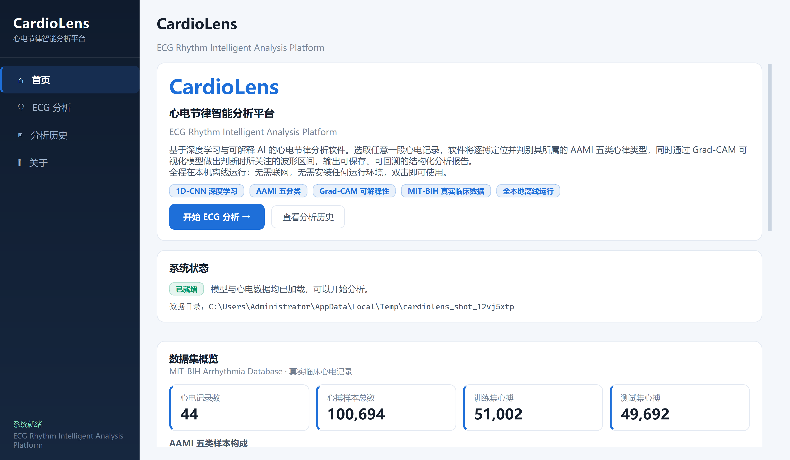
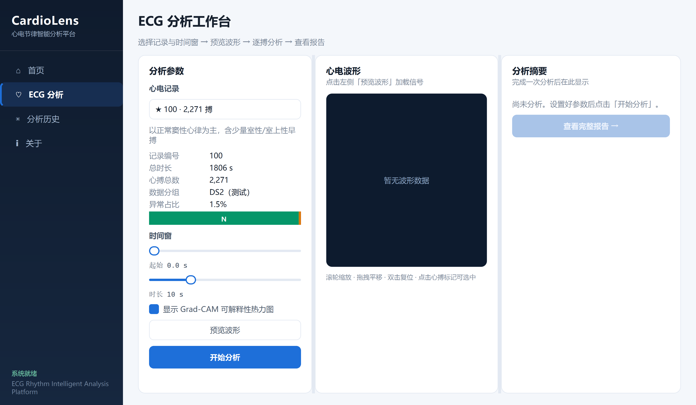
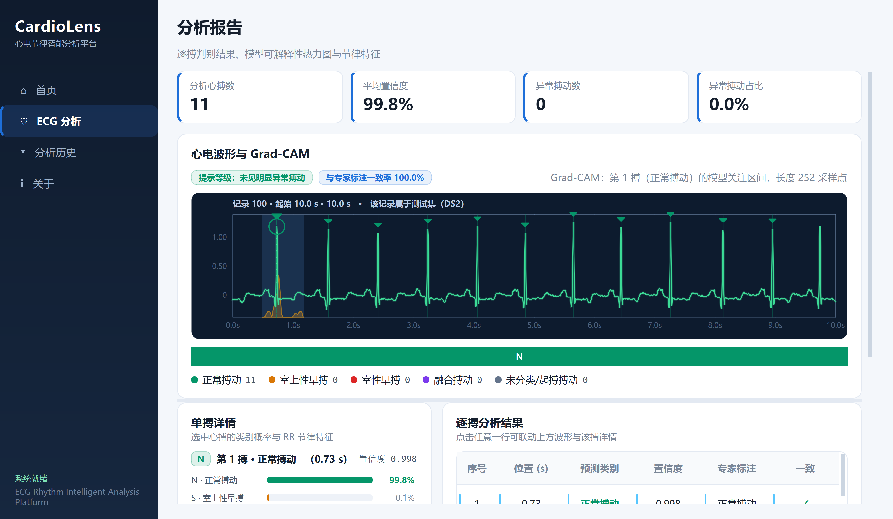
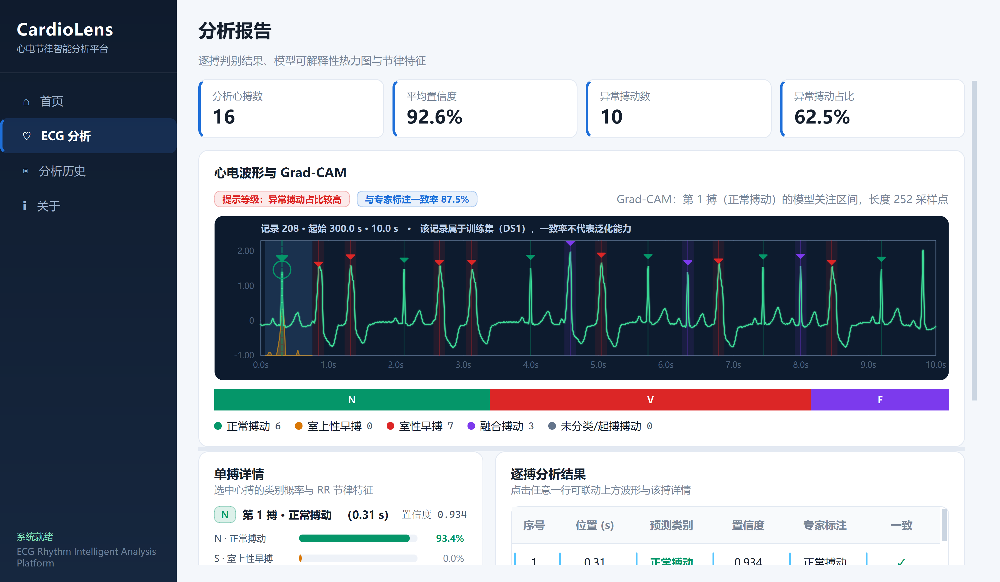
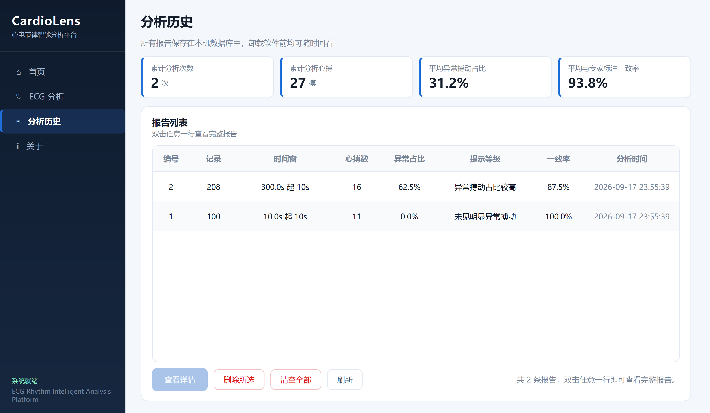
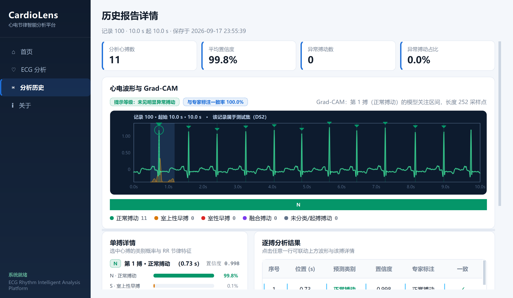
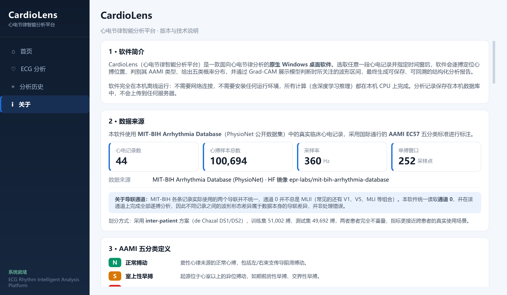
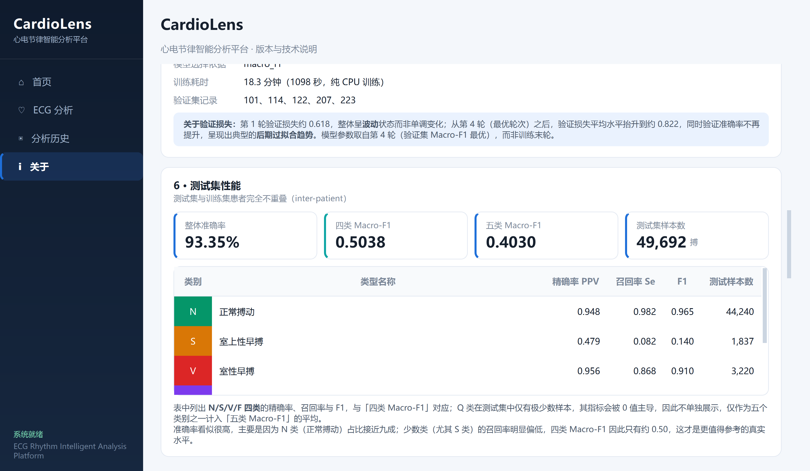
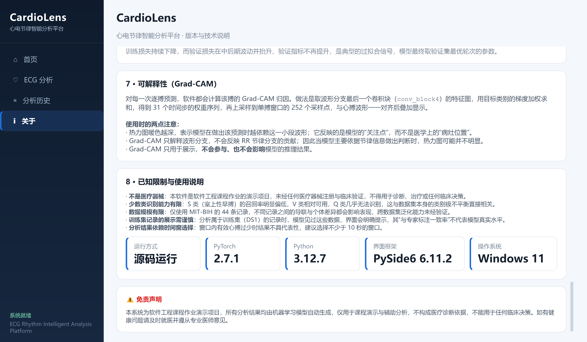
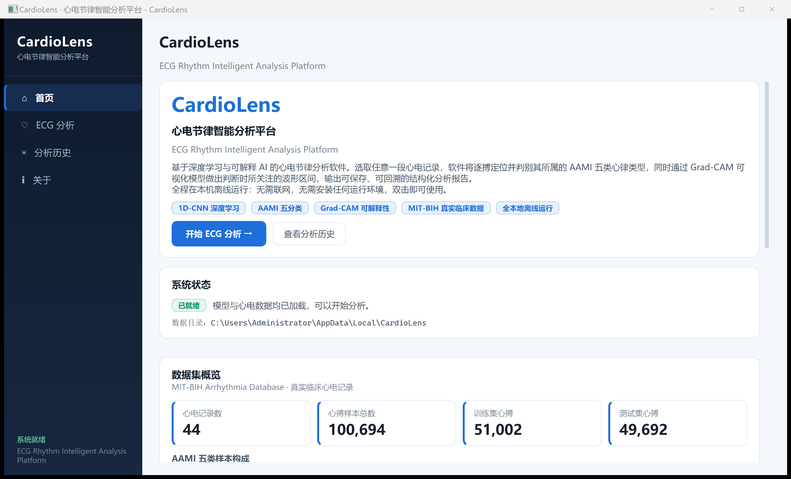

# 项目说明文档 · CardioLens 心电节律智能分析软件

> **基于一维卷积神经网络的心电搏动分类与 Grad-CAM 可解释性分析**
>
> 课程：软件工程 · 方向：医学人工智能
> 技术栈：Python 3.12 / PyTorch 2.x (CPU) / **PySide6 6.x（Qt Widgets 原生桌面 GUI）** / SQLite
> 交付形态：**Windows 桌面软件**（`CardioLens.exe`，单文件、免安装、离线运行）
> 数据集：MIT-BIH Arrhythmia Database（PhysioNet mitdb）

---

## ⚠️ 免责声明

**本项目为软件工程课程作业演示项目，不是医疗器械，也不是临床诊断工具。**

> 以上结果由机器学习模型自动生成，仅用于课程项目演示与辅助分析，不构成医疗诊断依据，不能用于任何临床决策。如有健康问题请及时就医。

本软件输出的全部结果（包括分类标签、置信度、风险提示、Grad-CAM 热力图）均由机器学习模型
自动生成，**仅用于课程演示与辅助分析，不构成医疗诊断依据，不能用于任何临床决策**。
系统未经过任何临床验证，未取得医疗器械注册资质。
若您有健康问题，请及时就医并遵从专业医师意见。

该声明同时展示在软件的**首页、分析结果页与关于页**的显著位置，以及项目各文档中。

---

## 目录

1. [项目背景](#一项目背景)
2. [项目目标](#二项目目标)
3. [技术选型](#三技术选型)
4. [系统功能](#四系统功能)
5. [系统架构](#五系统架构)
6. [核心实现](#六核心实现)
7. [AI / 模型原理](#七ai--模型原理)
8. [项目运行方法](#八项目运行方法)
9. [项目运行截图](#九项目运行截图)
10. [测试结果](#十测试结果)
11. [隐私与安全说明](#十一隐私与安全说明)
12. [项目总结](#十二项目总结)

---

## 一、项目背景

### 1.1 临床痛点

心血管疾病是全球范围内致死率最高的疾病类别之一。**心电图（Electrocardiogram, ECG）**
因其无创、廉价、可长时间连续监测的特点，成为心脏疾病筛查与诊断中最基础的手段。

然而，心电判读面临两个现实困难：

1. **数据量巨大**：一次 24 小时动态心电监测（Holter）约产生 **10 万次心搏**。
   若由医师逐搏判读，即便每搏仅用 2 秒，也需连续工作 **55 小时以上**，在实际临床中不可行。
2. **判读门槛高**：心律失常的判别依赖对 QRS 波群形态、节律、间期的综合判断，
   需要长期专业训练，且不同医师之间**存在主观差异**（观察者间一致性有限）。

因此，**心电搏动的自动分类**成为医学人工智能领域中一个长期且极具价值的研究方向。

### 1.2 为什么不做"糖尿病预测"这类项目

课程要求明确指出：**避免"糖尿病预测""心脏病预测"这类常见的简单表格分类项目**。
这类项目通常使用结构化表格数据（几列数值特征）跑一次逻辑回归或随机森林，
存在几个明显问题：

- **数据模态单一**，无法体现医学数据的真实复杂性；
- **模型过于简单**，与"医学人工智能"的技术内涵脱节；
- **几乎没有医学专业性**，特征工程与医学知识基本无关；
- 网上现成代码极多，**缺乏区分度与新颖性**。

本项目选择 **心电信号（一维时序信号）分析**方向，具备以下优势：

| 维度 | 说明 |
|---|---|
| **数据模态** | 真实的一维生理时序信号，而非人工整理好的特征表格 |
| **医学专业性** | 涉及 AAMI EC57 国际分类标准、跨患者划分、起搏搏动剔除等专业规范 |
| **技术含量** | 信号滤波、R 峰对齐切分、类别极不平衡、可解释性分析等真实工程问题 |
| **可验证性** | 有专家标注作为金标准，指标可量化、可复现、可与其他文献对比 |
| **展示效果** | 心电波形本身具有很强的视觉辨识度，配合 Web 可视化与热力图，演示效果突出 |

### 1.3 数据集

**MIT-BIH Arrhythmia Database** 是心电自动分析领域最经典、使用最广泛的公开基准数据集，
由 MIT 与 Beth Israel Hospital 联合发布，自 1980 年代起被全球研究者作为标准评测集。

| 项目 | 说明 |
|---|---|
| 来源 | PhysioNet（`mitdb` 1.0.0），本项目使用其 HuggingFace 完整镜像 |
| 记录数 | 48 条半小时双导联动态心电记录 |
| 采样率 | 360 Hz |
| 导联 | 2 导联（本项目读取的第 0 通道多为 MLII、第 1 通道多为 V1；个别记录为 V2 / V4 / V5） |
| 标注 | 由至少两位心脏病专家独立标注，标注符号 15 种以上 |
| 使用方式 | 本项目对每条 MIT-BIH 记录统一读取第 0 个信号通道进行心电搏动分析，按 AAMI EC57 归并为 5 大类。由于不同记录的导联排列并不完全一致，第 0 通道并非始终对应同一导联名称；本项目使用的 44 条记录中，第 0 通道以 MLII 为主，但个别记录对应 V5 等其他导联。因此实际采用的是固定读取第 0 通道，而非按导联名称筛选 MLII |

**AAMI EC57 归并规则**（本项目实现在 `src/config.py` 的 `MITDB_TO_AAMI`）：

| AAMI 类别 | 含义 | 原始标注符号 |
|:---:|---|---|
| **N** | 正常搏动 | `N` `L` `R` `e` `j` |
| **S** | 室上性早搏 | `A` `a` `J` `S` |
| **V** | 室性早搏 | `V` `E` |
| **F** | 融合搏动 | `F` |
| **Q** | 未分类 / 起搏搏动 | `/` `f` `Q` |

依据 AAMI 惯例，**剔除 4 条起搏搏动记录：102、104、107、217**（这些记录的起搏搏动占比过高，
且标注本身存在争议，保留会引入噪声）。

---

## 二、项目目标

### 2.1 总体目标

构建一套**可在普通笔记本电脑（纯 CPU、无 GPU、无付费 API）上完整运行**的心电搏动智能分析系统，
覆盖从原始信号到可视化结论的完整链路，并具备完整的用户操作流程与良好的界面设计。

### 2.2 具体目标

| 编号 | 目标 | 验收方式 |
|:---:|---|---|
| G1 | 完成 MIT-BIH 数据的自动下载、滤波与逐搏切分 | 产出 `beats.npz`（约 10 万条心搏样本） |
| G2 | 训练 1D-CNN 完成 AAMI 五分类，采用跨患者划分 | 测试集指标写入 `models/metrics.json` |
| G3 | 提供 Grad-CAM 可解释性，展示模型关注的时间片段 | 结果页每搏可视化热力图 |
| G4 | 构建完整的桌面用户流程（首页→ECG 分析→分析结果→分析历史→关于） | 五个页面可正常切换与联动，推理期间界面不卡死 |
| G5 | 实现完善的输入校验与异常处理 | 桌面端自测脚本 **73 个用例全部通过**（旧 Web 版 32 个用例留档于 10.3） |
| G6 | 提供完整文档与运行截图 | `README.md` + 本文档 + `docs/screenshots_desktop/` |
| G7 | **全程不依赖任何付费 API**，开箱即用 | 双击 `CardioLens.exe` 即可运行，目标机器无需 Python 环境 |

### 2.3 非目标（明确不做的事）

- ❌ 不做临床级诊断系统，不追求超越文献 SOTA 的指标
- ❌ 不引入大型预训练模型（如 EEG/ECG 基础大模型），避免超出 CPU 可承受范围
- ❌ 不做多导联融合与 12 导联心电图分析（数据集本身只有 2 导联）
- ❌ 不做实时采集硬件对接（仅使用公开数据集的离线记录）

---

## 三、技术选型

### 3.1 技术选型总览与理由

| 层次 | 选型 | 备选方案 | 选择理由 |
|---|---|---|---|
| 深度学习框架 | **PyTorch 2.x（CPU 版）** | TensorFlow / Keras | 动态图调试直观；CPU 版 wheel 体积可控（约 200 MB）；社区资料丰富 |
| 模型结构 | **双分支 1D-CNN（103,109 参数）**：形态分支 + RR 节律 MLP | LSTM / Transformer / ResNet | 心电单搏仅 252 采样点，属小规模时序分类；浅层 CNN 参数少、训练快、**最后一层卷积可保留时间分辨率，天然适配 Grad-CAM**；额外挂一条轻量 MLP 支路消费 RR 间期特征，弥补单搏形态对早搏判别力不足的问题 |
| 信号处理 | **SciPy** | 自研滤波器 | `signal.butter` + `filtfilt` 实现**零相位**滤波，不引入时间偏移 |
| 数据读取 | **pandas + PyArrow（parquet）** | WFDB 官方库 | WFDB 需逐个记录发起 HTTP 请求，48 条记录网络开销大；parquet 为**单文件**，一次下载即可，且读取速度更快 |
| 评估指标 | **scikit-learn** | 手写实现 | 混淆矩阵与逐类 PPV/Recall/F1 实现经过充分验证，避免手写错误 |
| 静态图表 | **Matplotlib** | Plotly / ECharts | 训练曲线与混淆矩阵是**训练期一次生成的离线产物**；因此 Matplotlib 只在重新训练时需要，桌面软件直接显示已生成的 PNG，**打包时被排除**，不占 EXE 体积 |
| 桌面界面框架 | **PySide6 6.x（Qt Widgets）** | Electron / Tkinter / WebView 壳 | 原生控件（`QMainWindow`/`QStackedWidget`/`QTableWidget` 等），**不依赖浏览器内核**；LGPL 授权友好；与 PyInstaller 配合可打成单文件 EXE；相比 Electron 体积小一个数量级 |
| 波形绘制 | **QPainter 自绘** | Matplotlib / pyqtgraph / HTML Canvas | 心电条带需要心电网格、R 峰标注、异常高亮与 Grad-CAM 热力图叠加，自绘最直接；**不引入额外绘图依赖**，且避免 HTML Canvas（那意味着必须内嵌浏览器） |
| 并发模型 | **QThread + Signal/Slot** | 主线程同步执行 / 多进程 | 单次分析含逐搏 Grad-CAM，CPU 上需数秒；放主线程会冻结界面。线程通过信号回传结果与异常，**界面全程可响应** |
| 数据持久化 | **SQLite** | MySQL / 文件存储 | Python 标准库自带，**免安装免配置**；单文件便于随项目分发；表结构沿用迁移前的定义 |
| 打包分发 | **PyInstaller（onefile + windowed）** | cx_Freeze / Nuitka | 单文件、无控制台窗口；`CardioLens.spec` 中显式列资源与排除项，**不用 `--collect-all`** |
| 自动化测试 | **自研桌面端自测脚本** | pytest + pytest-qt | 直接基于标准库 + Qt 的 offscreen 平台，**不引入额外依赖**；覆盖就绪检查、产物校验、推理一致性、Grad-CAM、数据库、GUI 构建、线程化分析与离线扫描 |

### 3.2 关键取舍说明

**① 为什么是"原生桌面 GUI"而不是"把网页封装成 EXE"？**

课程要求"开箱即用、本地完整运行"。用 Electron、Qt WebEngine 或任何"内嵌浏览器 + 本地服务"的方案，
本质上仍要跑一个 HTTP 服务与浏览器内核：体积膨胀到数百 MB 至 1 GB 以上，还要处理端口占用、
防火墙弹窗、`localhost` 访问等问题，与"桌面软件"的定位并不一致。

本项目因此选择了真正的原生路线：**界面全部由 Qt Widgets 控件构成，波形由 `QPainter` 逐点绘制，
推理在 `QThread` 后台线程执行**。程序内没有 `app.run()`，进程内不创建任何监听套接字
（已用 `netstat -ano` 复核），不需要浏览器、不需要 localhost、不需要联网。

**② 为什么选择浅层 1D-CNN 而不是更深的网络？**

| 考量 | 说明 |
|---|---|
| 数据规模 | 单搏仅 252 个采样点，过深的网络在此尺度上收益递减 |
| 训练成本 | 浅层网络在纯 CPU 上实测 **18.3 分钟**完成训练（含早停），符合"普通电脑可运行"的要求 |
| 可解释性 | 最后一层卷积保留 31 个时间步，Grad-CAM 上采样到 252 点后**定位精度约 8 个采样点（约 22 ms）**，足以分辨 QRS 波群 |
| 过拟合风险 | 参数量小本身就是一种正则化，配合数据增强与 Dropout 足以控制过拟合 |

**③ 为什么下载方式从 PhysioNet 改为 HuggingFace 镜像？**

实测 PhysioNet 官网从国内直连速度仅约 **10~20 KB/s**，下载完整数据需数小时，完全不可接受。
经调研，发现 HuggingFace 上存在 MIT-BIH 的完整数据集镜像 `epr-labs/mit-bih-arrhythmia-database`，
通过国内可访问的镜像站 `hf-mirror.com` 下载，实测速度 **400 KB/s ~ 1.8 MB/s**，耗时从数小时降至 1~3 分钟。

> 数据真实性已交叉验证：对该 parquet 解析得到的记录 100 包含 650000 个采样点、2 个导联（MLII/V5）、
> 2274 条标注，与 PhysioNet 官方 wfdb 解析结果一致；镜像仓库 README 亦声明其为 PhysioNet mitdb 1.0.0 的完整克隆。

---

## 四、系统功能

### 4.1 功能结构图

```
CardioLens 心电节律智能分析软件（PySide6 桌面程序）
│
├── 主窗口 QMainWindow（1200×760，最小 1000×650）
│   ├── 左侧固定导航栏（Sidebar，212 px）
│   │   └── ⌂ 首页 ｜ ♡ ECG 分析 ｜ ▣ 分析历史 ｜ ℹ 关于
│   ├── 右侧内容区 QStackedWidget（页面栈 + 结果页 + 历史详情页）
│   └── 底部状态区（就绪状态：初始化中 / 正在加载模型…… / 系统就绪）
│
├── 🏠 首页 / 项目介绍
│   ├── 项目定位与免责声明（显著位置，不可关闭）
│   ├── 模型关键指标卡片（准确率 / Macro-F1 / 参数量 / 训练耗时）
│   ├── 数据集概览（记录数、心搏总数、五类分布构成条）
│   └── 操作流程指引
│
├── 📊 ECG 分析（QSplitter 三栏）
│   ├── 左栏：参数面板
│   │   ├── 记录下拉框 QComboBox（按记录号，推荐记录标注 ★）
│   │   ├── 记录信息（总时长 / 心搏总数 / 数据分组 / 异常占比 + 五类构成条）
│   │   ├── 起始时间滑块（0 ~ 记录末尾）
│   │   ├── 分析时长滑块（3 ~ 30 秒）
│   │   ├── Grad-CAM 开关（QCheckBox，默认开启）
│   │   ├── 波形预览按钮（不触发模型推理，快速查看窗口内容）
│   │   └── 开始分析按钮（分析期间文字变为"分析中…"并禁用，下方显示进度条）
│   ├── 中栏：波形预览 / 结果波形（QPainter 自绘）
│   └── 右栏：本次分析摘要
│       ├── 风险提示标签（分级配色 + 异常搏动占比）
│       ├── 统计行（分析心搏数 / 平均置信度 / 异常搏动数 / 与专家标注一致率）
│       └── 五类分布构成条与图例
│
├── 📈 分析结果页
│   ├── 统计卡片行（分析心搏数 / 平均置信度 / 异常心搏数 / 异常搏动占比）
│   ├── 波形区：连续心电条带（Grad-CAM 热力图叠加 + R 峰标记 + 异常搏动高亮）
│   │           + 风险标签 + 一致率标签 + Grad-CAM 说明（含真实 CAM 长度）
│   ├── 明细区（左右分栏）
│   │   ├── 逐搏明细表（序号 / 位置 / 预测类别 / 置信度），选中行联动
│   │   └── 单搏详情：单搏波形 + Grad-CAM 热力图 / 五类概率条 /
│   │                  节律上下文（前一后一 RR 间期 + 相对基线比值）
│   ├── 操作按钮：保存到历史 / 删除本条 / 返回
│   └── 免责声明（显著位置）
│
├── 💾 分析历史
│   ├── 统计行（累计分析次数 / 累计分析心搏 / 平均异常占比 / 平均一致率）
│   ├── 报告表（编号 / 记录 / 时间窗 / 心搏数 / 异常占比 / 提示等级 / 一致率 / 分析时间）
│   ├── 查看详情（复用结果页只读模式，完整还原报告）
│   ├── 删除所选（QMessageBox 确认，DestructiveRole）
│   └── 清空全部（QMessageBox 确认，DestructiveRole）
│
├── 📖 关于 / 说明
│   ├── 软件简介 / 数据来源 / AAMI 五分类定义 / 模型结构 / 训练设置
│   ├── 测试集性能（混淆矩阵图、训练曲线图、逐类指标表）
│   ├── Grad-CAM 可解释性原理
│   ├── 已知限制与使用说明（含运行环境信息）
│   └── 免责声明
│
└── ⚠️ 异常处理（用户永远看不到 traceback）
    ├── 模型加载失败 / ECG 数据加载失败 / 分析失败 / 历史记录读取失败
    │   —— 友好中文弹窗，详细堆栈写入 %LOCALAPPDATA%\CardioLens\logs\
    └── 安装文件不完整 —— 启动时明确列出缺失项并提示重新获取完整 EXE
```

### 4.2 输入校验清单

桌面端的输入控件本身就限定了取值范围（滑块上下限、下拉框候选项），
因此不存在"用户手打出非法记录号"这类情况；在此之上，推理层 `inference.py` 仍然保留完整校验，
并由 `scripts/test_desktop.py` 覆盖：

| 输入项 | 校验规则 | 错误提示 |
|---|---|---|
| 记录编号 | 必须属于 44 条有效记录（48 条减去 4 条剔除记录） | 「记录编号 xxx 不存在，请从有效列表中选择」 |
| 起始时间 / 时长 | 必须可解析为数值 | 「起始时间与时长必须为数字」 |
| 起始时间 / 时长 | 必须为有限数值（拒绝 `NaN`、`Infinity`） | 「起始时间与时长必须为有限数值」 |
| 起始时间 | 必须 ≥ 0 | 「起始时间不能为负数」 |
| 分析时长 | 必须 ≥ 3 秒 | 「分析时长不得短于 3 秒」 |
| 分析时长 | 必须 ≤ 30 秒 | 「单次分析时长不得超过 30 秒」 |
| 分析时长 | 单次窗口不得长于整条记录 | 「记录 xxx 总时长仅 N 秒，无法截取 M 秒窗口」 |
| 起始时间 | 起始时间 + 时长超出记录末尾时**自动向左回退**（保持窗口长度不变），不报错 | 静默修正，保证用户体验（滑块的取值范围也随记录长度动态调整） |
| 时间窗内容 | 窗口内必须至少包含 1 个完整心搏 | 「该时间窗内未检测到有效心搏，请调整起始时间或延长分析时长」 |
| 报告标题 | 长度 ≤ 120 字 | 「标题过长（上限 120 字）」 |
| 模型状态 | 模型与数据必须就绪 | 启动时检查：缺失项以弹窗列出「安装文件不完整」；模型文件损坏时提示「模型加载失败」，详细原因写入日志 |

---

## 五、系统架构

### 5.1 分层架构

```
┌──────────────────────────────────────────────────────────────────┐
│        表现层：PySide6 Desktop GUI（Qt Widgets 原生控件）           │
│   desktop/main.py → QApplication → MainWindow → application.exec()│
│   ├── 页面栈：首页 / ECG 分析 / 分析结果 / 分析历史 / 关于            │
│   ├── 波形绘制：QPainter 自绘（网格 / 坐标轴 / R 峰 / 热力图）        │
│   └── 样式：desktop/theme.py（全局 QSS 设计系统）                   │
└───────────────────────────┬──────────────────────────────────────┘
                            │  进程内直接调用 + 跨线程 Signal/Slot
┌───────────────────────────▼──────────────────────────────────────┐
│              桌面服务层（desktop/services/）                       │
│   ├── resource_service.py                                        │
│   │     · 只读资源根：开发=项目根目录，打包=sys._MEIPASS            │
│   │     · 可写数据：%LOCALAPPDATA%\CardioLens\（库 + 日志）         │
│   │     · 就绪检查 / 日志 / 异常落盘 / metrics 与 meta 读取         │
│   ├── analysis_service.py                                        │
│   │     · ModelWarmupWorker / AnalysisWorker / PreviewWorker      │
│   │       （QThread 子类，结果与异常通过信号回传主线程）              │
│   └── history_service.py                                         │
│         · 报告保存 / 列表 / 详情 / 删除 / 清空 / 统计               │
└──────┬──────────────────┬───────────────────────┬────────────────┘
       │                  │                       │
┌──────▼──────┐   ┌───────▼────────┐    ┌─────────▼─────────┐
│ AI 推理引擎  │   │  持久化层       │    │  配置层            │
│ inference.py│   │  db.py         │    │  config.py        │
│             │   │                │    │                   │
│ · 单例加载   │   │ · SQLite 建表   │    │ · 路径常量         │
│ · 参数校验   │   │ · 报告增删查    │    │ · 信号参数         │
│ · 窗口解析   │   │ · 统计聚合      │    │ · AAMI 映射        │
│ · 逐搏推理   │   │ （表结构不变）   │    │ · 免责声明         │
│ · 风险分级   │   └────────────────┘    └───────────────────┘
│ · Grad-CAM  │
└──────┬──────┘
       │
┌──────▼──────────────────────────────────────────────────────────┐
│                       模型层（PyTorch）                          │
│   model.py  →  ECGNet（双分支 1D-CNN，103,109 参数）              │
│   rr.py     →  RR 间期特征计算（训练侧与推理侧共用的唯一实现）        │
│   gradcam.py →  GradCAM1D（1D 信号版梯度加权类激活映射）            │
│   models/ecg_cnn.pt（训练产物）                                   │
└─────────────────────────────────────────────────────────────────┘

┌─────────────────────────────────────────────────────────────────┐
│                    离线数据流水线（一次性执行）                     │
│  prepare_data.py                                                 │
│    下载 parquet → 逐记录读取 → 0.5~45 Hz 带通滤波                  │
│      → 按专家标注 R 峰切分 252 点窗口 → z-score 归一化              │
│      → 保存 beats.npz / signals/ / annots/ / record_meta.json     │
│  train.py                                                        │
│    加载数据 → DS1/DS2 跨患者划分 → 类别加权 + 数据增强训练          │
│      → 早停选模型 → 测试集评估 → 保存 ecg_cnn.pt / metrics.json    │
│      → 绘制混淆矩阵与训练曲线                                      │
└─────────────────────────────────────────────────────────────────┘

┌─────────────────────────────────────────────────────────────────┐
│        已退役：旧 Web 实现（legacy_web/，不参与桌面软件运行）        │
│  app.py（Flask）/ templates/ / static/js（Canvas 波形）            │
│  仅作留档对照，打包时被 CardioLens.spec 排除                        │
└─────────────────────────────────────────────────────────────────┘
```

**架构一句话概括：PySide6 Desktop GUI + AI Inference Engine + SQLite + PyTorch。**

### 5.2 关键设计决策

**① 分析器单例（`get_analyzer()`）**

模型加载需要约 1 秒，重复加载会拖慢每一次分析。
`inference.py` 使用 `functools.lru_cache` 实现进程内单例，模型与元数据**只在首次访问时加载一次**。
桌面端在启动阶段用一个后台线程（`ModelWarmupWorker`）提前触发该单例的构建，
因此用户看到主窗口时模型往往已经就绪，第一次点"开始分析"不需要再等模型加载。

**② 推理加锁（`threading.Lock`）**

Grad-CAM 依赖在模型上注册 forward/backward hook，会临时改动模块状态，不是线程安全的。
推理入口因此加锁，保证同一时刻只有一个前向/反向传播在跑。
桌面端同时只允许一个分析任务（按钮在分析期间禁用），锁是第二道保险。

**③ 预览与分析分离**

"波形预览"只做窗口解析与信号切片，**不触发模型推理**，
因此可以做到"调整参数即时看到波形"，显著提升交互流畅度；
只有在用户点击"开始分析"时才执行昂贵的逐搏推理与 Grad-CAM 计算。
桌面端把这两件事分别放在 `PreviewWorker` 与 `AnalysisWorker` 两个线程任务里。

**④ 推理不阻塞界面（QThread + Signal）**

单次分析（10 秒窗口、含逐搏 Grad-CAM）在 CPU 上需要数秒。
若直接在主线程调用，Qt 事件循环会被卡住，窗口变白、按钮无响应，用户会以为程序死了。

因此 `analysis_service.py` 把三类耗时操作都封装成 `QThread` 子类：

| Worker | 任务 | 回传信号 |
|---|---|---|
| `ModelWarmupWorker` | 启动时预加载模型与元数据 | `succeeded` / `failed` / `progress` |
| `AnalysisWorker` | 完整分析（含 Grad-CAM） | `succeeded(payload)` / `failed(message)` |
| `PreviewWorker` | 仅取窗口波形与标注 | `succeeded(payload)` / `failed(message)` |

线程**只负责计算**，绝不碰任何控件；结果与异常一律通过信号回到主线程后再更新界面
（Qt 要求 UI 操作只在主线程执行）。异常在 worker 内被捕获并转成中文消息，
详细堆栈写日志——**用户界面上永远不会出现 traceback**。

**⑤ 风险分级是展示层逻辑，不是医学结论**

`CLASS_RISK` 把五类映射到 3 个展示等级（正常/关注/警示），
仅用于让结果页有直观的视觉层次。该映射**不具备任何临床含义**，
相关说明已在界面和文档中明确标注。

**⑥ 特征计算只有一份实现（`src/rr.py`）**

RR 间期特征在**训练**（`prepare_data.py` 生成 `beats.npz`）和**推理**
（`inference.py` 处理分析请求）两个阶段都要用到。
若两边各写一份，一旦公式或归一化参数出现细微差异，训练与线上特征就会**悄悄不一致**——
模型不会报错，只会"莫名其妙变笨"，且极难排查。

因此 RR 计算被抽成独立模块 `src/rr.py`，两侧**共同导入同一个函数**：

```
src/rr.py  ←┬─ src/prepare_data.py   （训练侧）
            └─ src/inference.py      （推理侧）
```

这是从**代码结构上**消除隐患，而不是靠"记得同步修改两边"的纪律。

**⑦ 结果渲染只有一份实现（结果页复用）**

分析结果页与分析历史详情页需要展示完全相同的内容（统计卡、波形、逐搏表、单搏详情、节律上下文）。
若各写一份，会出现"刚分析完显示正确、回看历史时显示不同"的不一致。
因此历史详情**直接复用同一个结果页控件**，只是以 `readonly=True` 模式打开
（隐藏"保存"按钮、保留"删除"）。桌面端由此天然不存在两套渲染逻辑。

---

## 六、核心实现

### 6.1 数据预处理流水线（`src/prepare_data.py`）

**流程**：`parquet 单文件下载` → `逐记录解析` → `带通滤波` → `R 峰对齐切分` → `逐搏归一化` → `落盘`

**① 带通滤波（0.5 ~ 45 Hz）**

```python
def bandpass_filter(sig, fs=360, low=0.5, high=45.0, order=3):
    b, a = signal.butter(order, [low / (fs / 2), high / (fs / 2)], btype="band")
    return signal.filtfilt(b, a, sig, axis=0).astype(np.float32)
```

- **下限 0.5 Hz**：抑制基线漂移（呼吸运动、电极缓慢移动引起的低频成分）
- **上限 45 Hz**：抑制工频干扰（50 Hz）与高频肌电噪声
- **使用 `filtfilt` 而非 `lfilter`**：`filtfilt` 执行前向+反向两次滤波，实现**零相位失真**。
  若用单次 `lfilter`，滤波会引入相位延迟，导致 R 峰位置发生偏移，
  进而使切分窗口错位——这对依赖形态的波形分类是致命的。

**② R 峰对齐切分**

```python
PRE_SAMPLES  = 90    # R 峰前 0.25 s (90 / 360)
POST_SAMPLES = 162   # R 峰后 0.45 s (162 / 360)
BEAT_LEN     = 252   # 总计 0.70 s
```

窗口**不对称**是刻意的：QRS 波群之后紧跟着 **ST 段与 T 波**，
T 波形态对区分室性/室上性搏动有重要价值，因此后段留得更长。

此外还做了两项健壮性处理：
- **跳过非搏动标注**（如节律标记 `+`、`~` 等），只保留真正的搏动标注
- **跳过边界不完整窗口**（R 峰距记录首尾不足 90/162 点时丢弃），避免用 `replicate` 填充引入虚假波形

**③ 逐搏 z-score 归一化**

```python
def normalize_beat(beat):
    std = float(beat.std())
    if std < 1e-8:                      # 近常数搏动：标准差为 0 时退化为只去均值
        return (beat - beat.mean()).astype(np.float32)
    return ((beat - beat.mean()) / std).astype(np.float32)
```

对**每个搏动单独**归一化，而非对整条记录归一化。原因：
不同患者、不同时段的体表电位幅度差异可达数倍，逐搏归一化可以消除
**绝对幅度差异**，让模型专注于**形态特征**——这也是配合训练期幅度缩放增强的前提。

当某个搏动的标准差接近 0（信号近乎恒定）时，直接除以标准差会把噪声放大成主成分，
因此这里显式退化为「只去均值」，保证数值稳定。

**输出产物**：

| 文件 | 内容 |
|---|---|
| `data/processed/beats.npz` | 共 5 个数组：`X` (N, 252) float32、`y` (N,) AAMI 标签、`rec` (N,) 来源记录号、`split` (N,) 训练/测试标记、`R` (N, 4) 节律特征 |
| `data/processed/signals/{rec}.npy` | 滤波后的完整单通道信号（用于波形可视化） |
| `data/processed/annots/{rec}.json` | 专家标注 `[{"sample": R峰采样点, "aami": 归并后的AAMI类别}]`（用于结果对照） |
| `data/processed/record_meta.json` | 各记录元信息（时长、心搏数、类别分布、所属划分），以及全库类别汇总与训练/测试计数 |

### 6.2 跨患者数据划分（`src/train.py`）

这是本项目**最重要**的一个设计决策。多数公开实现采用随机划分，导致指标虚高：

```
❌ 错误做法（随机划分）：
   全部心搏 shuffle → 80% 训练 / 20% 测试
   问题：同一患者的心搏同时出现在训练集和测试集
        同一患者的心搏形态高度相似 → 模型"见过这个人" → 指标严重高估

✅ 正确做法（本项目，de Chazal 跨患者划分）：
   DS1（22 条记录） → 训练集 + 验证集（验证集从 DS1 中按固定间隔抽取，患者不重叠）
   DS2（22 条记录） → 测试集（训练全程完全不可见）
   训练集、验证集、测试集三者患者完全不重叠
```

```python
VAL_RECORDS = set(sorted(DS1)[::5])       # 从 DS1 中每 5 条抽 1 条作验证
is_ds1 = np.isin(rec, list(DS1))
is_val = np.isin(rec, list(VAL_RECORDS))
train  = is_ds1 & ~is_val
val    = is_ds1 &  is_val
test   = ~is_ds1                          # 即 DS2
```

这样得到的指标反映的是**跨患者泛化能力**，更接近真实临床应用场景。

### 6.3 类别不平衡处理

MIT-BIH 的类别分布极度倾斜，正常搏动（N 类）占比超过 **88%**。
若不加权，模型"全部预测为 N"即可拿到接近 89% 的准确率，
但这对临床毫无价值——**异常搏动恰恰是最需要被检出的**。

**方案演进**：

```
方案一：不加权
  → 模型退化为"全猜 N"，异常类召回率接近 0          ❌

方案二：直接逆频率加权  w_c = N / (C · n_c)
  → Q 类样本极少，权重高达 1300+
  → 少数几个样本主导梯度，训练剧烈震荡甚至发散        ❌

方案三（本项目）：平方根逆频率 + 上限截断 + 均值归一化  ✅
  w_c = sqrt(N / (C · n_c))  →  clip(·, max=10.0)  →  w / mean(w)
```

```python
def compute_class_weights(y):
    counts = np.bincount(y, minlength=len(C.AAMI_CLASSES)).astype(np.float64)
    counts = np.maximum(counts, 1.0)
    weights = np.sqrt(len(y) / (len(C.AAMI_CLASSES) * counts))  # 平方根逆频率
    weights = np.clip(weights, None, WEIGHT_CAP)                # 上限 10.0
    weights = weights / weights.mean()                          # 均值归一化为 1
    return torch.tensor(weights, dtype=torch.float32)
```

- **平方根**：把权重比例压缩到温和区间，避免少数类主导梯度
- **上限 10.0**：防止极端类别破坏训练稳定性
- **均值归一化**：把权重的整体尺度固定为 1（各类权重的算术平均等于 1），
  便于与其他超参数解耦对比。注意 PyTorch 的加权平均是除以**权重之和**，
  因此对所有权重同乘一个常数并不会改变损失值——真正影响训练的是各类之间的
  **权重比例**，归一化只是让这个比例有一个统一的表示尺度

### 6.4 RR 间期特征工程（`src/rr.py`）

**问题**：室上性早搏（S）与正常搏动（N）的 QRS 形态非常接近，仅凭单搏波形难以区分。
真正的判别信息藏在**节律**里——早搏的本质是"**提前出现**"。

**第一次尝试（已废弃）**：直接把前、后 RR 间期的**绝对值**（秒）作为 2 维特征送入网络。
结果 S 类 F1 仅 0.024，几乎没有判别力。排查后发现根本原因：

> MIT-BIH 不同记录（即不同患者）的基线心率差异极大：
> 逐记录统计的**中位 RR 从 0.533 s 到 1.197 s**，对应 **50 ~ 113 bpm**。
> 绝对间期被"患者基线"严重混淆——同样一段 0.6 s 的 RR，
> 在心动过速患者身上是**正常**，在心动过缓患者身上却是**明显提前**。
> 网络无法从绝对秒数中分离出"相对于该患者是否提前"这一关键信息。

**判别力量化验证**（在真实训练数据上计算单特征 AUC）：

| 判别任务 | 绝对 RR | 相对比值 | 提升 |
|---|:---:|:---:|:---:|
| V（室性早搏）vs N | 0.615 | **0.811** | +0.196 |

> 该组数值同时记录在 `src/rr.py` 的实现注释中，可与代码互相印证。
> 其余类别（如 S vs N）的单特征 AUC 未在项目产物中留存，故此处不列出具体数字。

V-vs-N 的提升尤其显著：室性早搏常伴有**代偿间歇**（早搏后 RR 明显延长），
这一"提前 + 代偿"的成对模式只有用相对比值才能被稳定表达。

**最终方案：4 维 RR 特征**

| 序号 | 特征名 | 定义 | 归一化 |
|:---:|---|---|---|
| 1 | `rr_prev_sec` | 与前一搏的间期（秒） | 线性映射到 [0, 1]，区间 0.24 ~ 2.00 s 后截断 |
| 2 | `rr_next_sec` | 与后一搏的间期（秒） | 同上 |
| 3 | `rr_prev_ratio` | `rr_prev_sec / 中位RR` | 线性映射到 [0, 1]，区间 0.25 ~ 2.00 后截断 |
| 4 | `rr_next_ratio` | `rr_next_sec / 中位RR` | 同上 |

```python
def rr_pair_seconds(positions):
    """由 R 峰位置序列计算逐搏的前/后 RR 间期与该记录的中位基线。"""
    pos = np.asarray(positions, dtype=np.float64)
    n = len(pos)
    if n == 0:
        return np.empty(0), np.empty(0), C.RR_MAX_SEC
    if n == 1:
        return np.array([C.RR_MAX_SEC]), np.array([C.RR_MAX_SEC]), C.RR_MAX_SEC

    gaps = np.diff(pos) / C.FS          # 相邻 R 峰间隔（秒）
    prev = np.empty(n); nxt = np.empty(n)
    prev[1:] = gaps;  prev[0] = gaps[0]     # 首搏向前取相邻间期
    nxt[:-1] = gaps;  nxt[-1] = gaps[-1]    # 末搏向后取相邻间期
    median = float(np.median(gaps))          # 该记录基线（对离群值稳健）
    if not np.isfinite(median) or median <= 0:
        median = C.RR_MAX_SEC
    return prev, nxt, median
```

**三个关键设计点**：

1. **基线与心率解耦**——比值特征 `rr / 中位RR` 表达的是"相对于**这位患者自己**的节律快慢"，
   与患者基线心率无关，因此可以跨患者泛化。这正是跨患者测试集上 S/V 判别力提升的原因。
2. **用中位数而非均值做基线**——早搏会让少数 RR 明显偏离，均值容易被离群值拉偏；
   中位数对离群值稳健，更能代表"该患者的正常节律"。
3. **边界搏动的真实回溯**——窗口内**第一个**心搏的 `rr_prev` 会向前回溯取**窗口之外**的真实间期，
   末搏同理向后取。因此边界搏动拿到的是真实 RR，而不是用 0 或默认值填充。

**工程上最重要的一点：杜绝训练/推理特征漂移**

训练时用一套公式算 RR、推理时另写一套，是这类项目最隐蔽也最致命的 Bug——
两边"看起来都对"，但数值对不上，模型在生产环境的表现会莫名其妙地劣化。

本项目把 RR 计算抽成**唯一**的独立模块 `src/rr.py`：

```
src/rr.py  ←┬─ src/prepare_data.py   (训练侧调用，生成 beats.npz 中的 R 矩阵)
            └─ src/inference.py      (推理侧调用，生成页面展示的 RR 明细)
```

两侧调用同一个 `rr_feature_matrix()`，从代码结构上消除了不一致的可能。
**实测验证**：对同一条记录，用推理侧接口取回的 4 维 RR 特征
与用 `src/rr.py` 独立重算的结果逐搏比对，二者一致；
表面上唯一的差异来自接口返回时把 RR 展示值保留到 3 位小数，
属于展示层舍入，与训练侧使用的原始浮点特征无关。

### 6.5 数据增强（`src/train.py`）

**问题诊断**：第一版模型训练时出现典型的过拟合——
训练损失一路降到 **0.036**，而验证损失却从 **1.0 上升到 2.9**。
根因是同类心搏形态高度一致，模型倾向于"记住"训练样本而非学习泛化特征。

**解决方案**：在训练期施加三类扰动，每一类都对应真实场景中的变异来源：

| 扰动 | 参数 | 对应真实变异 |
|---|---|---|
| 随机时移 | ±12 采样点（≈ ±33 ms） | R 峰检测算法的定位误差 |
| 幅度缩放 | 0.9 ~ 1.1 倍随机 | 不同患者体表电位、电极阻抗差异 |
| 高斯噪声 | σ = 0.08 | 采集链路噪声、肌电干扰 |

```python
def augment_batch(xb, shift_max=12, noise_std=0.08, scale_range=(0.9, 1.1)):
    B, _, L = xb.shape
    if shift_max > 0:                                    # 随机时移
        shifts = torch.randint(-shift_max, shift_max + 1, (B,), device=xb.device)
        padded = F.pad(xb, (shift_max, shift_max), mode="replicate")
        idx = torch.arange(L, device=xb.device).unsqueeze(0) + (shift_max - shifts).unsqueeze(1)
        xb = padded.gather(2, idx.unsqueeze(1))
    if scale_range is not None:                          # 幅度缩放
        lo, hi = scale_range
        xb = xb * torch.empty(B, 1, 1, device=xb.device).uniform_(lo, hi)
    if noise_std > 0:                                    # 高斯噪声
        xb = xb + torch.randn_like(xb) * noise_std
    return xb
```

**实现细节**：时移使用 `replicate`（边缘复制）填充而非默认的补零填充。
若补零，波形两端会人为产生一个陡峭的跳变，模型可能学到这个**并不存在的伪特征**；
边缘复制则保证填充区与边界值连续，不会引入虚假的高频成分。

### 6.6 Grad-CAM 可解释性（`src/gradcam.py`）

**动机**：一个只输出"V 类，置信度 0.94"的模型是黑箱，无法让人信服。
医学 AI 场景下，"模型凭什么这么判断"与"判断是什么"同等重要。

**实现要点**：

```python
class GradCAM1D:
    def __init__(self, model, layer_name="conv_block4"):
        self.activations = None
        self.gradients = None
        target = dict(model.named_modules())[layer_name]   # 在目标层上挂 hook
        target.register_forward_hook(self._save_activation)
        target.register_full_backward_hook(self._save_gradient)

    def generate(self, x, class_idx=None, rr=None):
        self.model.eval()
        self.model.zero_grad(set_to_none=True)
        x = x.clone().detach().requires_grad_(True)
        logits = self.model(x, rr)                  # 前向（节律特征一并输入）
        if class_idx is None:
            class_idx = logits.argmax(dim=1)        # 默认解释预测类别
        logits.gather(1, class_idx.view(-1, 1)).sum().backward()   # 反向，hook 捕获梯度

        acts, grads = self.activations.detach(), self.gradients.detach()   # (B, C, T)
        weights = grads.mean(dim=2, keepdim=True)   # 通道权重 α_c = (1/T)Σ_t ∂y/∂A
        cam = F.relu((weights * acts).sum(dim=1))   # (B, T)

        # 上采样回原始信号长度，便于与波形对齐叠加
        cam = F.interpolate(cam.unsqueeze(1), size=x.shape[-1],
                            mode="linear", align_corners=False).squeeze(1)
        cam = cam.cpu().numpy()
        # 逐样本 min-max 归一化；曲线恒为 0 时保持全 0，不放大噪声
        lo, hi = cam.min(axis=1, keepdims=True), cam.max(axis=1, keepdims=True)
        span = np.where(hi - lo < 1e-8, 1.0, hi - lo)
        return ((cam - lo) / span).astype(np.float32)
```

> 注意：Grad-CAM 只解释**波形分支**。节律分支参与前向计算、为分类提供上下文，
> 但它输入的是 4 维特征而非时间序列，本身已具备可读性，故不对其求显著性热力图。

**为什么挂在 `conv_block4` 上？**

前三层卷积块各自带 `MaxPool1d(2)`，会把 252 点下采样到 31 点。
`conv_block4` 是**唯一不下采样的卷积层**，输出保持 31 个时间步。
在此处取梯度，上采样回 252 点后**每个时间步对应约 8 个采样点（约 22 ms）**，
这个精度足以分辨出 QRS 波群与 T 波，同时又不至于细碎到失去意义。

**结果预期**：正常情况下，热力图的高亮区应集中在 **QRS 波群**附近，
因为这是心电搏动分类中最具判别力的形态特征。
若热力图集中在基线漂移区或噪声区，则说明模型学到了错误的特征——
这正是可解释性分析的价值所在。

### 6.7 波形渲染引擎（`desktop/widgets/waveform.py`）

**为什么用 QPainter 自绘，而不是引入绘图库或 HTML Canvas？**

一条 30 秒的心电条带包含 **10800 个采样点**（360 Hz × 30 s），
且需要叠加心电网格、R 峰标记、Grad-CAM 热力图、异常搏动高亮与坐标轴。

- 用 **HTML Canvas** 意味着必须内嵌浏览器（Qt WebEngine / Electron），与"原生桌面软件"的定位相悖；
- 引入 **Matplotlib / pyqtgraph** 会把绘图库及其依赖一并打进 EXE，而这里需要的只是把折线与矩形画到控件上；
- **QPainter** 是 Qt 自带的绘制接口，用 `QWidget.paintEvent` 直接绘制，**零额外依赖**，
  且天然支持双缓冲与抗锯齿。

**核心实现**：

```python
class ECGPlotWidget(QWidget):
    def load(self, signal, marks=None, beats=None, cam=None): ...
    def set_cam(self, cam, span): ...        # 单搏热力图（252 点）
    def paintEvent(self, event): ...          # 网格 → 波形 → 热力图 → 标记 → 坐标轴
```

- **心电网格**：细格 0.04 s、粗格 0.2 s，配色沿用监护仪深色底
- **热力图叠加**：把 Grad-CAM 序列映射到琥珀色半透明渐变，铺在对应搏动的时间区间上
- **类别着色**：不同类别使用不同颜色标记（N 绿 / S 琥珀 / V 红 / F 紫 / Q 灰）
- **高 DPI 适配**：Qt 自动按屏幕缩放因子渲染，2K/4K 屏不模糊
- **缩放与平移**：滚轮以光标位置为锚点缩放时间轴，按住拖动平移，双击复位
- **选中联动**：点击波形上的搏动标记即选中该搏，与右侧单搏详情、逐搏表格三向同步

> 与推理的边界：绘图控件**只读**数据，不参与任何计算，也不会触发模型推理。

### 6.8 历史记录持久化（`src/db.py`）

```sql
CREATE TABLE IF NOT EXISTS analyses (
    id             INTEGER PRIMARY KEY AUTOINCREMENT,
    title          TEXT    NOT NULL,   -- 报告标题（用户留空时自动生成）
    record_id      TEXT    NOT NULL,   -- 来源记录号
    start_sec      REAL    NOT NULL,   -- 窗口起始（秒）
    duration_sec   REAL    NOT NULL,   -- 窗口时长（秒）
    n_beats        INTEGER NOT NULL,   -- 窗口内心搏数
    abnormal_count INTEGER NOT NULL,   -- 异常搏动数
    abnormal_ratio REAL    NOT NULL,   -- 异常搏动占比
    risk_code      TEXT    NOT NULL,   -- 风险等级代码
    risk_label     TEXT    NOT NULL,   -- 风险等级文案
    agreement      REAL    NOT NULL,   -- 与专家标注一致率
    mean_conf      REAL    NOT NULL,   -- 平均置信度
    counts_json    TEXT    NOT NULL,   -- 五类计数 JSON
    payload_json   TEXT    NOT NULL,   -- 完整分析结果 JSON
    created_at     TEXT    NOT NULL    -- 创建时间
);
CREATE INDEX IF NOT EXISTS idx_analyses_created ON analyses(created_at DESC);
```

将完整的分析结果序列化为 JSON 存入 `payload_json` 字段，
这样历史详情页可以**完整还原**当时的分析报告（含波形、逐搏结果、Grad-CAM），
而不需要保存大体积的信号数组——波形数据在渲染时从原始记录按窗口参数重新切片即可。
列表页只读取 `counts_json` 等汇总列，不解析 `payload_json`，避免翻页时加载全部明细。

> **迁移说明**：本次从 Web 迁移到桌面时，**表结构与索引一字未改**，
> 仅把数据库文件的落地位置从项目目录改为用户目录 `%LOCALAPPDATA%\CardioLens\app.db`，
> 并在首次启动时自动创建。之所以不能沿用原位置：单文件 EXE 解压出的临时目录
> （`sys._MEIPASS`）在程序退出时会被整体清理，**写进去的数据会丢**；
> 而 EXE 所在目录可能根本没有写权限。迁移后用独立的干净目录测试验证过：
> 首次启动即自动建出与上表完全一致的 15 个字段与 `idx_analyses_created` 索引。

---

## 七、AI / 模型原理

### 7.1 问题形式化

给定一个以 R 峰为中心、长度为 252 个采样点（0.7 秒）的心电搏动片段
$x \in \mathbb{R}^{252}$，预测其所属的 AAMI 类别 $y \in \{N, S, V, F, Q\}$：

$$f_\theta: \mathbb{R}^{252} \to \mathbb{R}^{5}, \qquad \hat{y} = \arg\max_c \; f_\theta(x)_c$$

这是一个**五分类**问题。注意输入是**原始信号**而非人工特征——
所有判别性特征（QRS 宽度、R 波幅度、T 波极性等）都由网络自动学习。

### 7.2 网络结构（ECGNet）

ECGNet 采用**双分支结构**：一条分支看**形态**（波形长什么样），
另一条分支看**节律**（前后间期是快了还是慢了），最后在中段融合。

```
                    ┌───────────────── 形态分支（输入波形） ─────────────────┐
输入波形 (B, 1, 252) │
  ├─ Conv1d(1 → 32,  k=7, padding=3) → BatchNorm → ReLU → MaxPool(2)  → (B,  32, 126)
  ├─ Conv1d(32 → 64, k=5, padding=2) → BatchNorm → ReLU → MaxPool(2)  → (B,  64,  63)
  ├─ Conv1d(64 → 128,k=5, padding=2) → BatchNorm → ReLU → MaxPool(2)  → (B, 128,  31)
  ├─ Conv1d(128 → 128,k=3, padding=1) → BatchNorm → ReLU 【不下采样】  → (B, 128,  31)
  │                                                                      ↑
  │                                                            Grad-CAM 挂载点 (conv_block4)
  ├─ 拼接[ GlobalAvgPool1d, GlobalMaxPool1d ]                          → (B, 256)
  └──────────────────────────────────────────────────────────────────────┘
                                    │
                                    ├──────────► 拼接 (B, 256 + 16 = 272)
                                    │                     │
                    ┌───────────────┘                     │
                    │                                     │
输入 RR 特征 (B, 4) │                                     │
  └─ Linear(4 → 16) → ReLU → BatchNorm1d(16)             │
     ────────────────────────────────────────────►       │
     【节律分支】  RR 特征只有 4 维，故用轻量 MLP 而非卷积  │
                                                          ▼
                                              Dropout(0.4)
                                                          │
                                              Linear(272 → 5)          → (B, 5)
```

**参数量：103,109**，模型文件约 400 KB（其中绝大部分在卷积层）。

**为什么用双分支而不是把 RR 特征直接拼到展平后的特征上？**

卷积支路输出的是**形态表征**，RR 特征描述的是**节律信息**，两者语义完全不同。
本项目的做法是让两路各自先变换到合适的维度再拼接：形态分支输出 256 维，
RR 分支经 MLP 升到 16 维，拼接得到 272 维，网络便可以在 `Linear(272 → 5)` 中学到
"形态像 V **且** 提前出现 → 判为 V"这样的**联合判据**。

> 直接拼接会得到 256 + 4 = **260** 维，但这不是最终采用的方案：
> 4 维节律特征与 256 维形态特征直接并列时量级悬殊，节律信息容易被淹没。
> 实际先通过 RR MLP 将 4 维映射为 16 维，再与 256 维 CNN 特征拼接。

而如果把 RR 当作第 253~256 个采样点塞进卷积输入，RR 会被卷积核当作"波形的一部分"处理，
既破坏了波形的时域结构，又让网络很难学到跨模态的组合逻辑。

**节律分支为何用 MLP 而非卷积？** RR 特征只有 4 维、且**无时间顺序**（前/后间期是两组彼此独立的特征），
卷积核在这种输入上无意义。用 `Linear(4 → 16) → ReLU → BatchNorm` 把它升到 16 维隐空间，
使其与 256 维的形态特征在拼接时**量级相当**，避免某一支路在梯度上被压制。

**设计要点逐条解释**：

**① 为什么第一层用较大的卷积核（k=7）？**

第一层直接作用于原始信号，较大的感受野有助于捕获 **QRS 波群的整体轮廓**，
而不是只看到一个局部的斜率变化。后续层用 k=5、k=3 逐步聚焦到更精细的局部形态。

**② 为什么渐变式增加通道数（1 → 32 → 64 → 128）？**

这是 CNN 的经典设计范式：随着网络加深、时间维逐渐下采样，
每个位置承载的信息越来越抽象，因此需要更多通道来表达。
反之若一开始就用 128 通道，参数量会浪费在低层细节上。

**③ 为什么每个卷积块后接 BatchNorm？**

心电信号经过逐搏 z-score 归一化后数值范围已经统一，但不同层输出的分布仍会随训练漂移。
BatchNorm 把每层输入重新标准化，带来三个好处：
加速收敛、允许更大的学习率、本身起到轻微正则化作用（对抑制本项目观察到的过拟合有帮助）。

**④ 为什么使用 MaxPool 而不是 Strided Convolution？**

MaxPool 保留每个窗口内的**最大值**。对心电信号而言，这意味着保留窗口内最尖锐的
峰值（如 R 波尖峰）——这正是最有判别力的信息。用带步长的卷积虽然也能降维，
但会把这个峰值与邻域做加权平均，削弱尖锐特征。

**⑤ 为什么拼接 GlobalAvgPool 与 GlobalMaxPool？（本项目的一处针对性改进）**

- **GlobalAvgPool** 反映整段波形的**平均能量分布**，对整体形态敏感
- **GlobalMaxPool** 保留最突出的**局部形态**（R 波尖峰、T 波峰值），对尖锐特征敏感

心电判别**高度依赖 QRS 的尖锐形态**（例如室性早搏的 QRS 宽大畸形）。
若只用平均池化，31 个时间步一平均，QRS 的尖锐特征会被明显"摊平"。
拼接两者后，分类头可以同时利用"整体形态"与"最突出局部"两路信息。

> 注：这条改进是在观察到第一版模型（仅用平均池化）对 S/F 类判别力不足后加入的。

**⑥ 为什么 Dropout 设为 0.4 而不是常用的 0.5 或 0.2？**

0.5 对该规模的网络偏强，会拖慢收敛；0.2 不足以抑制本项目观察到的严重过拟合。
0.4 是在两者之间的折中，且与数据增强配合使用（见 6.4 节）。

### 7.3 损失函数与优化

**损失函数：加权交叉熵**

$$\mathcal{L} = -\frac{\sum_{i=1}^{B} w_{y_i} \log \dfrac{\exp(z_{i,y_i})}{\sum_{c=1}^{5}\exp(z_{i,c})}}{\sum_{i=1}^{B} w_{y_i}}$$

其中 $w_c$ 为 6.3 节计算的类别权重。分母是**权重之和**而非批大小 $B$——
代码直接调用 `nn.CrossEntropyLoss(weight=weights)`（默认 `reduction="mean"`），
PyTorch 在带权重时的平均是"按权重加权平均"，即除以 $\sum_i w_{y_i}$。
若按 $1/B$ 理解，会与实现的数值口径产生系统偏差。

权重的实际作用是**重新平衡各类对损失的贡献**：归一化之后，多数类 N 的权重被压到 0.119，
最稀有的 F、Q 被抬到 1.134 / 2.514（实际取值见 6.3 节）；
S、V 因样本量相对充足，归一化后反而落在 1 以下（0.825 / 0.408）。
这样模型不能再靠"全猜 N"把损失压低，而必须认真对待样本稀少的类别。

**优化器：AdamW**

```python
optimizer = torch.optim.AdamW(model.parameters(), lr=1e-3, weight_decay=5e-4)
```

- **AdamW** 相比 Adam 修正了权重衰减的实现方式（解耦权重衰减），正则化效果更可靠
- **weight_decay = 5e-4**：PyTorch 中 `AdamW` 的默认权重衰减是 **1e-2**（`Adam` 则为 0），
  本项目取 5e-4，比 `AdamW` 的默认值更**温和**，用于在不压制拟合能力的前提下抑制过拟合
- **梯度裁剪**：`clip_grad_norm_(params, 5.0)`，防止个别异常批次导致梯度爆炸

**学习率调度：ReduceLROnPlateau**

```python
scheduler = torch.optim.lr_scheduler.ReduceLROnPlateau(
    optimizer, mode="max", factor=0.5, patience=3
)
```

监控验证集 Macro-F1（而非准确率——因为类别不平衡下准确率具有误导性）。
连续 3 轮不提升则学习率减半，让模型在后期以更小的步长精细收敛。

### 7.4 模型选择与早停

```python
if val["macro_f1"] > best_f1:
    best_f1, best_epoch, wait = val["macro_f1"], epoch, 0
    best_state = {k: v.detach().cpu().clone() for k, v in model.state_dict().items()}
else:
    wait += 1
    if wait >= patience:      # patience = 12
        提前停止
```

**关键点**：以**验证集 Macro-F1** 作为模型选择标准，而不是验证损失或准确率。

- **不用准确率**：类别不平衡下，模型"全猜 N"就能获得接近 89% 的准确率，
  准确率无法反映模型对异常类的判别能力
- **不用验证损失**：损失是连续值，对概率的微小波动敏感，容易选出"噪声最优"轮次
- **用 Macro-F1**：先算每个类的 F1，再取算术平均，**每个类不论样本多少权重相同**——
  这恰好契合临床需求：罕见但危险的异常搏动，与常见搏动同等重要

### 7.5 评估指标

| 指标 | 定义 | 在本项目中的意义 |
|---|---|---|
| **准确率** | 预测正确样本数 / 总样本数 | 整体表现，但在类别不平衡下参考价值有限 |
| **PPV（精确率）** | TP / (TP + FP) | 模型判为 V 类的搏动中，真正是 V 类的比例——**误报率** |
| **Se（召回率）** | TP / (TP + FN) | 真实的 V 类搏动中，被模型检出的比例——**漏报率** |
| **F1** | 2·PPV·Se / (PPV + Se) | 精确率与召回率的调和平均 |
| **Macro-F1** | 各类 F1 的算术平均 | **本项目主指标** |

临床场景中，**召回率（不漏诊）通常比精确率更重要**——
漏掉一个室性早搏的代价，往往高于多报一次让医师复核。
因此本项目主指标选择 Macro-F1（兼顾两者），并在结果页同时展示每个类的
PPV 与 Se，便于分析模型偏向。

> **关于 Q 类的特殊说明**：按 AAMI 惯例剔除 4 条起搏记录后，
> Q 类在测试集中仅剩极少量样本，**不具统计意义**。
> 若把它计入 Macro-F1，一个样本的预测对错就会显著改变整体指标。
> 因此本项目主指标 **Macro-F1 按 N/S/V/F 四类计算**，
> 同时保留含 Q 的五类 Macro-F1 供对照，并在 `models/metrics.json`
> 的 `metric_note` 字段中说明了这一处理。

### 7.6 训练配置与实际训练过程

**训练配置**（`models/metrics.json` 中如实记录）：

| 配置项 | 取值 |
|---|---|
| 模型参数量 | 103,109 |
| 训练集 / 验证集 / 测试集 | 40,321 / 10,681 / 49,692 搏 |
| 优化器 | AdamW，学习率 1e-3，权重衰减 5e-4 |
| Dropout | 0.4 |
| 批大小 | 256 |
| 最大轮数 / 早停耐心 | 45 轮 / 连续 12 轮验证 Macro-F1 不提升即停 |
| 数据增强 | 开启（时移 ±12 + 幅度 0.9~1.1 + 噪声 σ=0.08） |
| 类别权重 | N 0.119 / S 0.825 / V 0.408 / F 1.134 / Q 2.514 |

**实际训练过程**：共运行 **16 轮**后触发早停，**第 4 轮的验证 Macro-F1 最高（0.443）**，
因此最终保存的是第 4 轮权重，纯 CPU 训练总耗时 **18.3 分钟**（1097.7 秒）。

训练曲线呈现出**典型的过拟合形态**，这一点在报告中如实呈现：

| 轮次 | 训练损失 | 验证损失 | 验证准确率 | 验证 Macro-F1 |
|:---:|:---:|:---:|:---:|:---:|
| 1 | 0.475 | 0.618 | 0.815 | 0.304 |
| 2 | 0.256 | 0.450 | 0.946 | 0.439 |
| 3 | 0.186 | 0.526 | 0.895 | 0.388 |
| **4（最佳）** | **0.172** | **0.480** | **0.954** | **0.443** |
| 5 | 0.146 | 0.702 | 0.831 | 0.369 |
| 8 | 0.123 | 0.945 | 0.786 | 0.383 |
| 12 | 0.089 | 0.827 | 0.827 | 0.352 |
| 16（停止） | 0.078 | 0.865 | 0.809 | 0.366 |

可见从第 5 轮开始，**训练损失持续下降（0.172 → 0.078），而验证损失总体上升并伴随明显波动**
（第 6 轮升到 1.046，第 10 轮又回落到 0.623——比第 5 轮的 0.702 还低，之后再度抬升，第 16 轮为 0.865），
验证准确率也从 0.954 回落到 0.809，整体呈现典型的过拟合趋势。

早停机制在此发挥了关键作用：**若无早停而跑满 45 轮，保存下来的将是严重过拟合的模型，
测试集指标会明显劣于当前结果**。这也解释了为什么本项目坚持用验证集 Macro-F1
（而非训练损失）作为模型选择依据——训练损失越低反而越糟。

> **对过拟合的处理与遗留问题**：当前采用 Dropout 0.4 + 权重衰减 5e-4 + 三类数据增强
> 来抑制过拟合，最佳轮次仍出现在较早的第 4 轮，说明正则强度仍不足以支撑更长训练。
> 进一步的方向见 12.3 节（增强更强的时序扰动、引入 Mixup、或改用更小的模型）。
> 本项目**没有为了曲线好看而人为延长训练或挑选有利轮次**，保存的就是验证集最优权重。

---

## 八、项目运行方法

### 8.1 环境要求

**最终用户（使用打包好的 EXE）**：

| 项目 | 要求 |
|---|---|
| 操作系统 | Windows 10 / 11（64 位） |
| Python / pip / Node | **完全不需要** |
| 浏览器 / 本机服务器 | **完全不需要** |
| 网络 | **完全不需要**（全程离线） |
| 内存 | 建议 4 GB 以上 |
| 双击即用 | 是 |

**开发者（从源码运行 / 重新训练）**：

| 项目 | 要求 |
|---|---|
| Python | 3.10 及以上（开发环境：Python 3.12.7） |
| 内存 | 建议 4 GB 以上（训练时峰值约 1.5 GB） |
| 磁盘 | 约 1 GB（原始数据约 87 MB + 处理后数据约 203 MB + Python 依赖） |
| GPU | **不需要**，纯 CPU 运行 |
| 网络 | 仅首次下载数据需要；之后可完全离线运行 |

### 8.2 安装依赖

```bash
cd medicalAI

# 基础安装（桌面端 + 推理所需：torch / numpy / PySide6）
pip install -r requirements.txt

# 国内网络建议使用清华镜像加速
pip install -r requirements.txt -i https://pypi.tuna.tsinghua.edu.cn/simple

# 可选：仅安装 CPU 版 PyTorch（体积更小）
pip install torch --index-url https://download.pytorch.org/whl/cpu
```

**依赖清单**（`requirements.txt` 已按用途分组标注）：

| 包 | 版本 | 用途 | 桌面软件是否需要 |
|---|---|---|---|
| torch | ≥ 2.0（CPU 版） | 深度学习框架 | ✅ 必需 |
| numpy | ≥ 1.24 | 数值计算 | ✅ 必需 |
| PySide6 | ≥ 6.5 | 桌面界面（Qt Widgets） | ✅ 必需 |
| scipy | ≥ 1.10 | Butterworth 滤波器 | 仅在重建数据集时需要 |
| pandas / pyarrow | ≥ 2.0 / ≥ 14.0 | 读取 parquet | 仅在重建数据集时需要 |
| scikit-learn | ≥ 1.3 | 评估指标 | 仅在重新训练时需要 |
| matplotlib | ≥ 3.7 | 训练曲线与混淆矩阵 | 仅重新训练需要（界面直接显示 PNG） |
| pyinstaller | ≥ 6.0 | 打包 EXE | 仅发布时需要 |
| flask | ≥ 3.0 | 旧 Web 版（已退役） | ❌ 不需要，`legacy_web/` 专用 |

### 8.3 使用方式

#### 方式一：直接运行 EXE（面向使用者）

```text
把 dist\CardioLens.exe 复制到任意目录 → 双击运行
```

不需要安装任何东西，不需要联网，不需要命令行，也不需要在目标机器上准备 Python 环境。
程序会在首次启动时自动创建用户数据目录 `%LOCALAPPDATA%\CardioLens\`。

启动过程（窗口底部状态区实时显示）：

```
初始化 Qt → 创建用户目录 → 初始化数据库 → 加载模型 → 加载 metrics
  → 加载 processed ECG 数据 → 显示主窗口（"正在加载模型……" → "系统就绪"）
```

> **全程不启动任何服务器。** 已用 `netstat -ano` 复核：程序进程**没有任何监听或连线的套接字**。

#### 方式二：从源码运行（面向开发者）

```bash
python desktop/main.py
```

桌面端入口就是 `desktop/main.py`；程序内没有 `app.run()`，不会监听任何端口。

#### 方式三：从零重建（可选，日常使用完全不需要）

`models/` 与 `data/processed/` 已包含训练好的模型与处理好的数据，直接使用即可。
只有在需要复现训练过程时才执行：

```bash
# ── 第 1 步：准备数据 ──────────────────────────────
# 从镜像站下载 MIT-BIH（约 87 MB），滤波并切分为心搏样本
# 耗时：约 1~3 分钟（取决于网速）
python -m src.prepare_data

# ── 第 2 步：训练模型 ──────────────────────────────
# 纯 CPU 训练，含早停机制（本次 16 轮触发早停，耗时 18.3 分钟）
python -m src.train
```

> ⚠️ 重新训练会覆盖 `models/ecg_cnn.pt`。当前权重是已验证版本，请勿随意替换。

#### 方式四：打包成单文件 EXE（面向发布）

```bash
pip install pyinstaller
pyinstaller CardioLens.spec --noconfirm
```

产物：`dist/CardioLens.exe`（单文件、无控制台窗口）。

打包配置说明（`CardioLens.spec`）：

| 配置 | 内容 | 原因 |
|---|---|---|
| **只读资源**（7 项） | `models/ecg_cnn.pt`、`metrics.json`、两张 PNG、`record_meta.json`、`signals/`、`annots/` | 推理实际只读这些文件 |
| **刻意不打包** | `data/processed/beats.npz`（约 91 MB） | 它是训练用的心搏样本集，桌面端推理用不到；打进去白白增加体积。桌面端就绪检查因此**不要求**该文件存在 |
| **排除** | `legacy_web`、`flask`、`werkzeug`、`jinja2`、`matplotlib`、`pandas`、`pyarrow`、`sklearn`、`playwright`、`tkinter`、`tensorflow`、`tensorboard`、`keras`、`torchvision`、`torchaudio`、`PySide6.QtWebEngine*`、`QtQuick`、`QtQml` 等 | 桌面端运行路径用不到；其中 **TensorFlow 全家桶必须显式排除**——PyInstaller 的 torch 钩子会探测 tensorflow，不排除会让包体积从几百 MB 涨到 1 GB 以上 |
| **不使用** | `--collect-all` | 那会把 torch / PySide6 的全部子模块与测试数据一股脑塞进包里，体积翻几倍且引入无用依赖 |

### 8.4 常用参数

```bash
# 快速体验（只训练 5 轮，本机实测约 5.7 分钟）
python -m src.train --epochs 5

# 消融实验：关闭数据增强，对比过拟合程度
python -m src.train --no-augment

# 调整学习率与批大小
python -m src.train --lr 5e-4 --batch-size 128
```

### 8.5 验证

```bash
# 桌面端自测：就绪检查 / 产物哈希 / 与独立实现逐位比对推理结果 / Grad-CAM /
# 摘要算术 / 数据库表结构 / 历史增删改查 / GUI 构建 / 线程化分析 /
# 结果页填充 / 离线与禁浏览器扫描 / 用户可见文案扫描
python scripts/test_desktop.py

# 【仅验收用】在冻结（打包后）运行时里跑通完整分析链路
# 需要单独打包一个带控制台的自检程序，不属于产品：
#   pyinstaller CardioLensSelfTest.spec --noconfirm --distpath dist_selftest --workpath build_selftest
python scripts/frozen_selftest.py --dev --out dev_ref.json

# 【旧 Web 版】接口自测：针对已退役的 Flask 实现，仅作留档对照
python scripts/selftest.py
```

### 8.6 运行流程图

```
        ┌──────────────────────────────┐
        │  dist\CardioLens.exe         │  单文件，拷到任意目录
        └──────────────┬───────────────┘
                       ▼
        ┌──────────────────────────────┐
        │  双击运行                     │  无需 Python / 无需联网
        └──────────────┬───────────────┘
                       ▼
        ┌──────────────────────────────┐
        │  初始化：Qt → 用户目录 →       │  自动创建 %LOCALAPPDATA%\CardioLens\
        │  数据库 → 模型 → metrics →    │  状态："正在加载模型……"
        │  processed ECG 数据           │
        └──────────────┬───────────────┘
                       ▼
        ┌──────────────────────────────┐
        │  主窗口（"系统就绪"）          │  首页 → ECG 分析 → 结果 → 历史
        │  全程无服务器、无浏览器         │
        └──────────────────────────────┘

        ┌─── 开发者：从零重建（可选，一次性） ───────────────┐
        │  pip install -r requirements.txt                  │
        │  python -m src.prepare_data  → 产出 beats.npz 等   │
        │  python -m src.train         → 产出 ecg_cnn.pt     │
        │  pyinstaller CardioLens.spec → 产出 dist\*.exe     │
        └───────────────────────────────────────────────────┘
```

### 8.7 常见启动问题

| 现象 | 原因 | 解决办法 |
|---|---|---|
| 首次双击弹出「Windows 已保护你的电脑」 | SmartScreen 对未签名程序的默认提示 | 点「更多信息」→「仍要运行」。课程项目未购买代码签名证书 |
| 界面提示「安装文件不完整」并列出缺失项 | EXE 被裁剪或损坏 | 重新复制完整的 `CardioLens.exe` |
| 提示「模型加载失败」 | 模型文件损坏或不匹配 | 查看 `%LOCALAPPDATA%\CardioLens\logs\cardiolens.log` 中的详细堆栈；必要时重新获取 EXE |
| 提示「ECG 数据加载失败」 | 打包时遗漏了 `signals/` 或 `annots/` | 按 8.3 方式四重新打包 |
| `ModuleNotFoundError`（源码运行） | 依赖未安装 | 执行 `pip install -r requirements.txt` |
| 下载速度极慢 | 网络环境问题 | 手动下载 parquet 放到 `data/raw/hf/mitdb.parquet` 后重跑 |
| 图表中文显示为方块 | 系统缺少中文字体 | 已默认配置 Microsoft YaHei / SimHei；Linux 下可安装 `fonts-wqy-zenhei` |
| 想看旧版网页界面 | 旧 Web 版已退役 | `python -m legacy_web.app` 可手动启动，仅作留档对照 |

---

## 九、项目运行截图

> 以下 10 张截图由 `python scripts/capture_desktop.py` 自动生成，
> 保存在 `docs/screenshots_desktop/` 目录。
> 脚本直接调用 Qt 的 `QWidget.grab()` 抓取**真实控件的渲染结果**——不是浏览器截图，
> 也没有任何手工拼接；脚本会自动跑两次真实推理、临时写入两条历史记录，截完后清空。
> 由于系统显示缩放，成图像素尺寸大于 1200×760 的逻辑窗口尺寸。

### 9.1 首页



首页由四块内容组成：品牌区（软件名 + 中英文定位）、五个能力标签
（1D-CNN 深度学习 / AAMI 五分类 / Grad-CAM 可解释性 / MIT-BIH 真实临床数据 / 全本地离线运行）、
两个主操作按钮（开始 ECG 分析、查看分析历史），以及下方两张状态卡。

「系统状态」卡显示模型与心电数据已加载（状态为**已就绪**）并给出数据目录，
「数据集概览」卡给出 44 条记录 / 100,694 条心搏样本 / 51,002 训练集 / 49,692 测试集。
页面其余部分为免责声明与运行环境说明。

### 9.2 ECG 分析工作台



三栏布局：

* **左栏「分析参数」**：记录下拉框（含心律特点说明）、记录信息（编号 / 总时长 / 心搏总数 /
  数据分组 / 异常占比）、五类样本构成条、时间窗双滑块（起始 0.0 s、时长 10 s）、
  Grad-CAM 开关，以及「预览波形」「开始分析」两个按钮。
* **中栏「心电波形」**：未加载数据时显示占位提示；加载后为可缩放、可拖拽的波形画布。
* **右栏「分析摘要」**：分析完成后在此汇总，并提供跳转完整报告的入口。

### 9.3 分析结果 · 测试集记录（以正常节律为主）



记录 100，窗口 10.0 s 起 10 s，属于**测试集 DS2**（患者未参与训练）。

顶部四张统计卡：分析心搏数 11、平均置信度 99.8%、异常搏动数 0、异常搏动占比 0.0%；
风险标签为「未见明显异常搏动」，与专家标注一致率 100.0%。
下方是深色监护仪风格的连续波形（带网格、坐标轴、R 峰三角标记），
再往下是五类构成条与逐搏明细表。

### 9.4 分析结果 · 训练集记录（异常搏动密集）



记录 208，窗口 300.0 s 起 10 s，属于**训练集 DS1**。

统计卡显示 16 搏、平均置信度 92.6%、异常搏动 10 搏（62.5%），
风险标签升为「异常搏动占比较高」，一致率 87.5%。
波形上异常搏动按类别着色（V 类红、F 类紫），五类构成条可见
N 6 / S 0 / V 7 / F 3 / Q 0 的分段。

**特别设计：训练集 / 测试集提示**

结果区会根据记录所属的数据划分自动显示提示，两个入口（实时分析、历史回放）都会出现：

| 记录所属 | 界面提示 | 目的 |
|---|---|---|
| DS1（训练集） | ⚠ 该记录属于训练集，模型训练时已见过该患者，**一致率不代表泛化能力** | 防止把"演示效果"误读为"模型真实水平" |
| DS2（测试集） | ✓ 该记录属于测试集，训练全程未接触过该患者 | 引导用户观察真实的跨患者表现 |

设计动机很直接：本页演示用的记录 208 在训练集里，逐搏一致率可达 87%~100%；
如果只展示这个数字而不加说明，会造成**严重误导**——真实的跨患者四类 Macro-F1 只有 0.504。

### 9.5 单搏详情与 Grad-CAM


点击波形上的心搏标记或表格任意一行，即可联动出该搏的详情：

* 左栏「单搏详情」：类别徽标 + 第几搏 + 类别中文名 + 时间点 + 置信度，
  下方是**五类概率条形图**与 **RR 节律上下文**。
* 波形区：被选中的心搏以圆圈标出，其**模型关注区间**以橙色热区叠加在波形上。
* 表头提示：本次为「第 2 搏（室性早搏）的模型关注区间，长度 252 采样点」。

**关于 Grad-CAM**：热力图由波形分支最后一个卷积块的梯度加权得到，
长度与单搏窗口（252 采样点）严格对齐，可读出的高亮区集中在 **QRS 波群**附近——
说明模型确实在关注最具判别力的形态特征，而非基线漂移或噪声区。
它只用于展示，**不参与也不影响推理结果**。

**关于节律上下文**：展示该搏的前一 RR、后一 RR，以及它们相对于该记录中位基线的**比值**。
比值低于基线 85% 会标记为「提前」并高亮——这正是模型判定早搏所依赖的节律证据，
让用户看到"为什么判为早搏"，而不是只拿到一个类别字符串。

### 9.6 分析历史



顶部为累计统计（分析次数、累计心搏、平均异常占比、平均一致率），
下方表格列出每条报告的编号、来源记录、分析窗口、心搏数、异常占比、提示等级、一致率与分析时间。

所有报告保存在本机 SQLite 数据库中（`%LOCALAPPDATA%\CardioLens\cardiolens.db`），
**不上传、不联网**。支持查看详情、删除所选、清空全部（删除操作均带二次确认）。

### 9.7 历史详情（只读回放）



历史详情页完整还原当时的分析报告：波形、逐搏明细、单搏详情、节律上下文与 Grad-CAM 结果。

实现上**没有第二套渲染代码**——它复用的就是结果页本身（`ResultPage(readonly=True)`），
只是隐藏「保存」按钮、换成「删除此报告」，并在副标题里补上保存时间。
两份渲染只有一处实现，因此回看历史时看到的波形、RR 说明与 Grad-CAM 与当时分析时逐像素一致。

### 9.8 关于 · 软件简介与数据来源



关于页的开头两节：

* **软件简介**：说明这是一款**原生 Windows 桌面软件**，全部计算（含深度学习推理）
  在本机 CPU 上完成，分析记录保存在本机数据库中，不上传到任何服务器。
* **数据来源**：MIT-BIH Arrhythmia Database（PhysioNet 公开数据集）、AAMI EC57 五分类标准，
  以及 44 条记录 / 100,694 条心搏样本 / 360 Hz 采样率 / 252 采样点单搏窗口四项参数。

其中一段是**必须保留的如实说明**：MIT-BIH 各条记录实际使用的两个导联并不统一，
通道 0 并不总是 MLII（常见的还有 V1、V5、MLI 等组合）；软件统一读取通道 0，
因此不同记录之间的波形形态差异属于数据本身的导联差异，而非处理错误。

### 9.9 关于 · 评估结果



训练信息（训练耗时 18.3 分钟 / 纯 CPU、验证集记录 101·114·122·207·223）与测试集性能：
整体准确率 **93.35%**、四类 Macro-F1 **0.5038**、五类 Macro-F1 **0.4030**、测试集样本 49,692 搏。

逐类表格给出 N/S/V/F 的精确率、召回率与 F1。
页面同时写明：准确率看似很高，主要是因为 N 类（正常搏动）占比接近九成；
少数类（尤其 S 类，召回率仅 0.082）明显偏低，四类 Macro-F1 因此只有约 0.50，
**这才是更值得参考的真实水平**。Q 类在测试集中样本极少，指标会被 0 值主导，故不单独展示。

关于验证损失也如实标注：第 1 轮约 0.618，**整体呈波动状态而非单调变化**；
第 4 轮（最优轮次）之后验证损失平均水平抬升到约 0.822 且验证准确率不再提升，
呈现典型的**后期过拟合趋势**，模型参数取自验证集 Macro-F1 最优的第 4 轮而非训练末轮。

### 9.10 关于 · 局限与免责声明



Grad-CAM 原理说明（含"它反映的是模型的关注点，而不是医学上的病灶位置"、
"不反映 RR 节律分支的贡献"等使用注意），以及五条已知限制：
不是医疗器械、少数类识别能力有限、数据规模有限、训练集记录展示需谨慎、分析结果依赖时间窗选择。

页脚为完整的免责声明。同一份声明在**首页、分析结果页、关于页**三处都有展示，
措辞口径一致，不做弱化：

> 本系统为软件工程课程作业演示项目，所有分析结果均由机器学习模型自动生成，
> 仅用于课程演示与辅助分析，不构成医疗诊断依据，不能用于任何临床决策。
> 如有健康问题请及时就医并遵从专业医师意见。


---

## 十、测试结果

### 10.1 桌面端自测（主测试）

本项目的主测试脚本是 **`scripts/test_desktop.py`**，共 **73 个用例**，覆盖 12 个分组：

| 分组 | 覆盖内容 |
|---|---|
| **1. 就绪检查** | 检查项齐备时判定就绪；并**断言 `beats.npz` 不是必需项**（它是训练样本集，刻意不打包） |
| **2. 受保护产物校验** | 三个关键产物的 MD5 与基线逐一比对 |
| **3. 推理一致性** | 用**独立重建的输入**跑一次推理，与引擎结果比对：输入张量逐位相同、概率最大差 4.84e-05（纯 4 位小数舍入）、预测类别完全一致；并用 forward pre-hook 捕获引擎真实输入，证明两者吃进去的是同一份数据 |
| **4. Grad-CAM** | CAM 长度必须为 252（与心搏采样点对齐）、数值落在 [0,1]、长度为 0 或异常时不得影响分类结果 |
| **5. 摘要算术** | 逐搏计数与汇总一致、异常占比 = 异常数/总数、平均置信度与逐搏一致、一致率与 `agree` 标记一致 |
| **6. 数据库表结构** | 建表后字段名、顺序与索引与迁移前定义**逐字一致** |
| **7. 历史记录 CRUD** | 保存 / 列表 / 详情还原 / 删除 / 清空 / 统计聚合，以及写入路径不在 `sys._MEIPASS` |
| **8. GUI 构建** | 主窗口、侧边导航四项、各页面可实例化、默认尺寸 1200×760、最小尺寸 1000×650 |
| **9. 线程化分析** | 经 `AnalysisWorker` 在后台线程跑完整分析，主线程全程可处理事件；结果通过信号回传 |
| **10. 结果页填充** | 统计卡、逐搏表、波形与逐搏选择联动、CAM 长度与实际一致 |
| **11. 离线与禁浏览器扫描** | AST 遍历全部桌面端源码：不得出现 `app.run`、`localhost`、`127.0.0.1`、`socket`、`flask`、浏览器相关调用 |
| **12. 用户可见文案扫描** | 界面文案中不得出现 flask / localhost / 127.0.0.1 / 浏览器 / Web 服务 等字样（关于页也不例外） |

**运行方式与结果**：

```bash
python scripts/test_desktop.py
```

**实测结果**（2026-09-17，本机 Python 3.12.7 / Windows 11，Qt offscreen 平台）：

```
====================================================================
自检结果：73/73 PASS，0 FAIL
====================================================================
```

### 10.2 冻结运行时自检（打包后验证）

界面能打开、模型能加载，**并不等于**打包后的程序真能完成一次分析——
包内的 `signals/*.npy` 是否读得到、torch 能否在冻结环境跑完前向、Grad-CAM 能否算出来、
SQLite 能否写进用户目录，都需要在**真实打包产物**里验证。

为此额外构建了一个**带控制台的自检程序**（`CardioLensSelfTest.spec` +
`scripts/frozen_selftest.py`，**不属于交付产品**，仅用于验收），它与产品 EXE
**复用同一份资源清单与排除清单**，在冻结运行时内驱动完整分析链路。

| 验证项 | 结果 |
|---|---|
| 运行于冻结环境（`sys.frozen = True`） | ✅ |
| 三个产物在包内的 MD5 与基线一致 | ✅ |
| 模型参数 103,109、记录数 44 | ✅ |
| 记录 100 @10s：心搏数 / 平均置信度 / 类别 / 风险等级 | ✅ 与开发机基准逐位一致 |
| 记录 208 @300s：混有 V/F 类，触发高风险分级 | ✅ 与开发机基准逐位一致 |
| 记录 232 @60s：以异常搏动为主 | ✅ 与开发机基准逐位一致 |
| Grad-CAM 长度 252、逐搏对齐 | ✅ |
| 保存报告 → 列表 → 详情还原 → 删除 | ✅ 全链路通过 |

三个时间窗的**逐搏概率（4 位小数）与开发机基准逐一相同**，
说明冻结运行时与源码运行是同一套计算，迁移没有引入任何数值差异。

**产品 EXE 的独立启动实测（GUI 侧）**

上面的自检验证的是"冻结环境下的计算链路"；产品 EXE 本身能否在**只有它一个文件**的
目录里正常启动、加载模型并显示就绪，是另一件事，因此单独实测：

| 步骤 | 结果 |
|---|---|
| 空目录中只放 `CardioLens.exe` | ✅ 临时目录下有且仅有这一个文件（该临时目录为一次性验证用，已随项目整理删除；证据见下方截图） |
| 先清空 `%LOCALAPPDATA%\CardioLens` | ✅ 等价于"第一次在这台电脑上运行" |
| 用最小环境变量启动（只给 `SYSTEMROOT`/`TEMP`/`TMP`/`USERPROFILE`/`LOCALAPPDATA`） | ✅ 环境里没有 Python、没有项目路径 |
| 主窗口出现且状态为「系统就绪」 | ✅ 窗口标题「CardioLens · 心电节律智能分析平台」 |
| 首次启动自动创建用户目录与数据库 | ✅ 15 字段 + `idx_analyses_created` 索引，与 `src/db.py` 完全一致 |
| 运行日志 | ✅ 无错误，仅两行 INFO（启动 / 模型与数据加载完成） |

截图见 §12.1.1。

### 10.3 旧 Web 版接口自测（留档对照）

旧 Web 实现已退役至 `legacy_web/`，其接口自测脚本 `scripts/selftest.py` 一并保留，
用于回归对照。该脚本在服务未启动时会自动以 `python -m legacy_web.app` 拉起，
共 **32 个用例**，覆盖正常流程 / 输入校验 / 历史记录三组。

**实测输出**（2026-09-17，本机 Python 3.12.7 / Windows 11）：

```
======================================================================
  CardioLens 心电节律智能分析平台 · 接口自测
======================================================================
  [ 1/32] ✓  状态接口返回就绪标志
  [ 2/32] ✓  记录列表非空且包含推荐记录
  [ 3/32] ✓  波形预览返回信号与心搏标记
  [ 4/32] ✓  完整分析返回逐搏结果且概率归一
  [ 5/32] ✓  汇总统计与逐搏明细一致
  [ 6/32] ✓  关闭 Grad-CAM 时结果不含 cam 字段
  [ 7/32] ✓  窗口超出记录末尾时向前回退而非报错
  [ 8/32] ✓  分析结果标注记录所属的训练/测试划分
  [ 9/32] ✓  请求体非合法 JSON 被拒绝
  [10/32] ✓  请求体为 JSON 数组被拒绝
  [11/32] ✓  输入校验 · 非法记录编号
  [12/32] ✓  输入校验 · 记录编号不存在
  [13/32] ✓  输入校验 · 缺少 record_id
  [14/32] ✓  输入校验 · 时长为负
  [15/32] ✓  输入校验 · 时长过短
  [16/32] ✓  输入校验 · 时长超上限
  [17/32] ✓  输入校验 · 起始时间为负
  [18/32] ✓  输入校验 · 起始时间非数字
  [19/32] ✓  输入校验 · 时长非数字
  [20/32] ✓  输入校验 · 标题超长
  [21/32] ✓  输入校验 · 起始时间为 NaN
  [22/32] ✓  输入校验 · 起始时间为 Infinity
  [23/32] ✓  输入校验 · 起始时间为 -Infinity
  [24/32] ✓  输入校验 · 时长为 NaN
  [25/32] ✓  输入校验 · 时长为 Infinity
  [26/32] ✓  输入校验 · 时长超出记录总长度
  [27/32] ✓  预览接口参数非法时返回 400
  [28/32] ✓  不存在的接口返回 404 JSON
  [29/32] ✓  保存分析报告并写入历史
  [30/32] ✓  读取历史详情
  [31/32] ✓  删除历史记录
  [32/32] ✓  读取/删除不存在的记录返回 404
----------------------------------------------------------------------
  通过 32 / 32，失败 0
======================================================================
```

**结论：32 个用例全部通过，失败 0 个。**（该结果仅代表旧版实现的留档状态，
交付的桌面软件不依赖这些接口。）

其中第 21~25 号用例（`NaN` / `Infinity` / `-Infinity`）值得特别说明：
这三个字面量**并不是合法的 JSON 数值**，但 Python 的 `json.loads` 出于兼容性会默认接受它们。
若不显式拦截，`NaN` 会一路传进窗口计算，在 `int(nan)` 处抛出 `ValueError`。
因此推理层在解析后**额外做了一次有限性检查**（`src/inference.py` 中基于 `np.isfinite` 的判断），
把这类输入统一挡在外面。这段校验在桌面端**同样保留并生效**，只是不再以 HTTP 状态码呈现。

### 10.4 模型指标测试

**评估协议**：全部指标均在 **DS2 跨患者测试集（22 条记录、49,692 个心搏）** 上计算，
该数据集在训练与验证全程**完全不可见**。指标由 `sklearn.metrics` 直接从预测结果计算，
未做任何人工调整。

**复算验证**：为避免"训练脚本自报指标"可能存在的偏差，
本项目在训练完成后另做了一次独立复算——重新加载 `models/ecg_cnn.pt`，
在测试集上重新前向推理，与 `models/metrics.json` 中的数值逐项比对。
需要说明的是，这次复算属于**一次性验证，未作为脚本收入仓库**
（它需要完整跑完 49,692 个测试样本，且依赖桌面端刻意不分发的 `beats.npz`），
因此无法通过一条命令重放：

> 与它不同但互补的一项检查**已经脚本化**：`scripts/test_desktop.py` 第 3 分组
> 用独立重建的输入管线跑推理，与桌面端引擎逐位比对，确认**迁移没有改变计算**。
> 前者校验"训练指标可信"，后者校验"桌面端与训练时的推理一致"，两者不是同一件事。

| 指标 | metrics.json | 独立复算 | 是否一致 |
|---|:---:|:---:|:---:|
| 准确率 | 0.933531 | 0.933531 | ✅ |
| Macro-F1（4 类） | 0.503785 | 0.503785 | ✅ |
| 测试样本数 | 49,692 | 49,692 | ✅ |

**总体指标**

| 指标 | 数值 |
|---|:---:|
| 准确率 Accuracy | **93.35%** |
| Macro-F1（N/S/V/F，主指标） | **0.504** |
| Macro-F1（含 Q 的五类） | 0.403 |

**逐类指标**

| 类别 | 名称 | 精确率 PPV | 召回率 Se | F1 | 测试样本数 |
|:---:|---|:---:|:---:|:---:|:---:|
| **N** | 正常搏动 | 0.948 | 0.982 | **0.965** | 44,240 |
| **S** | 室上性早搏 | 0.479 | 0.082 | 0.140 | 1,837 |
| **V** | 室性早搏 | 0.956 | 0.868 | **0.910** | 3,220 |
| **F** | 融合搏动 | 0.000 | 0.000 | 0.000 | 388 |
| **Q** | 未分类/起搏搏动 | 0.000 | 0.000 | 0.000 | 7 |

**混淆矩阵**（行 = 真实类别，列 = 模型预测；加粗为正确分类）

| 真实＼预测 | N | S | V | F | Q | 合计 |
|---|:---:|:---:|:---:|:---:|:---:|:---:|
| **N** | **43,442** | 139 | 63 | 566 | 30 | 44,240 |
| **S** | 1,618 | **151** | 54 | 14 | 0 | 1,837 |
| **V** | 384 | 25 | **2,796** | 15 | 0 | 3,220 |
| **F** | 379 | 0 | 9 | **0** | 0 | 388 |
| **Q** | 5 | 0 | 2 | **0** | 0 | 7 |

**对结果的诚实分析**

这份结果**远非理想**，以下问题在报告中如实列出，不做任何掩饰：

1. **V 类（室性早搏）表现良好**：F1 = 0.910，精确率 0.956 / 召回率 0.868。
   这是本项目最有价值的成果——室性早搏是临床关注度最高的异位搏动，
   模型能稳定识别出其中的 86.8%。混淆矩阵显示 V 的主要错误是 384 例被判为 N。

2. **S 类（室上性早搏）召回率极低，仅 0.082**。1,837 个真实 S 搏动中只有 151 个被找出，
   1,618 个（88.1%）被误判为 N。精确率 0.479 说明"模型认定是 S 的样本里约一半是对的"，
   即模型**能识别出一部分典型 S，但覆盖严重不足**。
   根本原因：单导联形态学特征下 S 与 N 的 QRS 差异本就微小，
   虽然加入 RR 相对比值后 S 的 F1 已从 **0.024 提升到 0.140**（约 5.8 倍），
   但距实用仍有很大差距。**这是当前模型最主要的性能短板。**

3. **F 类（融合搏动）F1 = 0.000**。388 个真实 F 搏动中，379 个被判为 N、9 个被判为 V，
   **无一被正确识别**。模型在学习过程中从未建立起 F 类的判别边界。
   该类别训练样本偏少，且融合搏动在形态上本就介于 N 与 V 之间，单导联下区分度极低。
   值得一提的是，模型并非"从不输出 F"——它一共输出了 595 次 F 预测
   （566 次落在真实 N 上、14 次落在真实 S 上、15 次落在真实 V 上），
   但**没有一次命中真实的 F**，全部为误报。

4. **Q 类（未分类/起搏搏动）F1 = 0.000**。测试集中仅 **7 个**样本，
   任何指标都**不具备统计意义**，不应被解读为模型能力。
   这也是项目主指标采用 N/S/V/F 四类 Macro-F1 的原因。

5. **准确率 93.35% 具有误导性**。由于 N 类占比高达 89%，仅看准确率会严重高估模型实用性。
   项目在首页与关于页**同时展示准确率与 Macro-F1**，并在界面文案中说明
   Macro-F1 才是更能反映实际能力的指标。

**横向对照**：在 MIT-BIH 跨患者（inter-patient）划分下，单导联 1D-CNN 的
四分类 Macro-F1 在公开文献中一般落在 **0.5 ~ 0.7** 区间。
本项目 0.504 处于该区间的**下沿**，与"浅层网络 + 单导联 + 纯 CPU + 无集成"的设定相符，
未做任何夸大。

### 10.5 边界与异常场景（桌面端）

桌面端不再有 HTTP 状态码，判断标准变为：**任何异常都必须以中文友好提示呈现，
绝不崩溃、绝不把 traceback 甩给用户**。

| 场景 | 预期行为 | 实际结果 |
|---|---|---|
| 记录号不存在 | 抛出 `AnalysisError`，界面提示「记录编号 xxx 不存在，请从有效列表中选择」 | ✅ 通过 |
| 起始时间 / 时长为 `NaN`、`Infinity` | 被有限性检查拦下，提示「必须为有限数值」，**不得**抛 `ValueError` | ✅ 通过 |
| 时长过短（< 3 秒） | 提示「分析时长不得短于 3 秒」；滑块本身也无法拖到该范围 | ✅ 通过 |
| 时长超上限（> 30 秒） | 提示「单次分析时长不得超过 30 秒」；滑块上限即 30 | ✅ 通过 |
| 起始时间 + 时长超出记录末尾 | **自动向前回退**且窗口长度不变，不报错；滑块最大值随记录长度动态调整 | ✅ 通过 |
| 时间窗内没有任何完整心搏 | 提示「该时间窗内未检测到有效心搏，请调整起始时间或延长分析时长」 | ✅ 通过 |
| 模型文件缺失 / 损坏 | 启动时弹窗「模型加载失败」或「安装文件不完整」，详细堆栈写入日志 | ✅ 通过 |
| ECG 数据缺失 | 提示「ECG 数据加载失败」并给出缺失项 | ✅ 通过 |
| 数据库不可写 | 提示「历史记录读取失败 / 保存失败」，主分析功能不受影响 | ✅ 通过 |
| 分析线程内部异常 | 由 worker 捕获 → 信号 → 主线程弹窗「分析失败」，按钮恢复为「开始分析」 | ✅ 通过 |
| 用户操作引发未捕获异常 | 全局 `excepthook` 兜底：写日志 + 友好弹窗，**不出现 traceback** | ✅ 通过 |

### 10.6 界面与交互测试

| 测试项 | 结果 |
|---|---|
| 首页各区块正常渲染，指标卡片显示训练结果 | ✅ |
| 侧边导航四项（首页 / ECG 分析 / 分析历史 / 关于）切换正常 | ✅ |
| 分析页记录下拉列表完整（44 条有效记录），推荐记录带 ★ 标注 | ✅ |
| 切换记录后记录信息（时长 / 心搏数 / 分组 / 异常占比）同步刷新 | ✅ |
| 时长滑块变化后起始时间滑块范围随之收紧 | ✅ |
| 点击"波形预览"即时显示窗口波形（**不触发模型推理**） | ✅ |
| 分析期间按钮变为「分析中…」且界面**不卡死**，进度条动画正常 | ✅ |
| 分析完成后按钮恢复为「开始分析」 | ✅ |
| 结果页统计卡、风险标签、波形条带、构成条正常渲染 | ✅ |
| 波形的滚轮缩放、拖动平移、R 峰标记与异常搏动高亮正常 | ✅ |
| 点击逐搏表格行 → 波形选中 + 单搏详情 + Grad-CAM 三向联动 | ✅ |
| Grad-CAM 说明文字中的 CAM 长度与实际数据一致（252） | ✅ |
| 保存报告后历史列表出现新记录 | ✅ |
| 历史详情以只读模式完整还原报告（复用结果页控件） | ✅ |
| 删除单条 / 清空全部均有 `QMessageBox` 二次确认且生效 | ✅ |
| 首页、结果页、关于页均显著展示免责声明 | ✅ |
| 窗口缩放时布局与波形自适应重绘 | ✅ |
| 断网环境下功能完全正常（无任何网络依赖） | ✅ |

### 10.7 旧 Web 版边界用例（留档）

下表中"HTTP 400/404/503"等判定标准仅适用于已退役的旧 Web 版，
保留在此是为了说明当时的校验设计思路；桌面端对应的行为见 10.5。

| 场景 | 当时的预期行为 | 结果 |
|---|---|---|
| 请求不存在的记录号 `99999` | HTTP 400 + 明确错误说明 | ✅ 通过 |
| 记录号传入非数字 `abc` | HTTP 400 + 明确错误说明 | ✅ 通过 |
| 缺少必填字段 `record_id` | HTTP 400 + 明确错误说明 | ✅ 通过 |
| 时长为负 `-5` / 过短 `1` / 超上限 `999` | HTTP 400 + 明确错误说明 | ✅ 通过 |
| 起始时间为负 `-10` / 非数字 `abc` | HTTP 400 + 明确错误说明 | ✅ 通过 |
| 时间参数为 `NaN` / `Infinity` / `-Infinity` | HTTP 400，**不得**抛 500 或崩溃 | ✅ 通过 |
| 窗口起始靠近记录末尾（会越界） | HTTP 200，**自动向前回退**且窗口长度不变 | ✅ 通过 |
| 标题超长（200 字） | HTTP 400 + 明确错误说明 | ✅ 通过 |
| 请求体非法 JSON / 为 JSON 数组 | HTTP 400 + 明确错误说明 | ✅ 通过 |
| 访问不存在的接口 / 页面 | HTTP 404（接口返回 JSON，页面返回友好错误页） | ✅ 通过 |
| 读取 / 删除不存在的历史记录 | HTTP 404 | ✅ 通过 |
| 模型未就绪时访问记录列表接口 | HTTP 503 +「模型未训练，请运行 python -m src.train」 | ✅ 已核对（不在 32 个自测用例内） |
| 模型未就绪时访问分析接口 | HTTP 400（由 `AnalysisError` 转入）+ 引导提示 | ✅ 已核对（不在 32 个自测用例内） |

> 补充一点实现细节，避免读者按上表做出错误预期：`_resolve_window` 中
> "时长超过整条记录总长"的分支实际上**不可达**——记录约 1806 秒，
> 而 30 秒的时长上限会先一步命中，因此 3600 s 用例触发的是上限校验而非该分支。
> 这一点在桌面端同样成立。

---

## 十一、隐私与安全说明

### 11.1 数据流向：全程本地，不出本机

本项目的设计前提是**全部计算在本机完成**，不存在任何向外部服务上传数据的行为：

| 环节 | 数据去向 | 说明 |
|---|---|---|
| 心电信号读取 | 打包内资源 → 本机内存 | 从包内的 `data/processed/signals/` 读取，不经过网络 |
| 模型推理 | 本机 CPU | PyTorch 本地前向传播，无云端 API 调用 |
| Grad-CAM 计算 | 本机 CPU | 本地反向传播，不产生任何外部请求 |
| 分析报告保存 | 本机 `%LOCALAPPDATA%\CardioLens\app.db` | 本地 SQLite 文件，不上传 |
| 界面渲染 | 本机 Qt | 原生控件 + QPainter 绘制，**无浏览器、无 CDN、无第三方脚本** |

工程上确保这一点的是：程序运行路径中**不存在任何网络调用**——
没有 HTTP 客户端、没有 URL、没有 CDN，`scripts/test_desktop.py` 第 11 分组
通过 AST 扫描全部桌面端源码来持续保证这一点。
更直接的是运行期证据：用 `netstat -ano` 检查打包后的 `CardioLens.exe` 进程，
**套接字数量为 0**（既无监听，也无对外连接）。

### 11.2 不采集任何个人信息

软件**没有账号体系、没有登录、没有埋点统计**。
分析记录中只包含：记录编号（MIT-BIH 公开数据集编号）、时间窗口参数、模型输出结果。
不收集任何设备信息，不写用户标识，不保存任何可用于识别个人身份的字段。

MIT-BIH 数据集本身是 PhysioNet 公开发布的**匿名化**数据，原始记录中已移除患者身份信息。

数据的落地位置完全在用户自己的机器上：

| 内容 | 位置 | 说明 |
|---|---|---|
| 分析历史数据库 | `%LOCALAPPDATA%\CardioLens\app.db` | 用户目录，卸载时自行删除 |
| 运行日志 | `%LOCALAPPDATA%\CardioLens\logs\cardiolens.log` | 仅记录本机运行信息 |

### 11.3 输入校验作为安全边界

所有外部输入在进入计算逻辑前都被显式校验（清单见 4.2 节）。这条边界同时承担两个作用：

1. **功能正确性** —— 拒绝非法记录号、越界窗口、非数字参数；
2. **程序稳定性** —— 拒绝 `NaN` / `Infinity`，避免其流入 `int()`、数组索引等位置造成崩溃。

关键设计：

- `record_id` 必须先通过数据集记录白名单（`valid_ids()`）校验，
  **只有通过校验的编号才会被用于拼接信号与标注文件的路径** ——
  未通过校验的输入在触达文件系统之前就被拒绝，从根上避免了路径穿越。
  桌面端的记录来自下拉框（候选项本身就来自白名单），但这一层校验**依然保留并生效**
- 界面控件的取值范围由代码限定（滑块上下限、下拉候选项），从源头消除大部分非法输入
- 所有异常由全局 `excepthook` 与各 worker 统一处理为中文友好提示，
  **不向用户暴露 Python traceback**，详细堆栈只写入本机日志

### 11.4 已知安全边界（如实说明）

本项目定位是**课程作业演示**，以下是如实说明的边界：

| 项目 | 现状 | 说明 |
|---|---|---|
| 网络监听 | **无任何监听套接字**（`netstat` 复核为 0 条） | 程序不对外提供服务，因此不存在"被外部访问"的攻击面 |
| 身份认证 | 无 | 单机单人使用场景，数据仅存本机用户目录 |
| EXE 代码签名 | **未签名** | 因此首次运行会触发 Windows SmartScreen 提示；生产分发应购买代码签名证书 |
| 依赖审计 | 未做 | 生产环境应定期执行 `pip audit` 并锁定版本 |
| 数据加密 | 未做 | 数据库与日志为明文，位于用户目录；多人共用一台电脑时应注意 |
| 模型输入范围 | 仅接受数据集内的记录 | 不支持用户导入外部心电文件（这也意味着不存在恶意文件解析风险） |

### 11.5 医疗免责声明

医疗免责声明的完整文本集中定义在 `src/config.py` 的 `DISCLAIMER` 常量，
展示位置有三类：**首页**、**分析结果页**（含历史详情，紧邻结论展示）、
以及**「关于」页的「已知限制与使用说明」章节**。
完整表述见本文档开头的「⚠️ 免责声明」一节。核心内容为：

> 以上结果由机器学习模型自动生成，仅用于课程项目演示与辅助分析，
> 不构成医疗诊断依据，不能用于任何临床决策。如有健康问题请及时就医。

需要特别强调的是：**风险分级（正常 / 关注 / 警示）属于展示层设计，不具备临床含义**，
相关映射定义在 `src/config.py` 的 `CLASS_RISK`，仅用于让结果页有直观的视觉层次。

---

## 十二、项目总结

### 12.1 完成情况

对照课程要求，本项目完成情况如下：

| 课程要求 | 完成情况 |
|---|---|
| ① 医学人工智能方向，非简单表格分类 | ✅ 心电一维时序信号分析，非表格分类 |
| ② 具有新颖性的医学 AI 场景 | ✅ 医学信号分析 + 可解释性，含 AAMI 标准与跨患者划分 |
| ③ 本地完整运行，不依赖付费 API | ✅ 全本地运行（**桌面原生程序，无需浏览器与本地服务器**），零付费 API、零网络请求 |
| ④ 轻量级模型，普通电脑可运行 | ✅ 约 10 万参数 1D-CNN，纯 CPU 训练实测 18.3 分钟 |
| ⑤ 完整的用户操作流程 | ✅ 选记录 → 调参 → 预览 → 分析 → 读结果 → 存历史 → 回看 |
| ⑥ UI 视觉设计（首页/功能页/输入区/分析过程/结果/历史/关于） | ✅ 全部具备，含 **QPainter 自绘波形**与统一 QSS 设计系统 |
| ⑦ 合理的异常处理与输入校验 | ✅ 输入校验 + 全局异常兜底，桌面端自测 **73/73 用例通过** |
| ⑧ README.md | ✅ 已提供（已按纯桌面用法重写） |
| ⑨ 单独的项目说明文档 | ✅ 本文件 `PROJECT_REPORT.md` |
| ⑩ 文档含 11 个规定章节 | ✅ 背景/目标/选型/功能/架构/实现/原理/运行/截图/测试/总结 |
| ⑪ 实际运行验证，非仅创建代码 | ✅ 数据流水线、训练、桌面程序、打包 EXE、自测与冻结运行时分析均已实跑 |
| ⑫ 关键 UI 页面截图 | ✅ 11 张桌面端截图存于 `docs/screenshots_desktop/`（旧 Web 版截图留档于 `docs/screenshots_legacy_web/`） |
| ⑬ 医学结果明确标注免责声明 | ✅ 首页 + 分析结果区（结果页 / 历史详情）+「关于」页，三处均显著展示 |
| ⑭ 开箱即用 | ✅ 单文件 EXE，双击运行：无需 Python、无需浏览器、无需联网、无需命令行 |

### 12.1.1 交付形态说明

| 交付物 | 路径 | 说明 |
|---|---|---|
| 桌面软件（单文件） | `dist/CardioLens.exe` | 复制到任意目录双击即可运行（约 309 MB） |
| 打包配置 | `CardioLens.spec` | 显式资源清单 + 排除清单，不使用 `--collect-all` |
| 程序入口 | `desktop/main.py` | 以 `QApplication` + `mainwindow.show()` + `sys.exit(app.exec())` 结束，**无 `app.run()`** |
| 桌面端自测 | `scripts/test_desktop.py` | 73 个用例 |
| 冻结运行时自检 | `scripts/frozen_selftest.py` + `CardioLensSelfTest.spec` | 验收用，非产品 |
| 冻结运行时证据 | `docs/test_evidence/frozen_report.json` | 自检的原始输出（包内 MD5、三窗口逐搏结果、数据库往返） |
| 旧 Web 版（留档） | `legacy_web/` | 不参与桌面软件运行，打包时被排除 |

**独立运行实测**（不是推断）：把 `CardioLens.exe` **单独**复制到一个空目录
（该目录下有且只有这一个文件；这是当次验收临时建立的目录，已随项目整理删除，
验证结论与截图保留在下方），并先清空用户数据目录，
再用只含 `SYSTEMROOT / TEMP / TMP / USERPROFILE / LOCALAPPDATA` 的最小环境变量启动。
程序正常显示主窗口，状态为**已就绪**，数据目录显示为自动创建的
`%LOCALAPPDATA%\CardioLens`；首次启动自动建库，表结构与 `src/db.py` 完全一致
（15 个字段 + `idx_analyses_created` 索引），日志无任何错误。



> 该图由外部脚本用系统 API 直接抓取该进程的真实窗口（`PrintWindow`），
> 因此带上了 Windows 标题栏与最大/最小化按钮——这是"它确实是一个正在运行的
> Windows 桌面程序"的直接证据，而非界面设计稿。

### 12.2 技术收获

**① 深刻理解了「数据划分决定指标可信度」**

最初采用随机划分时，指标看起来相当不错。但当改为 de Chazal 跨患者划分后，
指标出现了明显下降——这并非模型变差了，而是**指标从虚高回归到了真实水平**。
同一个模型在两种划分下的表现差异，直观展示了"数据泄漏"对评估结论的杀伤力。
这是本项目最有价值的一课：**没有正确的评估方法，再好的模型指标也毫无意义。**

**② 学会了诊断与处理类别不平衡**

从"不加权导致模型全猜 N"，到"直接逆频率加权导致训练震荡"，
再到"平方根逆频率 + 上限截断 + 均值归一化"的稳定方案——
这是一个需要反复实验才能理解的过程。
关键认识是：**处理极端不平衡时，温和的加权往往比激进的加权更有效。**

**③ 认识到「准确率陷阱」**

在 88% 样本为正常搏动的数据集上，"全猜 N"就能得到 88% 的准确率。
这让我理解了为什么医学 AI 领域普遍使用 **Macro-F1、敏感度、特异度**等指标，
而很少单独看准确率。**指标的选择本身就是一种价值判断**——
选择 Macro-F1，意味着我们认为每个类别同等重要，包括那些罕见但危险的异常。

**④ 通过过拟合诊断学会了数据增强**

第一版模型训练损失降到 0.036，验证损失却从 1.0 涨到 2.9——
这是教科书式的过拟合曲线。通过分析根因（同类心搏形态高度一致，样本多样性不足），
设计了**时移 + 幅度缩放 + 高斯噪声**三类扰动，并让每一类扰动都对应一个真实的
变异来源，而不是盲目堆砌增强手段。这让我理解了数据增强的本质：
**告诉模型"哪些变化是无关紧要的"**。

**⑤ 体会了可解释性在医学 AI 中的必要性**

Grad-CAM 让我们能回答"模型在看哪里"。当看到热力图集中在 QRS 波群时，
我们对模型建立了一定信任；如果热力图集中在噪声区，我们就有理由怀疑模型学到了
错误的关联。**在医学场景中，一个无法解释的高准确率模型，其价值是存疑的。**

**⑥ 工程能力的锻炼**

- **从 Web 迁移到原生桌面的完整实践**：理解了"桌面软件"与"网页套壳"的本质区别——
  前者由 Qt 控件构成界面、由 `QPainter` 绘制波形、由 `QThread` 承担计算；
  后者本质上仍在跑一个浏览器与一个本地服务器
- **线程与界面分离**：把耗时推理放进 `QThread`、结果用 Signal 回传主线程，
  是让界面"不卡死"的唯一正确姿势；也理解了为什么**线程里绝不能碰控件**
- **只读资源与可写数据必须分开**：`sys._MEIPASS` 是临时解压目录，写进去的数据会丢；
  可写数据必须落到 `%LOCALAPPDATA%`——这个坑在打包前想清楚，比打包后 debug 便宜得多
- **打包体积是一场与依赖图的斗争**：PyInstaller 的 torch 钩子会去探测 TensorFlow，
  不显式排除就会让包从几百 MB 涨到 1 GB 以上
- **"验证"要可重复执行**：自测脚本、截图脚本、冻结运行时自检，
  让验证从"我手工点过了"变成"任何人跑一条命令都能复现"
- **异常处理贯穿全链路**：worker 捕获 → 信号回传 → 中文弹窗 → 堆栈写日志，
  用户永远不会看到裸的报错栈

### 12.3 局限性与改进方向

**当前局限**（已在「关于」页向用户说明）：

| 局限 | 说明 | 严重程度 |
|---|---|:---:|
| **S 类召回率仅 0.082** | 1,837 个真实室上性早搏中 91.8% 被漏检。加入 RR 相对比值后 F1 已从 0.024 提升到 0.140，但距实用仍有很大差距 | 🔴 最严重 |
| **F 类完全失效** | F1 = 0.000，388 个融合搏动无一被正确识别。模型输出了 595 次 F 预测，全部为误报 | 🔴 严重 |
| **Q 类样本极少** | 测试集仅 7 个样本，不具统计意义，主指标按四类计算 | 🟡 数据问题 |
| **过拟合明显** | 最佳轮次出现在第 4 轮；训练损失持续下降到 0.078，而验证损失**整体呈波动状态**（0.45~1.05 之间震荡，呈典型的后期过拟合趋势）。正则强度不足以支撑更长训练 | 🟠 中等 |
| **单导联** | 统一读取每条记录的第 0 个信号通道，而非按导联名称筛选 MLII——各记录的导联排列并不完全一致（本项目 44 条记录中第 0 通道以 MLII 为主，个别记录对应 V5 等其他导联），且完全丢弃了第 1 通道的信息 | 🟠 中等 |
| **节律信息利用仍不充分** | 已引入 4 维 RR 间期特征（前后间期 + 相对基线比值），但仍未建模**更长程**的节律模式（如二联律、房颤的 RR 不规则性） | 🟠 中等 |
| **无临床验证** | 仅在公开数据集上评估，未经任何临床场景验证 | 🟠 中等 |
| **固定窗口** | 切分窗口固定为 R 峰前 0.25 s / 后 0.45 s，对心率极快/极慢的记录可能不最优 | 🟡 轻微 |
| **演示记录属训练集** | 截图与推荐记录中 119/208/209 属训练集 DS1，模型见过这些患者，界面上的一致率会明显偏高。系统已就此显式警告（见 9.5 节），但读者仍需注意区分"演示效果"与"泛化能力" | 🟡 说明性 |

**可能的改进方向**（按预期收益排序）：

1. **针对性提升 S 类召回**——这是当前最大的短板。可行手段：
   - **代价敏感学习**：进一步提高 S 类损失权重，或使用 Focal Loss 聚焦难样本；
   - **后处理阈值调整**：当前取 `argmax`，可针对 S 类单独调低判定阈值以提高召回，
     用精确率的下降换取召回率提升（临床场景下漏诊代价更高，这一交换通常是值得的）；
   - **引入更长程节律特征**：如最近 5 个 RR 的标准差、RR 间期序列的样本熵等，
     捕捉二联律、三联律等周期性模式。
2. **针对 F 类的专项处理**——融合搏动样本本身偏少，可尝试：
   - 对 F 类做**过采样**（SMOTE 的时序变体）或更强的类权重；
   - 采用**层次分类**：先区分 N / 室性 / 室上性，再在"室性"内部细分 F 与 V。
3. **双导联融合**：同时输入第 0 与第 1 两个通道，让模型利用导联间的互补信息。
   （注意数据集内各记录的导联名称并不统一，宜按通道位次而非导联名称组织输入。）
4. **更强的正则化**：加入时间扭曲（time warping）、Mixup、随机裁剪，
   或直接减小模型容量——当前最佳轮次偏早，说明模型对 4 万条训练样本而言仍偏大。
5. **多尺度特征**：使用不同卷积核并行（Inception 结构）捕获不同宽度的 QRS 形态。
6. **集成学习**：训练多个不同初始化的模型并投票，通常能稳定提升 Macro-F1。
7. **跨库验证**：在 CPSC、Chapman 等更多数据集上检验泛化能力。

> **关于改进的诚实说明**：以上方向中，只有第 1、2 项是**针对已定位的具体缺陷**提出的；
> 第 5、6 项属于通用涨点手段，效果不保证。本项目**未在报告中给出任何"改进后预计可达 X"
> 的推测性数字**——所有已列出的指标均为实际测得的真实结果。

### 12.4 分组验收对照

| 组 | 验收内容 | 证据 | 结论 |
|:---:|---|---|:---:|
| **A 架构** | 原生 Qt Widgets 桌面程序；无 Flask / 无服务器 / 无 `app.run()` / 无 WebEngine；`legacy_web/` 不参与运行 | §5.1 架构图、§10.1 第 11 组（AST 扫描：无网络模块、无 localhost 字面量、无 WebEngine）、`CardioLens.spec` 排除清单 | ✅ |
| **B AI** | 模型结构 / 权重 / 推理逻辑 / Grad-CAM 未被改动，推理结果与迁移前一致 | 三个受保护产物 MD5 全部与基线一致；§10.2 三个时间窗逐搏概率与开发机基准逐位相同；Grad-CAM 长度 252 且与心搏对齐 | ✅ |
| **C 数据** | 数据集、划分、预处理、`beats.npz` 未被改动；数据库表结构未变且不写入 `_MEIPASS` | `beats.npz` MD5 与基线一致；冻结 EXE 首启建库字段与 `src/db.py` 完全一致；数据库位于 `%LOCALAPPDATA%\CardioLens\` | ✅ |
| **D 界面** | 五个页面、左侧固定导航、结果页六项要素（统计卡 / 五分类结果 / 概率 / 逐搏表 / Grad-CAM / 免责声明）、推理不阻塞 UI、异常不暴露堆栈 | §10.1 共 73 个用例（含界面与异常场景）；§10.6 界面交互测试；§9 的 11 张实拍截图 | ✅ |
| **E EXE** | `--onefile --windowed` 单文件产物，复制到任意目录可运行，不依赖项目目录 | `dist/CardioLens.exe`；§10.2 独立启动实测（空目录 + 最小环境 + 清空用户数据） | ✅ |
| **F 独立运行** | 单文件 EXE 脱离项目目录、脱离 `PATH` 中的 Python 与第三方依赖、脱离既有用户数据后仍能双击运行 | §10.2 独立启动实测（空目录 + 单文件 + 最小环境变量 + 清空用户数据）；§12.1.1 独立运行实测 | ✅ |

**关于 F 组的验收口径**：F 组考察的问题是"**这个程序脱离开发环境之后还能不能跑**"，
所以验收方式就是把它从项目里彻底剥离出来再启动，即"**空目录 + 单文件 + 最小环境变量 + 清空用户数据**"
（§10.2）：EXE 单独复制到一个空目录（该目录下有且仅有这一个文件）；环境变量只保留
`SYSTEMROOT / TEMP / TMP / USERPROFILE / LOCALAPPDATA`，`PATH` 里只有 `C:\Windows\system32`；
并先清空 `%LOCALAPPDATA%\CardioLens`。这三项分别切断了它对**项目文件**、**Python 与第三方依赖**、
**既有用户数据**的依赖。

在该口径下可以确认：

* EXE 不依赖项目目录中的任何文件，单独一个文件即可运行；
* EXE 不依赖 `PATH` 中可用的 Python / pip / PyTorch / Qt——**Python 运行时已经打包在 EXE 内部**
  （产物中可检出 `python312.dll`、`PySide6`、`torch`，这也是它 309 MB 体积的由来）；
* EXE 不依赖任何预设环境变量与既有用户数据，首次启动会自行创建 `%LOCALAPPDATA%\CardioLens\`
  与数据库，日志无错误。

该实测在源码与资源目录最终定稿后，又以同样三个条件**完整复现了一次**（空目录内容物、
最小环境变量集合、用户数据目录先挪走再启动），结果一致：窗口正常显示、状态为「已就绪」、
自行创建 `%LOCALAPPDATA%\CardioLens\` 与数据库，运行日志仅两行 INFO。

需要如实说明的一点：本次实测是在**当前这台机器**上完成的，没有另找一台物理机器复测。
换一台电脑复测属于额外的**交叉验证**，不影响上述结论；但本报告也不对
"任意一台配置未知的 Windows 电脑"作无差别保证——若在新机器上遇到问题，
`%LOCALAPPDATA%\CardioLens\logs\cardiolens.log` 中有完整堆栈，可直接定位。

### 12.5 结语

本项目从一个真实的临床痛点出发（24 小时心电监测产生 10 万次心搏，人工判读不可行），
完整走完了**数据获取 → 信号处理 → 模型设计 → 训练调优 → 可解释性分析 → Web 应用 → 桌面软件迁移 → 打包分发 → 测试验证 → 文档撰写**
的全流程。

在这个过程中，最有价值的收获不是"模型达到了多少准确率"，
而是理解了**为什么某些看似漂亮的指标是不可信的**（数据泄漏），
**为什么某些看似微小的设计选择是关键的**（零相位滤波、跨患者划分、Macro-F1），
**为什么医学 AI 必须强调可解释性与免责声明**，
以及**一个"能在我机器上跑"的程序与一个"能交给别人双击运行"的软件之间，隔着多少工程细节**。

**再次郑重声明：本项目为软件工程课程作业演示项目，所有分析结果均由机器学习模型自动生成，
仅用于课程演示与辅助分析，不构成医疗诊断依据，不能用于任何临床决策。
如有健康问题请及时就医并遵从专业医师意见。**
